# CAPP系统设计文档

## 文档3：功能模块详细设计

---

**文档版本**：V1.0
**编制日期**：2026-06-07
**适用范围**：工业压缩机/压力容器研发生产企业 CAPP（计算机辅助工艺规划）系统
**技术栈**：PHP原生（MVC） + MySQL 8.0 + Vue.js + Element UI

---

## 目录

- [1. 工艺路线管理模块](#1-工艺路线管理模块)
- [2. 工艺卡片管理模块](#2-工艺卡片管理模块)
- [3. BOM管理模块](#3-bom管理模块)
- [4. 工装夹具管理模块](#4-工装夹具管理模块)
- [5. 材料定额管理模块](#5-材料定额管理模块)
- [6. 工时定额管理模块](#6-工时定额管理模块)
- [7. 设备资源管理模块](#7-设备资源管理模块)
- [8. 质量控制点管理模块](#8-质量控制点管理模块)
- [9. 工艺变更管理模块](#9-工艺变更管理模块)
- [10. 工艺审批流程模块](#10-工艺审批流程模块)
- [11. 工艺文档管理模块](#11-工艺文档管理模块)
- [12. 标准工艺库管理模块](#12-标准工艺库管理模块)

---

## 1. 工艺路线管理模块

### 1.1 模块概述

工艺路线管理模块是CAPP系统的核心模块，负责管理产品从原材料到成品的完整加工流程。针对工业压缩机的精密机械加工（如曲轴加工、缸体加工、膜片焊接等）和压力容器的特种工艺（如卷板、焊接、热处理、无损检测等），提供工艺路线的创建、编辑、查看、版本管理和审批功能。该模块是连接产品设计（EBOM）与生产制造（MBOM）的桥梁，直接决定产品的加工质量和生产效率。

### 1.2 功能清单

| 功能编号 | 功能名称 | 功能描述 |
|---------|---------|---------|
| PR-001 | 工艺路线创建 | 基于产品EBOM创建工艺路线，关联产品编号、产品名称、版本号，支持从模板创建或从标准工艺库导入 |
| PR-002 | 工艺路线编辑 | 编辑工艺路线基本信息，调整工序顺序，修改工序内容，支持批量操作 |
| PR-003 | 工艺路线查看 | 以树形结构展示工艺路线全貌，支持按工序展开查看工步详情，支持工艺路线对比 |
| PR-004 | 版本管理 | 支持工艺路线的版本迭代，每次修改自动生成新版本，保留历史版本，支持版本差异对比和版本回退 |
| PR-005 | 工序定义 | 定义每道工序的工序号、工序名称、工序内容、加工部门、设备要求、工时定额等信息 |
| PR-006 | 工序编排 | 支持工序顺序调整（拖拽排序）、并行工序定义（多工序同时进行）、分支工序定义（条件分支） |
| PR-007 | 工艺路线模板 | 将常用工艺路线保存为模板，支持模板分类管理、模板检索和模板复用 |
| PR-008 | 工艺路线审批 | 提交工艺路线进入审批流程，支持工艺编制→校对→审核→批准的多级审批 |
| PR-009 | 工艺路线导入导出 | 支持Excel格式导入导出工艺路线数据，支持与PLM系统的数据同步 |
| PR-010 | 工艺路线查询 | 多条件组合查询（按产品、版本、状态、创建人、时间范围等），支持模糊搜索 |

### 1.3 业务流程

#### 1.3.1 工艺路线创建与审批流程

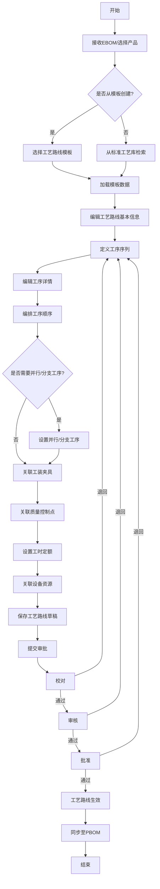

#### 1.3.2 工序编排流程

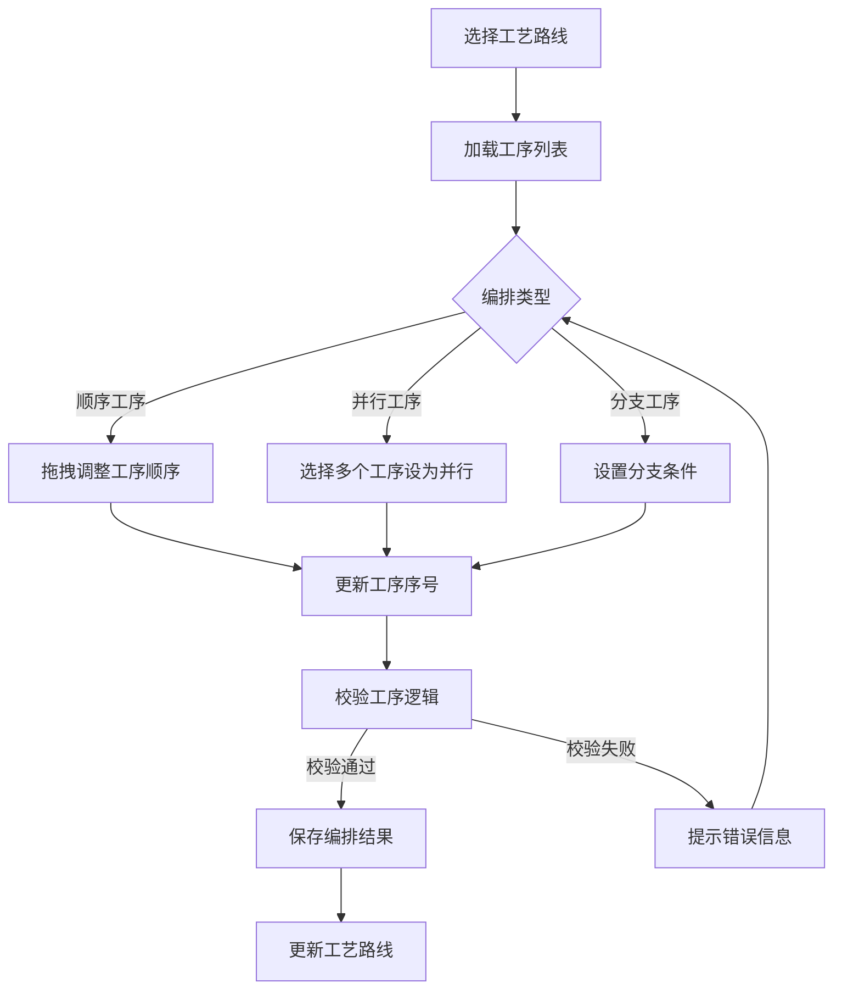

### 1.4 页面设计说明

#### 1.4.1 工艺路线列表页

- **布局**：顶部搜索栏 + 左侧分类树 + 右侧数据表格
- **搜索栏**：产品编号、产品名称、工艺路线编号、状态（下拉）、版本号、创建时间范围
- **分类树**：按产品类型（工业压缩机/压力容器）→ 产品系列 → 具体产品层级展示
- **数据表格列**：工艺路线编号、产品编号、产品名称、版本号、工序总数、状态、创建人、创建时间、操作
- **操作按钮**：查看、编辑（草稿状态）、复制、删除（草稿状态）、提交审批、版本对比
- **批量操作**：批量提交审批、批量导出

#### 1.4.2 工艺路线编辑页

- **布局**：顶部基本信息区 + 中部工序编排区 + 底部关联信息区
- **基本信息区**：产品编号（自动填充）、产品名称、工艺路线编号（自动生成）、版本号、工艺类型（下拉：机加工/焊接/装配/热处理/表面处理/无损检测/压力试验）、备注
- **工序编排区**：左侧工序树形列表 + 右侧工序详情编辑面板
  - 工序树支持拖拽排序
  - 并行工序以缩进+并行标识展示
  - 分支工序以条件标签展示
  - 点击工序节点展开工步列表
- **关联信息区**：Tab页签切换（工装夹具 / 质量控制点 / 设备资源 / 工时定额 / 材料定额）
- **工具栏**：保存草稿、提交审批、预览、导出、从标准库导入、保存为模板

#### 1.4.3 工艺路线查看页

- **布局**：工艺路线全貌可视化展示
- **展示方式**：甘特图模式（横轴为时间/工序，纵轴为工序序列）和流程图模式（Mermaid渲染）可切换
- **工序详情**：点击工序节点弹出详情面板，展示工序全部信息及关联资源
- **版本对比**：左右双栏对比两个版本的工序差异，差异部分高亮显示

### 1.5 关键逻辑说明

#### 1.5.1 工序号自动生成规则

工序号采用分层编码规则，格式为 `XX-XXX`：
- 前两位（XX）：工序大类编码（10-铸造、20-锻造、30-机加工、40-焊接、50-热处理、60-表面处理、70-装配、80-检验、90-包装）
- 后三位（XXX）：工序序号（001-999），同大类内递增

示例：`30-001` 表示机加工类第1道工序，`40-002` 表示焊接类第2道工序。

#### 1.5.2 并行工序逻辑

并行工序共享相同的"并行组号"（parallel_group_id），同一并行组内的工序可同时执行。并行工序的约束规则：
- 并行工序必须在所有前置工序完成后才能开始
- 后续工序必须等待并行组内所有工序完成
- 并行工序之间不能存在资源冲突（设备、工装互斥检查）

#### 1.5.3 版本管理逻辑

- 工艺路线状态为"草稿"或"已退回"时可编辑，编辑后自动递增修订版本号（如V1.0 → V1.1）
- 工艺路线审批通过后状态变为"已发布"，已发布版本不可直接编辑
- 对已发布版本的修改需创建新版本（如V1.0 → V2.0），旧版本保留为历史版本
- 版本号规则：主版本号（重大变更）.次版本号（小幅调整）

#### 1.5.4 工序编排校验规则

- 首道工序不能有前置工序
- 末道工序不能有后续工序
- 不允许出现循环依赖
- 并行工序的资源冲突校验
- 分支工序的条件完整性校验（所有分支路径必须汇合）

---

## 2. 工艺卡片管理模块

### 2.1 模块概述

工艺卡片管理模块负责管理工艺规程中各类卡片的形式化编制与管理。工艺卡片是指导车间生产的直接技术文件，包括工序卡片和工步卡片两大类。针对工业压缩机和压力容器的生产特点，系统支持加工工序卡、检验工序卡、辅助工序卡等多种卡片类型，并支持卡片模板管理和打印导出功能，确保工艺文件的标准化和规范化。

### 2.2 功能清单

| 功能编号 | 功能名称 | 功能描述 |
|---------|---------|---------|
| PC-001 | 工序卡片创建 | 基于工序信息创建工序卡片，自动填充工序基本信息，支持手动补充详细内容 |
| PC-002 | 加工工序卡 | 管理机加工工序的详细加工参数，包括加工部位、加工尺寸、公差要求、表面粗糙度等 |
| PC-003 | 检验工序卡 | 管理检验工序的检测项目、检测方法、检测工具、合格标准、抽检比例等 |
| PC-004 | 辅助工序卡 | 管理辅助工序（去毛刺、清洗、涂油、包装等）的操作要求和注意事项 |
| PC-005 | 工步卡片管理 | 管理工步级别的详细内容，包括工步内容、工艺参数、刀具/夹具/量具选择 |
| PC-006 | 卡片模板管理 | 创建和维护工艺卡片模板，支持模板分类、模板检索和模板应用 |
| PC-007 | 工艺卡片打印 | 支持按标准格式打印工艺卡片，支持批量打印、打印预览 |
| PC-008 | 工艺卡片导出 | 支持导出为PDF、Excel格式，支持按工序/产品批量导出 |
| PC-009 | 卡片关联管理 | 工序卡片与工序、工步卡片的层级关联，支持卡片间的引用关系 |
| PC-010 | 卡片审批 | 工艺卡片独立审批或随工艺路线统一审批 |

### 2.3 业务流程

#### 2.3.1 工艺卡片编制流程

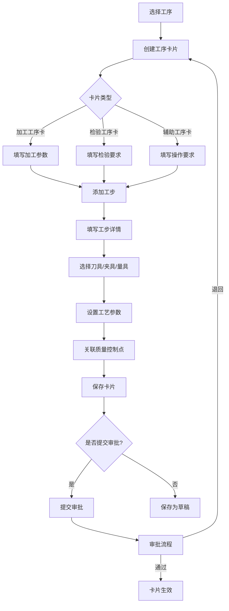

#### 2.3.2 工艺卡片打印导出流程

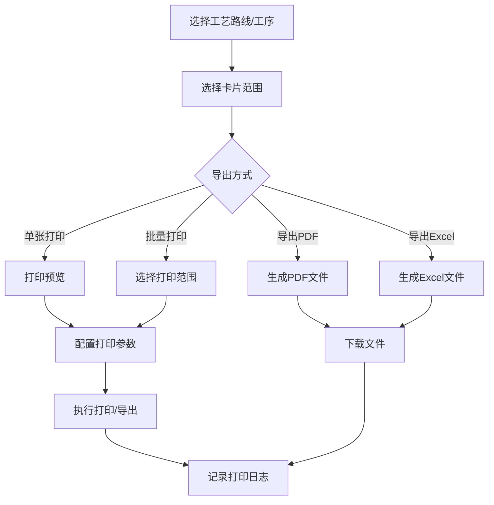

### 2.4 页面设计说明

#### 2.4.1 工艺卡片列表页

- **布局**：顶部筛选栏 + 数据表格
- **筛选条件**：产品编号、工序号、卡片类型（下拉）、状态、创建时间
- **表格列**：卡片编号、关联工序号、卡片类型、产品名称、工序名称、状态、编制人、编制日期、操作
- **操作**：查看、编辑、复制、删除、打印、导出、提交审批

#### 2.4.2 工序卡片编辑页

- **布局**：模拟纸质工艺卡片表单布局，分为表头区和明细区
- **表头区**：产品型号、产品名称、零件编号、零件名称、材料牌号、材料规格、工序号、工序名称、加工部门、设备名称
- **明细区（加工工序卡）**：
  - 工步序号、工步内容、加工部位、加工尺寸及公差、表面粗糙度、切削参数（转速/进给/切削深度）、刀具编号及名称、夹具编号及名称、量具编号及名称、工时
- **明细区（检验工序卡）**：
  - 检验序号、检验项目、检验方法、检验工具、检验标准/公差、抽检比例、合格判定
- **明细区（辅助工序卡）**：
  - 操作序号、操作内容、操作要求、注意事项、所需辅料
- **底部**：编制人、校对人、审核人、批准人签名栏及日期

#### 2.4.3 工步卡片编辑页

- **布局**：表格式编辑界面，每行一个工步
- **字段**：工步序号、工步名称、工步内容、工艺参数（转速/进给量/切削速度/切削深度等）、刀具信息、夹具信息、量具信息、备注
- **交互**：支持从标准工艺库快速选择工步内容，支持行内编辑和批量填写

### 2.5 关键逻辑说明

#### 2.5.1 卡片编号生成规则

卡片编号格式为 `PC-YYYYMMDD-XXXX`：
- PC：固定前缀（Process Card）
- YYYYMMDD：创建日期
- XXXX：当日流水号（0001-9999）

#### 2.5.2 工艺参数联动逻辑

- 选择加工工序类型后，系统自动加载对应的工艺参数模板（如车削参数、铣削参数、钻孔参数等）
- 选择材料牌号后，系统根据材料-参数对照表推荐切削参数
- 修改加工尺寸后，系统自动计算推荐的切削深度和进给量

#### 2.5.3 卡片模板应用逻辑

- 应用模板时，模板中的固定内容（如表头格式、字段布局）直接复制
- 模板中的变量内容（如具体尺寸、参数）以占位符形式保留，需手动填写或从工序数据自动填充
- 模板应用后与原始模板解除关联，后续修改不影响模板

#### 2.5.4 打印格式控制

- 打印格式遵循企业工艺文件标准（参照GB/T 24734工艺文件管理标准）
- 支持A4横向/纵向打印
- 支持自定义打印模板（通过HTML模板引擎实现）
- 打印时自动添加页眉（公司名称、文件编号）和页脚（页码、版本号）

---

## 3. BOM管理模块

### 3.1 模块概述

BOM（Bill of Materials）管理模块负责管理从工程设计到制造过程的产品结构数据，实现EBOM→PBOM→MBOM的转换与贯通。该模块通过接收CAXA PLM系统推送的EBOM数据，按工艺路线重构形成PBOM，再按生产单元拆分形成MBOM，打通设计-工艺-制造的数据链路。针对工业压缩机的复杂装配结构和压力容器的焊接结构，提供BOM对比分析和版本管理功能。

### 3.2 功能清单

| 功能编号 | 功能名称 | 功能描述 |
|---------|---------|---------|
| BM-001 | EBOM接收 | 从CAXA PLM系统同步接收EBOM数据，支持手动导入和自动定时同步 |
| BM-002 | EBOM查看 | 树形结构展示EBOM层级关系，支持节点展开/折叠、搜索定位 |
| BM-003 | PBOM转换 | 在EBOM基础上按工艺路线重构BOM结构，支持工序分配、虚拟件拆分、合件处理 |
| BM-004 | PBOM编辑 | 编辑PBOM节点信息，调整BOM结构，添加/删除/替换物料 |
| BM-005 | MBOM生成 | 在PBOM基础上按生产单元（车间/产线）拆分，生成制造级BOM |
| BM-006 | BOM对比 | 任意两个BOM版本之间的结构对比和物料差异分析，差异项高亮显示 |
| BM-007 | BOM版本管理 | BOM多版本管理，支持版本发布、版本回退、版本追溯 |
| BM-008 | BOM查询 | 按产品、物料编号、BOM类型、版本等条件查询BOM数据 |
| BM-009 | BOM导出 | 支持导出为Excel、PDF格式，支持多级BOM展开导出 |
| BM-010 | BOM同步状态监控 | 监控EBOM同步状态，异常情况告警，同步日志查询 |

### 3.3 业务流程

#### 3.3.1 EBOM接收与同步流程

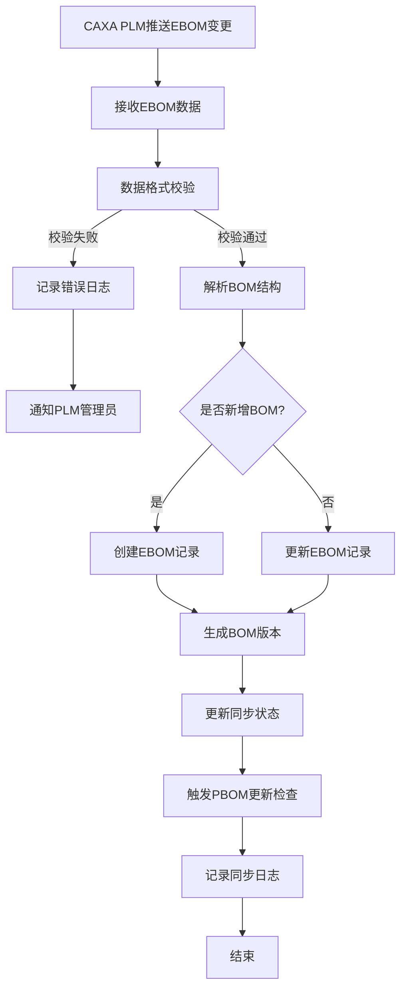

#### 3.3.2 PBOM转换流程

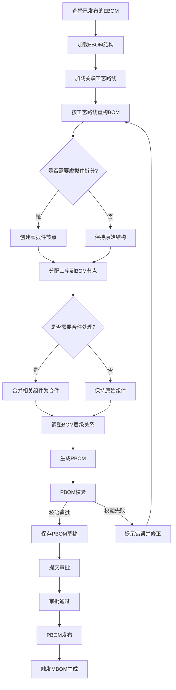

#### 3.3.3 MBOM生成流程

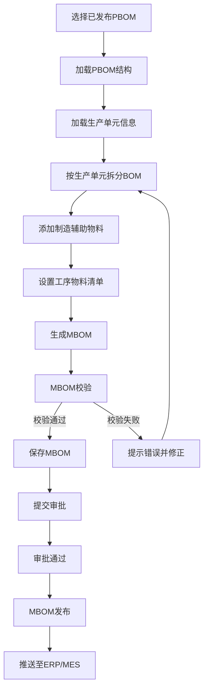

### 3.4 页面设计说明

#### 3.4.1 BOM管理主页

- **布局**：左侧产品树 + 右侧BOM展示区
- **产品树**：按产品类型→产品系列→产品型号层级展示，节点显示BOM类型标签（EBOM/PBOM/MBOM）和版本号
- **BOM展示区**：
  - 顶部：BOM类型切换Tab（EBOM / PBOM / MBOM）、版本选择器、操作按钮组
  - 主体：树形表格展示BOM结构，列包括层级、物料编号、物料名称、规格型号、单位、数量、版本、状态
  - 右键菜单：添加子件、删除节点、替换物料、查看详情、查看变更历史

#### 3.4.2 BOM对比页

- **布局**：左右双栏对比布局
- **左侧**：源BOM结构树
- **右侧**：目标BOM结构树
- **对比方式**：
  - 结构对比：层级结构差异（新增节点、删除节点、层级变化）
  - 物料对比：物料属性差异（数量变化、规格变化、替换物料）
- **差异展示**：新增项绿色高亮，删除项红色高亮，修改项黄色高亮
- **底部**：差异统计汇总（新增N项、删除N项、修改N项）

#### 3.4.3 PBOM转换编辑页

- **布局**：左侧EBOM源结构 + 右侧PBOM编辑区
- **转换操作面板**：
  - 虚拟件拆分：选择节点→创建虚拟件→分配子件
  - 合件处理：选择多个节点→合并为合件
  - 工序分配：选择BOM节点→关联工序
- **PBOM编辑区**：支持拖拽调整BOM层级，支持添加/删除/替换物料

### 3.5 关键逻辑说明

#### 3.5.1 EBOM数据同步机制

- **同步方式**：CAXA PLM通过REST API推送EBOM变更事件，CAPP系统接收并处理
- **同步频率**：实时推送 + 每日凌晨全量比对（补偿机制）
- **数据映射**：通过integration_mapping表维护PLM与CAPP之间的字段映射关系
- **冲突处理**：当CAPP端PBOM/MBOM已基于某EBOM版本生成时，新EBOM版本不会自动覆盖，而是生成变更提示

#### 3.5.2 PBOM转换规则

- **虚拟件拆分规则**：当EBOM中的某个组件在实际加工中需要拆分为多个零件分别加工时，在PBOM中创建虚拟件节点，将原组件下的零件重新分配
- **合件处理规则**：当多个EBOM组件在实际装配中作为一个整体处理时，在PBOM中合并为合件
- **工序分配规则**：每个PBOM节点必须关联至少一道工序，关联工序来源于该产品的工艺路线

#### 3.5.3 BOM版本管理规则

- EBOM版本由PLM系统管理，CAPP仅做同步和记录
- PBOM和MBOM版本由CAPP系统管理
- 版本号格式：`V{主版本}.{次版本}`（如V1.0、V1.1、V2.0）
- 已发布版本的PBOM/MBOM不可直接修改，需创建新版本
- BOM版本与工艺路线版本关联，工艺路线变更时触发BOM版本检查

#### 3.5.4 BOM校验规则

- 完整性校验：所有叶子节点必须有物料编码和单位
- 一致性校验：PBOM中所有物料必须在EBOM中存在或已说明来源
- 数量校验：上级节点数量不小于下级节点数量之和
- 循环校验：不允许出现循环引用

---

## 4. 工装夹具管理模块

### 4.1 模块概述

工装夹具管理模块负责管理生产过程中使用的各类工装夹具的全生命周期，包括工装台账管理、工装与工序关联、工装借用归还管理和工装寿命管理。针对工业压缩机的精密加工（如曲轴专用夹具、缸体定位夹具）和压力容器的焊接工装（如焊接变位器、组对工装），提供精细化的工装管理能力，确保工装资源的合理配置和有效利用。

### 4.2 功能清单

| 功能编号 | 功能名称 | 功能描述 |
|---------|---------|---------|
| TL-001 | 工装台账管理 | 维护工装基本信息，包括工装编号、名称、规格、类型、适用工序、存放位置等 |
| TL-002 | 工装分类管理 | 按工装类型（夹具/模具/刀具/量具/辅具）分类管理 |
| TL-003 | 工装与工序关联 | 将工装关联到具体工序，支持一个工装关联多道工序、一道工序关联多个工装 |
| TL-004 | 工装借用管理 | 记录工装借用信息（借用人、借用时间、用途、预计归还时间），支持扫码借用 |
| TL-005 | 工装归还管理 | 记录工装归还信息，归还时进行工装状态检查，记录使用情况 |
| TL-006 | 工装寿命管理 | 设置工装使用寿命（使用次数/使用时长），到期预警，超期禁用 |
| TL-007 | 工装维修管理 | 记录工装维修信息，包括故障描述、维修内容、维修费用、维修结果 |
| TL-008 | 工装报废管理 | 工装达到报废标准后进行报废处理，记录报废原因和审批流程 |
| TL-009 | 工装统计分析 | 工装利用率统计、工装故障率分析、工装成本分析 |
| TL-010 | 工装盘点 | 定期盘点工装库存，核对实物与台账一致性 |

### 4.3 业务流程

#### 4.3.1 工装借用归还流程

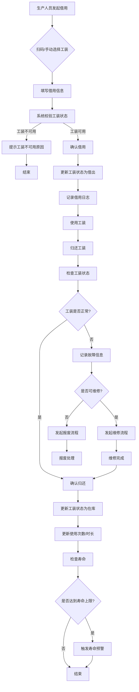

### 4.4 页面设计说明

#### 4.4.1 工装台账列表页

- **布局**：顶部筛选栏 + 左侧分类树 + 右侧数据表格
- **分类树**：按工装类型（夹具/模具/刀具/量具/辅具）→ 按适用工序分类
- **表格列**：工装编号、工装名称、规格型号、工装类型、适用工序、当前状态（在库/借出/维修/报废）、存放位置、剩余寿命、操作
- **操作**：查看详情、编辑、借用、归还、维修、报废

#### 4.4.2 工装详情页

- **布局**：Tab页签切换
- **基本信息Tab**：工装编号、名称、规格型号、类型、材质、精度等级、适用产品、适用工序、存放位置、采购日期、采购价格、供应商、图片
- **借用记录Tab**：借用历史列表（借用人、借用时间、归还时间、用途）
- **维修记录Tab**：维修历史列表（维修日期、故障描述、维修内容、维修费用）
- **寿命信息Tab**：设计寿命（次数/时长）、已使用（次数/时长）、剩余寿命百分比、寿命曲线图

### 4.5 关键逻辑说明

#### 4.5.1 工装编号规则

工装编号格式为 `TL-{类型码}-{序号}`：
- 类型码：FIX（夹具）、MOL（模具）、CUT（刀具）、MEG（量具）、AUX（辅具）
- 序号：四位数字，同类型内递增

示例：`TL-FIX-0001` 表示第1号夹具。

#### 4.5.2 工装寿命计算逻辑

- **按次数计寿命**：每次借出并归还计为一次使用，剩余寿命 = (设计寿命 - 已使用次数) / 设计寿命 * 100%
- **按时长计寿命**：累计借用时长，剩余寿命 = (设计时长 - 累计使用时长) / 设计时长 * 100%
- **预警阈值**：剩余寿命低于20%时触发黄色预警，低于10%时触发红色预警，达到0%时自动标记为待报废
- **寿命延长**：经过大修的工装可由管理员审批延长使用寿命

---

## 5. 材料定额管理模块

### 5.1 模块概述

材料定额管理模块负责管理产品制造过程中的材料消耗定额，包括毛坯尺寸计算、材料利用率计算和材料需求汇总。针对工业压缩机（如曲轴用锻件毛坯、缸体用铸件毛坯、膜片用特种金属板材）和压力容器（如筒体用钢板、封头用板材、法兰用锻件）的材料特点，提供精准的材料定额计算和标准库管理功能，为采购和成本核算提供数据支撑。

### 5.2 功能清单

| 功能编号 | 功能名称 | 功能描述 |
|---------|---------|---------|
| MT-001 | 材料定额创建 | 基于零件信息和工艺路线创建材料定额，选择材料牌号、规格，输入毛坯尺寸 |
| MT-002 | 毛坯尺寸计算 | 根据零件净尺寸和加工余量自动计算毛坯尺寸，支持手动调整 |
| MT-003 | 材料利用率计算 | 根据毛坯重量和零件净重计算材料利用率，与标准值对比分析 |
| MT-004 | 定额标准库 | 维护按产品类型和材料分类的定额标准，包括标准毛坯尺寸、标准余量、标准利用率 |
| MT-005 | 材料需求汇总 | 按产品/批次汇总材料需求，生成材料需求清单，支持导出 |
| MT-006 | 材料定额审批 | 材料定额编制完成后提交审批，审批通过后生效 |
| MT-007 | 材料定额查询 | 按产品、零件、材料牌号等条件查询材料定额 |
| MT-008 | 材料定额对比 | 不同版本/不同产品的材料定额对比分析 |

### 5.3 业务流程

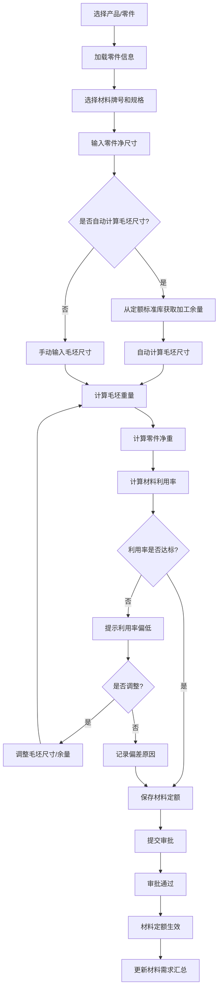

### 5.4 页面设计说明

#### 5.4.1 材料定额列表页

- **布局**：顶部筛选栏 + 数据表格
- **筛选条件**：产品编号、零件编号、材料牌号、材料分类（下拉）、状态
- **表格列**：定额编号、产品编号、零件编号、零件名称、材料牌号、材料规格、毛坯尺寸、毛坯重量、净重、利用率、状态、操作
- **操作**：查看、编辑、删除、提交审批、查看对比

#### 5.4.2 材料定额编辑页

- **布局**：左右分栏
- **左侧**：零件信息展示（零件图预览、零件编号、名称、材料、净尺寸、净重）
- **右侧**：定额编辑表单
  - 材料信息：材料牌号（下拉选择，联动规格）、材料规格、材料密度
  - 毛坯参数：毛坯长度、毛坯宽度/外径、毛坯高度/内径、加工余量（各方向分别设置）
  - 计算结果：毛坯重量（自动计算）、零件净重（自动计算）、材料利用率（自动计算，进度条展示）
  - 备注：特殊工艺说明、偏差原因

#### 5.4.3 材料需求汇总页

- **布局**：顶部筛选区 + 汇总表格 + 图表区
- **筛选区**：产品范围、批次号、材料分类
- **汇总表格**：按材料牌号+规格汇总，列包括材料牌号、材料规格、单位、单台用量、需求总量、库存量、缺口量
- **图表区**：材料用量饼图（按材料分类）、材料需求柱状图（按产品）

### 5.5 关键逻辑说明

#### 5.5.1 毛坯尺寸计算公式

- **圆棒料**：毛坯直径 = 零件最大外径 + 2 * 外圆加工余量；毛坯长度 = 零件总长 + 2 * 端面加工余量
- **板料**：毛坯长度 = 零件展开长度 + 2 * 边缘余量；毛坯宽度 = 零件展开宽度 + 2 * 边缘余量
- **锻件**：根据锻件图确定毛坯尺寸，考虑锻造比和拔模斜度
- **铸件**：根据铸件图确定毛坯尺寸，考虑铸造收缩率和加工余量

#### 5.5.2 材料利用率计算

材料利用率 = 零件净重 / 毛坯重量 * 100%

- 利用率 >= 标准值：绿色显示，正常通过
- 标准值 > 利用率 >= 最低允许值：黄色显示，需说明原因
- 利用率 < 最低允许值：红色显示，必须调整或审批特批

#### 5.5.3 定额标准库结构

按两级分类组织：
- 一级分类：产品类型（工业压缩机 / 压力容器）
- 二级分类：材料类型（碳钢 / 合金钢 / 不锈钢 / 有色金属 / 非金属）
- 标准内容：零件类型、毛坯形式、加工余量标准、材料利用率标准

---

## 6. 工时定额管理模块

### 6.1 模块概述

工时定额管理模块负责管理各工序的工时定额制定、标准库维护和统计分析。工时定额是生产计划排程、成本核算和绩效考核的重要依据。针对工业压缩机的多品种小批量生产特点和压力容器的单件小批量生产特点，系统提供科学的工时定额制定方法和丰富的标准库数据，支持工时数据的持续优化和统计分析。

### 6.2 功能清单

| 功能编号 | 功能名称 | 功能描述 |
|---------|---------|---------|
| TM-001 | 工时定额制定 | 按工序制定工时定额，包括准备时间、加工时间、辅助时间 |
| TM-002 | 工时定额标准库 | 维护按工序类型/设备类型分类的工时定额标准数据 |
| TM-003 | 工时定额计算 | 基于定额标准和实际参数自动计算工时定额，支持手动调整 |
| TM-004 | 工时定额审批 | 工时定额编制完成后提交审批，审批通过后生效 |
| TM-005 | 工时统计分析 | 按产品/工序/人员/设备/时间维度统计分析工时数据 |
| TM-006 | 工时对比分析 | 实际工时与定额工时对比分析，偏差率统计 |
| TM-007 | 工时报表 | 生成各类工时报表，支持导出 |

### 6.3 业务流程

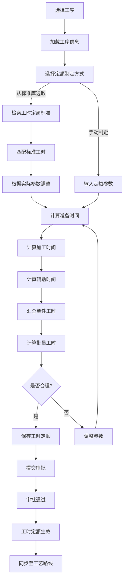

### 6.4 页面设计说明

#### 6.4.1 工时定额列表页

- **布局**：顶部筛选栏 + 数据表格
- **筛选条件**：产品编号、工序号、工序类型、设备类型、状态
- **表格列**：定额编号、产品编号、工序号、工序名称、准备时间、加工时间、辅助时间、单件工时、批量系数、批量工时、状态、操作

#### 6.4.2 工时定额编辑页

- **布局**：表单式编辑
- **基本信息**：产品编号、工序号、工序名称、加工设备、加工批量
- **定额明细**：
  - 准备时间：熟悉图纸、领取物料、装夹调整、首件检验
  - 加工时间：基本加工时间（基于切削参数计算）、工步间转换时间
  - 辅助时间：测量时间、清理时间、换刀时间
- **汇总信息**：单件工时（自动汇总）、批量系数（根据批量自动计算）、批量工时（自动计算）
- **定额依据**：引用的定额标准编号、定额标准名称、调整系数、调整说明

#### 6.4.3 工时统计分析页

- **布局**：顶部时间筛选 + 多个图表区域
- **图表1**：实际工时vs定额工时对比柱状图（按工序）
- **图表2**：工时偏差率趋势图（按月）
- **图表3**：各产品工时构成饼图（准备/加工/辅助占比）
- **图表4**：设备利用率排行

### 6.5 关键逻辑说明

#### 6.5.1 工时定额计算模型

单件工时 = 准备时间 / 批量 + 加工时间 + 辅助时间

- **准备时间**：与批量无关的固定时间（熟悉图纸、装夹调整等），按批量分摊
- **加工时间**：基于切削参数计算，T = L / (n * f)，其中L为加工长度，n为转速，f为进给量
- **辅助时间**：测量、清理、换刀等辅助操作时间
- **批量系数**：批量越大，单件分摊的准备时间越少，批量系数 = 1 - (批量 - 1) * 衰减率

#### 6.5.2 工时定额标准库分类

按两级分类组织：
- 一级分类：工序类型（车削/铣削/钻削/镗削/磨削/焊接/热处理/装配/检验等）
- 二级分类：加工特征（外圆/内孔/平面/螺纹/齿轮/槽等）
- 标准内容：加工尺寸范围、材料系数、设备系数、标准工时值

---

## 7. 设备资源管理模块

### 7.1 模块概述

设备资源管理模块负责管理企业生产设备的基础信息和能力数据，支持设备与工序的匹配、设备能力评估和设备负荷分析。针对工业压缩机生产所需的各种精密加工设备（如数控车床、加工中心、外圆磨床等）和压力容器生产所需的专用设备（如卷板机、自动焊机、热处理炉、X射线探伤机等），提供全面的设备资源管理能力，为工艺规划和生产排程提供设备数据支撑。

### 7.2 功能清单

| 功能编号 | 功能名称 | 功能描述 |
|---------|---------|---------|
| EQ-001 | 设备台账管理 | 维护设备基本信息，包括设备编号、名称、规格、型号、加工能力、精度等级等 |
| EQ-002 | 设备分类管理 | 按设备类型（机加设备/焊接设备/热处理设备/检测设备/起重设备等）分类管理 |
| EQ-003 | 设备与工序匹配 | 将设备关联到可执行的工序类型，建立设备-工序能力矩阵 |
| EQ-004 | 设备能力评估 | 评估设备是否满足工序的加工要求（尺寸范围、精度、功率等） |
| EQ-005 | 设备负荷分析 | 统计设备的计划工时和实际工时，分析设备利用率和负荷率 |
| EQ-006 | 设备状态管理 | 管理设备运行状态（运行/停机/维修/保养/报废），支持状态变更记录 |
| EQ-007 | 设备维护计划 | 制定设备维护保养计划，到期提醒 |
| EQ-008 | 设备能力矩阵 | 展示所有设备与工序类型的匹配关系，支持快速查找可用设备 |

### 7.3 业务流程

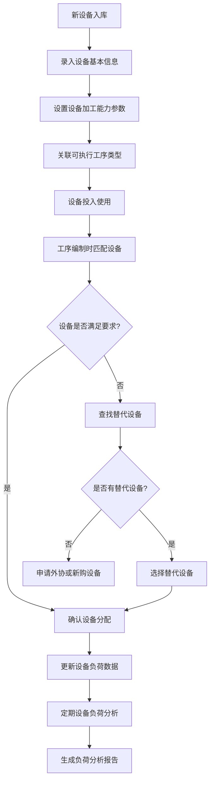

### 7.4 页面设计说明

#### 7.4.1 设备台账列表页

- **布局**：顶部筛选栏 + 左侧分类树 + 右侧数据表格
- **分类树**：按设备类型→按车间→按设备组
- **表格列**：设备编号、设备名称、规格型号、设备类型、精度等级、所在车间、当前状态、利用率、操作
- **操作**：查看详情、编辑、停用、启用、维护记录

#### 7.4.2 设备详情页

- **布局**：Tab页签切换
- **基本信息Tab**：设备编号、名称、规格型号、制造商、出厂日期、投产日期、精度等级、加工范围（长/宽/高/最大回转直径等）、功率、所在车间
- **能力参数Tab**：可加工工序类型列表、加工尺寸范围、加工精度范围、最大载荷、主轴参数等
- **工序匹配Tab**：已关联的工序类型列表，支持添加/删除关联
- **负荷分析Tab**：设备利用率趋势图、近期负荷列表、负荷率仪表盘
- **维护记录Tab**：维护保养历史列表

#### 7.4.3 设备能力矩阵页

- **布局**：矩阵热力图
- **行**：设备列表（按设备类型分组）
- **列**：工序类型列表
- **单元格**：颜色深浅表示匹配程度（深色=完全匹配，浅色=部分匹配，空白=不匹配）
- **交互**：点击单元格查看设备与工序的匹配详情

### 7.5 关键逻辑说明

#### 7.5.1 设备编号规则

设备编号格式为 `EQ-{车间码}-{类型码}-{序号}`：
- 车间码：CJ（机加车间）、HJ（焊接车间）、GR（热处理车间）、ZJ（装配车间）、JY（检验车间）
- 类型码：LATHE（车床）、MILL（铣床）、DRILL（钻床）、GRIND（磨床）、WELD（焊机）、BEND（卷板机）等
- 序号：两位数字

示例：`EQ-CJ-LATHE-01` 表示机加车间第1号车床。

#### 7.5.2 设备能力匹配算法

工序编制时，系统根据以下条件自动匹配可用设备：
1. 设备状态为"运行"
2. 设备类型与工序类型匹配
3. 加工尺寸在设备加工范围内
4. 加工精度满足工序精度要求
5. 设备当前负荷未超过阈值（默认80%）

匹配结果按匹配度评分排序，匹配度评分 = 尺寸匹配分 * 0.3 + 精度匹配分 * 0.3 + 负荷分 * 0.2 + 历史质量分 * 0.2。

#### 7.5.3 设备负荷计算

设备负荷率 = 设备计划工时 / 设备可用工时 * 100%

- 可用工时 = 设备日工作时长 * 工作日数 * 利用率系数
- 计划工时 = 分配到该设备的所有工序工时之和
- 负载状态：负荷率 < 60% 为空闲，60%-80% 为正常，80%-100% 为繁忙，>100% 为超负荷

---

## 8. 质量控制点管理模块

### 8.1 模块概述

质量控制点管理模块负责管理工艺过程中的关键质量控制点，包括关键工序识别、质检标准设定、质检记录管理和不合格品处理。针对工业压缩机的精密加工质量要求（如曲轴的尺寸精度、膜片的焊接质量）和压力容器的特种检验要求（如焊接接头无损检测、压力试验），提供全面的质量控制点管理能力，确保产品质量符合标准和规范要求。

### 8.2 功能清单

| 功能编号 | 功能名称 | 功能描述 |
|---------|---------|---------|
| QC-001 | 关键工序识别 | 标记关键工序和特殊工序，设置关键工序控制要求 |
| QC-002 | 质检标准设定 | 定义检测项目、检测方法、检测工具、合格标准、抽检规则 |
| QC-003 | 质检记录管理 | 记录实际检测数据，支持数值型、判定型、文本型检测结果 |
| QC-004 | 不合格品处理 | 不合格品登记、原因分析、处理方案（返工/返修/让步接收/报废）、处理结果跟踪 |
| QC-005 | 质量统计分析 | 合格率统计、不良原因分析（帕累托图）、质量趋势分析 |
| QC-006 | 质检任务管理 | 生成质检任务，分配质检人员，跟踪任务完成状态 |
| QC-007 | 质量追溯 | 按产品批次追溯质检记录，支持质量问题的正反向追溯 |

### 8.3 业务流程

#### 8.3.1 质量控制点设置流程

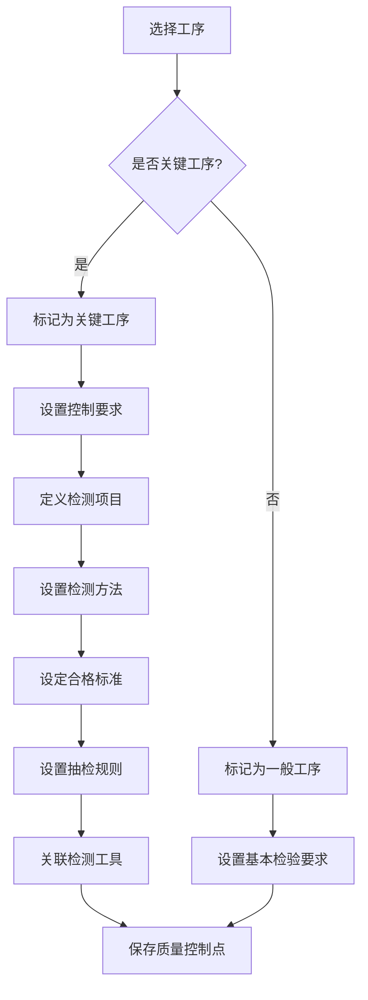

#### 8.3.2 不合格品处理流程

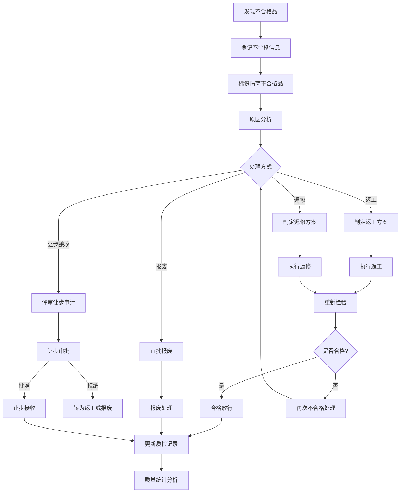

### 8.4 页面设计说明

#### 8.4.1 质量控制点列表页

- **布局**：顶部筛选栏 + 数据表格
- **筛选条件**：产品编号、工序号、控制点类型（关键/特殊/一般）、状态
- **表格列**：控制点编号、关联工序号、工序名称、控制点类型、检测项目数、合格率、最近检验日期、状态、操作
- **操作**：查看详情、编辑、停用/启用

#### 8.4.2 质检标准编辑页

- **布局**：表单式编辑
- **基本信息**：控制点编号、关联工序、控制点类型、控制级别
- **检测项目列表**（动态表格）：
  - 序号、检测项目名称、检测方法（如游标卡尺测量/超声波探伤/X射线检测/压力试验等）、检测工具、检测标准/公差、计量单位、抽检比例（全检/抽检比例）、合格判定规则
- **特殊要求**：对于压力容器的特殊要求（如符合GB 150标准、ASME规范等）

#### 8.4.3 质检记录页

- **布局**：顶部任务信息 + 检测数据录入区 + 判定结果区
- **任务信息**：产品编号、工序号、检测项目、检验人员、检验日期
- **检测数据录入**：根据检测项目动态生成录入表单，数值型显示上下限，判定型显示选项
- **判定结果**：合格/不合格自动判定（基于检测数据与标准对比）、综合判定、备注

### 8.5 关键逻辑说明

#### 8.5.1 关键工序识别规则

以下工序自动标记为关键工序：
- 涉及压力容器承压部件的焊接工序
- 涉及压力容器承压部件的无损检测工序
- 压力试验工序（水压试验、气压试验）
- 工业压缩机曲轴的关键尺寸加工工序
- 工业压缩机膜片的焊接工序
- 热处理工序（影响材料力学性能）
- 精度要求高于IT7级的加工工序

#### 8.5.2 抽检规则

- 关键工序：100%全检
- 重要工序：按GB/T 2828.1抽样标准，一般检验水平II，AQL值按产品要求设定
- 一般工序：首件必检 + 过程抽检（每批次抽检10%，不少于3件）

#### 8.5.3 不合格品处理权限

- 返工：质检员可直接判定
- 返修：需工艺工程师审批
- 让步接收：需质量主管审批，重大让步需总工程师审批
- 报废：需质量主管审批，高价值件报废需总经理审批

---

## 9. 工艺变更管理模块

### 9.1 模块概述

工艺变更管理模块负责管理工艺文件的变更全过程，包括变更申请、审批、执行和追溯。通过ECN（Engineering Change Notice，工程变更通知）机制，规范工艺变更流程，分析变更影响范围，确保变更的可追溯性。该模块与企业微信集成，实现变更通知的实时推送，确保相关人员及时获知变更信息。

### 9.2 功能清单

| 功能编号 | 功能名称 | 功能描述 |
|---------|---------|---------|
| EC-001 | 变更申请 | 创建ECN变更申请，填写变更原因、变更内容、变更范围 |
| EC-002 | 变更影响分析 | 自动分析变更影响范围（受影响的产品、工艺路线、BOM、工装等） |
| EC-003 | 变更审批 | 多级审批流程（申请→评审→批准→执行），支持会签 |
| EC-004 | 变更执行 | 按变更方案执行变更，更新受影响的工艺文件和数据 |
| EC-005 | 变更验证 | 变更执行后进行验证，确认变更效果 |
| EC-006 | 变更版本追溯 | 完整记录变更历史，支持变更链路追溯 |
| EC-007 | 变更通知 | 通过企业微信推送变更通知给相关人员 |
| EC-008 | 变更统计 | 变更类型统计、变更频率分析、变更响应时间分析 |

### 9.3 业务流程

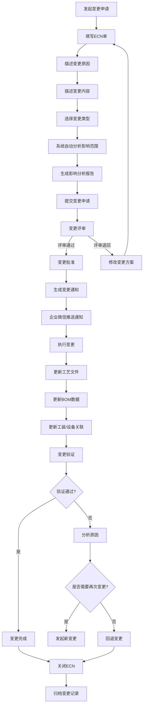

### 9.4 页面设计说明

#### 9.4.1 ECN列表页

- **布局**：顶部筛选栏 + 数据表格
- **筛选条件**：ECN编号、变更类型、影响产品、状态、发起人、时间范围
- **表格列**：ECN编号、变更标题、变更类型、紧急程度、影响范围、发起人、发起日期、当前状态、操作
- **操作**：查看详情、编辑（草稿状态）、提交审批、撤销

#### 9.4.2 ECN编辑页

- **布局**：分步骤表单（Step 1 → Step 2 → Step 3 → Step 4）
- **Step 1 - 变更基本信息**：ECN编号（自动生成）、变更标题、变更类型（设计变更/工艺优化/质量问题纠正/材料替代/客户要求）、紧急程度（普通/紧急/特急）、变更原因描述
- **Step 2 - 变更内容**：变更前描述、变更后描述、变更明细列表（受影响的工艺路线、工序、BOM、工装等）
- **Step 3 - 影响分析**：系统自动生成的影响分析报告（受影响产品清单、受影响工艺路线清单、受影响BOM清单、受影响工装清单）、人工补充影响项
- **Step 4 - 变更方案**：变更执行步骤、变更时间计划、所需资源、验证方法

#### 9.4.3 变更追溯页

- **布局**：时间轴展示变更链路
- **展示内容**：变更节点列表，每个节点显示变更时间、变更内容、变更人、变更前后对比
- **关联信息**：点击节点可查看受影响的工艺文件和BOM的变更详情

### 9.5 关键逻辑说明

#### 9.5.1 ECN编号规则

ECN编号格式为 `ECN-YYYYMM-XXXX`：
- YYYYMM：年月
- XXXX：当月流水号

示例：`ECN-202606-0001` 表示2026年6月第1个变更申请。

#### 9.5.2 变更影响分析算法

系统自动分析变更影响的范围：
1. **工艺路线影响**：如果变更涉及某道工序，则包含该工序的所有工艺路线均受影响
2. **BOM影响**：如果变更涉及物料替换或结构变化，则关联的PBOM和MBOM均受影响
3. **工装影响**：如果变更涉及工序加工方式变化，则关联的工装可能需要调整
4. **在制品影响**：如果变更涉及已投产产品，则分析在制品是否需要返工
5. **文档影响**：受影响的工艺规程、作业指导书等文档需要同步更新

#### 9.5.3 企业微信通知规则

- 变更申请提交时：通知评审人员
- 变更批准时：通知执行人员、生产计划人员、采购人员
- 变更完成时：通知所有相关人员
- 紧急变更：通知范围扩大至部门主管
- 通知内容：ECN编号、变更标题、变更类型、影响范围、要求完成时间

---

## 10. 工艺审批流程模块

### 10.1 模块概述

工艺审批流程模块负责管理CAPP系统中各类业务对象的审批流程，包括工艺路线、工艺卡片、材料定额、工时定额、工程变更等的审批。系统提供可视化流程设计器，支持灵活配置审批节点和审批规则，实现审批流程的数字化和规范化。通过与企业微信集成，支持移动端审批，提升审批效率。

### 10.2 功能清单

| 功能编号 | 功能名称 | 功能描述 |
|---------|---------|---------|
| WF-001 | 流程定义管理 | 创建和维护审批流程定义，支持可视化流程设计器 |
| WF-002 | 审批节点设置 | 配置审批节点（工艺编制→校对→审核→批准），设置节点审批人和审批规则 |
| WF-003 | 流程条件配置 | 设置流程分支条件（如按变更类型走不同审批路径） |
| WF-004 | 审批发起 | 提交业务对象进入审批流程，自动匹配流程定义 |
| WF-005 | 审批任务处理 | 审批人查看审批详情，执行审批操作（通过/退回/转审/加签） |
| WF-006 | 审批提醒 | 通过企业微信推送审批待办提醒，支持催办 |
| WF-007 | 审批记录查询 | 查询审批流程的处理记录，支持按流程、人员、时间范围查询 |
| WF-008 | 审批统计 | 审批效率统计（平均审批时长、审批通过率、退回率） |

### 10.3 业务流程

#### 10.3.1 审批流程配置流程

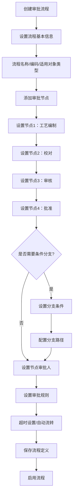

#### 10.3.2 审批任务处理流程

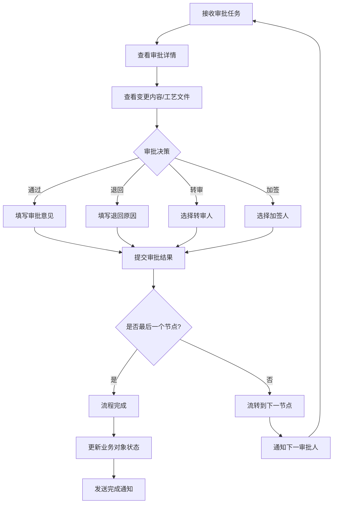

### 10.4 页面设计说明

#### 10.4.1 流程设计器页

- **布局**：左侧节点面板 + 中部画布区 + 右侧属性面板
- **节点面板**：提供可拖拽的节点类型（开始节点、审批节点、条件节点、并行节点、结束节点）
- **画布区**：拖拽节点到画布，连线建立节点间关系，支持节点位置调整
- **属性面板**：选中节点后显示属性编辑面板
  - 审批节点属性：节点名称、审批人（指定人员/角色/部门主管）、审批方式（单人审批/会签/或签）、超时时间、超时处理（自动通过/自动退回/通知管理员）
  - 条件节点属性：条件表达式（变更类型=紧急时走加急审批路径）

#### 10.4.2 审批待办列表页

- **布局**：Tab切换（待我审批 / 我已审批 / 我发起的）
- **待我审批Tab**：
  - 表格列：流程编号、审批对象类型、审批对象名称、发起人、发起时间、当前节点、紧急程度、操作
  - 操作：审批（弹出审批对话框）、查看详情
- **我已审批Tab**：历史审批记录，支持查看审批详情
- **我发起的Tab**：我发起的审批流程，显示当前进度

#### 10.4.3 审批处理对话框

- **布局**：弹出式对话框
- **上部**：审批对象摘要信息（编号、名称、类型、发起人、发起时间）
- **中部**：审批内容展示区（工艺路线/变更申请等的具体内容）
- **审批历史**：已完成的审批节点列表（审批人、审批时间、审批意见）
- **下部**：审批操作区
  - 审批意见：文本输入框
  - 操作按钮：通过、退回（需填写退回原因）、转审（需选择转审人）、加签（需选择加签人）

### 10.5 关键逻辑说明

#### 10.5.1 默认审批流程配置

| 审批对象 | 节点1 | 节点2 | 节点3 | 节点4 |
|---------|-------|-------|-------|-------|
| 工艺路线 | 工艺编制（编制人） | 校对（校对工程师） | 审核（工艺主管） | 批准（总工程师） |
| 工艺卡片 | 工艺编制（编制人） | 校对（校对工程师） | 审核（工艺主管） | 批准（总工程师） |
| 材料定额 | 编制（工艺工程师） | 审核（工艺主管） | 批准（生产部长） | - |
| 工时定额 | 编制（工艺工程师） | 审核（工艺主管） | 批准（生产部长） | - |
| 工程变更 | 申请（发起人） | 评审（评审组） | 批准（总工程师） | 执行（执行人） |

#### 10.5.2 审批超时处理

- 默认超时时间：普通审批24小时，紧急审批4小时，特急审批1小时
- 超时处理策略：超时后系统自动发送催办通知（企业微信），超时3倍后通知审批人的上级主管
- 审批人可设置代理审批人（出差/休假期间），代理审批人自动接管审批任务

#### 10.5.3 流程状态机

审批流程实例状态：草稿 → 审批中 → 已通过 / 已退回 / 已撤销

- 草稿：流程实例已创建但未提交
- 审批中：流程已提交，等待当前节点审批人处理
- 已通过：所有审批节点通过
- 已退回：任一审批节点退回
- 已撤销：发起人主动撤销

---

## 11. 工艺文档管理模块

### 11.1 模块概述

工艺文档管理模块负责管理CAPP系统中的各类工艺文档，包括工艺规程、作业指导书（SOP）、技术通知等。该模块提供文档的创建、编辑、版本控制、在线预览和下载功能，确保工艺文档的规范管理和版本追溯。针对工业压缩机和压力容器的生产特点，支持多种文档格式（Word、PDF、Excel、CAD图纸等），并与审批流程集成，确保文档发布的规范性。

### 11.2 功能清单

| 功能编号 | 功能名称 | 功能描述 |
|---------|---------|---------|
| DC-001 | 工艺规程管理 | 创建和维护工艺规程文档，关联产品工艺路线，支持模板生成 |
| DC-002 | 作业指导书管理 | 创建和维护SOP文档，支持图文混排、步骤说明、注意事项 |
| DC-003 | 文档分类管理 | 按文档类型（工艺规程/SOP/技术通知/检验规范等）分类管理 |
| DC-004 | 文档版本控制 | 文档多版本管理，每次修改自动生成新版本，支持版本对比和回退 |
| DC-005 | 文档在线预览 | 支持PDF、Word、Excel、图片等格式的在线预览 |
| DC-006 | 文档下载 | 支持文档下载，下载时自动添加水印（用户名+时间） |
| DC-007 | 文档审批 | 文档发布前需经过审批流程，审批通过后自动发布 |
| DC-008 | 文档检索 | 全文检索、按分类/标签/产品/时间等多维度检索 |
| DC-009 | 文档权限控制 | 基于角色的文档访问权限控制（查看/编辑/下载/打印/删除） |
| DC-010 | 文档回收站 | 已删除文档进入回收站，支持恢复和彻底删除 |

### 11.3 业务流程

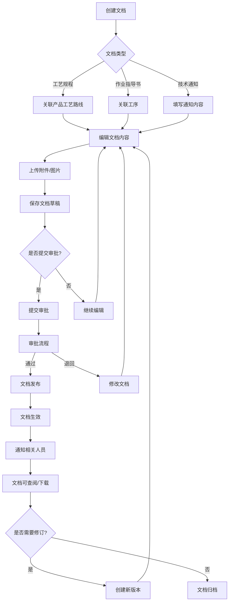

### 11.4 页面设计说明

#### 11.4.1 文档列表页

- **布局**：左侧分类树 + 右侧文档列表
- **分类树**：按文档类型（工艺规程/作业指导书/技术通知/检验规范/标准规范）→ 按产品分类
- **文档列表**：卡片式或列表式切换展示
  - 列表列：文档编号、文档标题、文档类型、关联产品、版本号、状态、编制人、更新时间、操作
  - 操作：查看、编辑、下载、删除、版本历史

#### 11.4.2 文档编辑页

- **布局**：顶部工具栏 + 中部富文本编辑器 + 右侧属性面板
- **工具栏**：保存、预览、提交审批、版本对比、上传附件
- **富文本编辑器**：支持文字格式、表格、图片插入、特殊符号、工艺参数引用
- **属性面板**：文档编号（自动生成）、文档标题、文档类型、关联产品、关联工艺路线、标签、版本号

#### 11.4.3 文档预览页

- **布局**：全屏预览模式
- **支持格式**：PDF（内置查看器）、Word（转换后预览）、Excel（转换后预览）、图片（直接展示）
- **工具栏**：缩放、翻页、下载、打印

### 11.5 关键逻辑说明

#### 11.5.1 文档编号规则

文档编号格式为 `{类型码}-YYYYMMDD-XXXX`：
- 类型码：PP（工艺规程Process Procedure）、SOP（作业指导书）、TN（技术通知Technical Notice）、IS（检验规范Inspection Specification）
- YYYYMMDD：创建日期
- XXXX：当日流水号

#### 11.5.2 文档版本控制规则

- 文档状态为"草稿"时可直接编辑，修改后自动递增修订版本（如V1.0 → V1.1）
- 文档审批通过后状态变为"已发布"，已发布版本不可直接编辑
- 对已发布版本的修改需创建新版本（如V1.0 → V2.0）
- 版本号规则与工艺路线版本规则一致

#### 11.5.3 文档权限矩阵

| 角色 | 查看 | 编辑 | 下载 | 打印 | 删除 | 审批 |
|------|------|------|------|------|------|------|
| 工艺工程师 | 是 | 是（自己编制的） | 是 | 是 | 否 | 否 |
| 工艺主管 | 是 | 是 | 是 | 是 | 是 | 是 |
| 车间主任 | 是 | 否 | 是 | 是 | 否 | 否 |
| 生产工人 | 是（已发布的） | 否 | 否 | 否 | 否 | 否 |
| 质量工程师 | 是 | 否 | 是 | 是 | 否 | 否 |

---

## 12. 标准工艺库管理模块

### 12.1 模块概述

标准工艺库管理模块负责管理和维护企业的标准工艺资源，包括典型工艺路线库、标准工序库、工艺知识库和工艺参数库。该模块是CAPP系统的知识沉淀中心，通过积累和复用优秀的工艺经验，提升工艺编制效率和质量。针对工业压缩机和压力容器的工艺特点，建立分产品类型、分零件类型的标准工艺体系，支撑新产品的快速工艺编制。

### 12.2 功能清单

| 功能编号 | 功能名称 | 功能描述 |
|---------|---------|---------|
| SK-001 | 典型工艺路线库 | 管理典型产品的标准工艺路线，支持按产品类型/零件类型分类检索 |
| SK-002 | 标准工序库 | 管理标准化工序定义，包括工序内容、加工参数、设备要求、工装要求 |
| SK-003 | 工艺知识库 | 管理工艺技术文档、经验总结、最佳实践、常见问题及解决方案 |
| SK-004 | 工艺参数库 | 管理各类加工工艺的标准参数（切削参数、焊接参数、热处理参数等） |
| SK-005 | 标准工艺检索 | 多维度检索标准工艺资源（按关键词、分类、标签、产品类型等） |
| SK-006 | 标准工艺应用 | 将标准工艺路线/工序应用到实际工艺编制中，支持修改和定制 |
| SK-007 | 标准工艺评审 | 标准工艺入库前需经过评审，确保工艺的合理性和先进性 |
| SK-008 | 标准工艺维护 | 定期评审和更新标准工艺，淘汰落后工艺，补充新工艺 |
| SK-009 | 工艺参数推荐 | 基于AI分析，推荐最优工艺参数组合 |

### 12.3 业务流程

#### 12.3.1 标准工艺入库流程

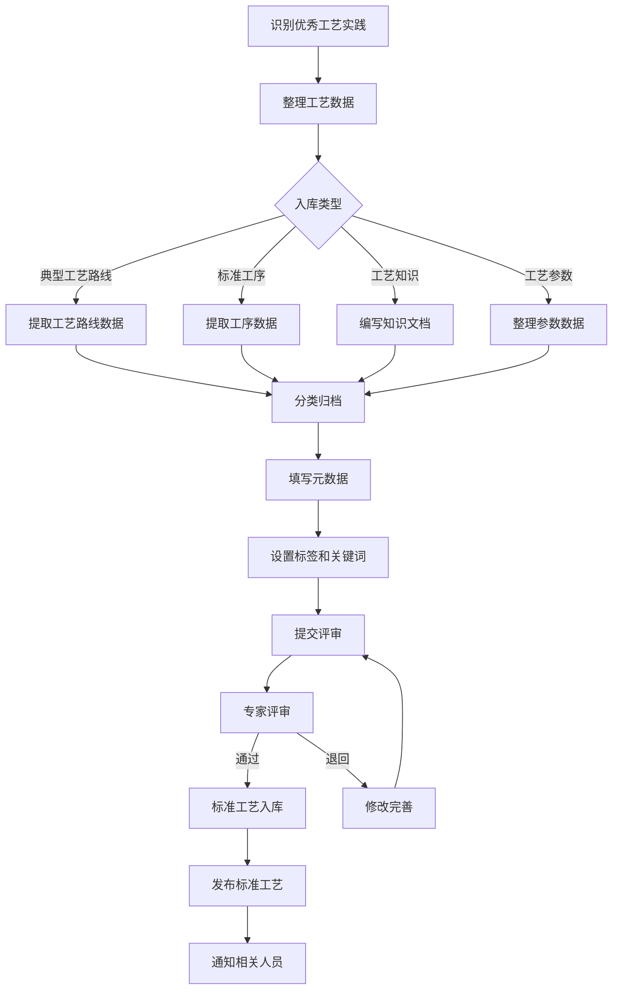

#### 12.3.2 标准工艺应用流程

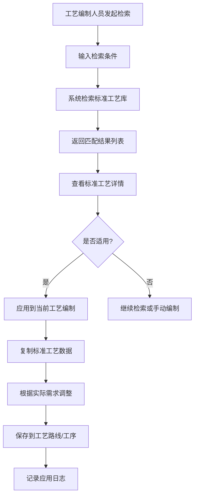

### 12.4 页面设计说明

#### 12.4.1 标准工艺库主页

- **布局**：顶部搜索栏 + 分类导航 + 内容展示区
- **搜索栏**：全文搜索框，支持关键词、标签搜索
- **分类导航**：按资源类型Tab切换（典型工艺路线 / 标准工序 / 工艺知识 / 工艺参数）
- **典型工艺路线Tab**：
  - 左侧分类树：按产品类型（工业压缩机/压力容器）→ 按零件类型（轴类/箱体类/盘类/焊接件等）
  - 右侧列表：卡片式展示，每个卡片显示工艺路线名称、适用产品、工序数量、更新时间、使用次数
- **标准工序Tab**：按工序类型分类展示标准工序列表
- **工艺知识Tab**：按知识分类展示文章列表，支持标签筛选
- **工艺参数Tab**：按加工类型分类展示参数表

#### 12.4.2 标准工艺详情页

- **布局**：Tab页签切换
- **工艺路线详情Tab**：工艺路线可视化展示（流程图/甘特图）、工序列表、关联资源
- **工序详情Tab**：工序基本信息、工步列表、工艺参数、设备要求、工装要求、质量控制点
- **关联信息Tab**：适用产品列表、应用次数统计、历史版本
- **评论Tab**：用户评论和讨论

#### 12.4.3 工艺参数库页

- **布局**：左侧参数分类 + 右侧参数表格
- **参数分类**：车削参数 / 铣削参数 / 钻削参数 / 焊接参数 / 热处理参数
- **参数表格**：材料牌号、加工方式、切削速度、进给量、切削深度、冷却液、适用设备
- **交互**：支持按材料牌号筛选、按加工方式筛选、参数对比

### 12.5 关键逻辑说明

#### 12.5.1 标准工艺分类体系

采用三级分类体系：
- 一级：产品大类（工业压缩机 / 压力容器）
- 二级：零件大类（轴类 / 箱体类 / 盘盖类 / 支架类 / 焊接件 / 管件等）
- 三级：具体零件类型（曲轴 / 连杆 / 缸体 / 封头 / 筒体 / 法兰等）

#### 12.5.2 标准工艺检索算法

采用多维度加权检索：
- 关键词匹配分（权重40%）：标题和内容的关键词匹配度
- 分类匹配分（权重20%）：与当前编制产品的分类匹配度
- 使用频率分（权重20%）：标准工艺的历史使用次数
- 更新时间分（权重10%）：最近更新的标准工艺优先
- 评分分（权重10%）：用户评分高的优先

#### 12.5.3 标准工艺评审机制

- 评审周期：每年至少评审一次
- 评审内容：工艺的先进性、适用性、经济性
- 评审方式：工艺专家小组评审
- 评审结果：继续有效 / 修订后有效 / 淘汰
- 淘汰标准：连续2年未被引用、工艺明显落后、有更优替代方案

---

**文档结束**

*本文档为CAPP系统功能模块详细设计文档，涵盖12个核心功能模块的设计说明。各模块的设计充分考虑了工业压缩机和压力容器的工艺特点，以及企业实际生产管理的需求。*
