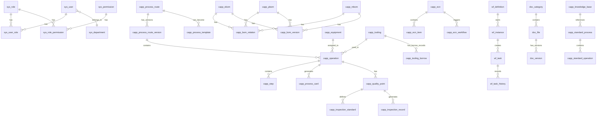
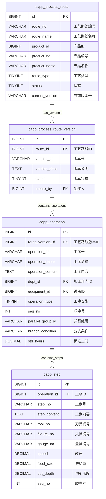
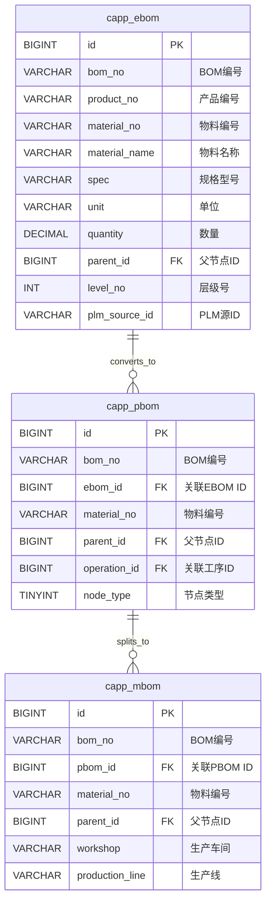

# CAPP系统设计文档

## 文档4：数据库设计

---

**文档版本**：V1.0
**编制日期**：2026-06-07
**适用范围**：工业压缩机/压力容器研发生产企业 CAPP（计算机辅助工艺规划）系统
**技术栈**：PHP原生（MVC） + MySQL 8.0

---

## 目录

- [1. 数据库设计规范](#1-数据库设计规范)
  - [1.1 命名规范](#11-命名规范)
  - [1.2 字段类型规范](#12-字段类型规范)
  - [1.3 设计原则](#13-设计原则)
- [2. ER关系图](#2-er关系图)
- [3. 核心数据表设计](#3-核心数据表设计)
  - [3.1 用户与权限](#31-用户与权限)
  - [3.2 工艺管理](#32-工艺管理)
  - [3.3 BOM管理](#33-bom管理)
  - [3.4 资源管理](#34-资源管理)
  - [3.5 质量管理](#35-质量管理)
  - [3.6 变更管理](#36-变更管理)
  - [3.7 审批流程](#37-审批流程)
  - [3.8 文档管理](#38-文档管理)
  - [3.9 标准工艺库](#39-标准工艺库)
  - [3.10 AI相关](#310-ai相关)
  - [3.11 系统集成](#311-系统集成)
- [4. 索引设计](#4-索引设计)
- [5. 数据字典](#5-数据字典)

---

## 1. 数据库设计规范

### 1.1 命名规范

#### 1.1.1 表名命名规范

| 规则 | 说明 | 示例 |
|------|------|------|
| 前缀分类 | 按模块使用表前缀 | sys_（系统）、capp_（工艺）、wf_（审批流程）、doc_（文档）、ai_（AI）、integration_（集成） |
| 全部小写 | 表名统一使用小写字母 | sys_user、capp_process_route |
| 下划线分隔 | 多单词以下划线分隔 | process_route、tooling_borrow |
| 关联表命名 | 两表名以下划线连接 | sys_user_role、sys_role_permission |
| 避免保留字 | 不使用MySQL保留字 | 使用user_account而非user |

#### 1.1.2 字段名命名规范

| 规则 | 说明 | 示例 |
|------|------|------|
| 全部小写 | 字段名统一使用小写字母 | user_name、create_time |
| 下划线分隔 | 多单词以下划线分隔 | route_name、create_time |
| 前缀约定 | 主键统一使用id，外键使用关联表_id | id、user_id、route_id |
| 布尔字段 | 使用is_前缀 | is_deleted、is_active、is_key_operation |
| 时间字段 | 使用_time后缀 | create_time、update_time、delete_time |
| 数量字段 | 使用_count后缀 | step_count、use_count |
| 状态字段 | 使用_status后缀 | approval_status、sync_status |
| 描述字段 | 使用_desc后缀 | operation_desc、change_desc |

#### 1.1.3 索引命名规范

| 规则 | 说明 | 示例 |
|------|------|------|
| 主键索引 | idx_pk_{表名} | idx_pk_sys_user |
| 唯一索引 | idx_uni_{表名}_{字段名} | idx_uni_sys_user_username |
| 普通索引 | idx_{表名}_{字段名} | idx_capp_process_route_product_id |
| 组合索引 | idx_{表名}_{字段1}_{字段2} | idx_capp_operation_route_id_seq |
| 全文索引 | idx_ft_{表名}_{字段名} | idx_ft_doc_file_title |

### 1.2 字段类型规范

| 数据类型 | 使用场景 | 说明 |
|---------|---------|------|
| `INT UNSIGNED` | 主键ID、数量、序号 | 无符号整数，自增主键 |
| `BIGINT UNSIGNED` | 大数据量表的主键 | 预留大数据量扩展 |
| `VARCHAR(n)` | 短文本字段 | n根据实际长度设定，不超过255 |
| `TEXT` | 长文本字段 | 工艺内容、审批意见等 |
| `MEDIUMTEXT` | 超长文本字段 | 富文本内容、JSON数据 |
| `DECIMAL(m,d)` | 金额、精度数值 | m为总位数，d为小数位 |
| `FLOAT` | 一般数值 | 工时、利用率等 |
| `DATETIME` | 日期时间 | create_time、update_time |
| `DATE` | 日期 | 审批截止日期 |
| `TINYINT` | 状态、类型、标志位 | 0/1状态值、枚举类型 |
| `JSON` | JSON结构数据 | 流程定义、扩展属性 |

#### 字段长度规范

| 字段类型 | 常用长度 | 示例字段 |
|---------|---------|---------|
| 编号类 | VARCHAR(32) | route_no、card_no、ecn_no |
| 名称类 | VARCHAR(100) | route_name、product_name |
| 描述类 | VARCHAR(500) | description、remark |
| 长文本类 | TEXT | operation_content、approval_comment |
| 路径类 | VARCHAR(500) | file_path、attachment_url |
| 枚举类 | TINYINT | status、type、category |

### 1.3 设计原则

#### 1.3.1 第三范式（3NF）原则

- 每个表必须有主键，主键使用自增整型
- 字段不可再分（原子性）
- 非主键字段必须直接依赖主键（消除传递依赖）
- 消除冗余数据，通过外键关联获取关联数据

#### 1.3.2 适度反范式原则

以下场景允许适度反范式：

| 场景 | 反范式方式 | 原因 |
|------|-----------|------|
| 高频查询字段 | 在从表中冗余主表名称 | 减少JOIN操作，提升查询性能 |
| 统计字段 | 冗余计数、汇总字段 | 避免实时COUNT计算 |
| 状态字段 | 冗余最新状态 | 避免关联查询获取状态 |
| 树形结构 | 冗余path或level字段 | 便于树形查询 |

#### 1.3.3 通用字段规范

每张表必须包含以下通用字段：

```sql
`id` BIGINT UNSIGNED NOT NULL AUTO_INCREMENT COMMENT '主键ID',
`create_time` DATETIME NOT NULL DEFAULT CURRENT_TIMESTAMP COMMENT '创建时间',
`update_time` DATETIME NOT NULL DEFAULT CURRENT_TIMESTAMP ON UPDATE CURRENT_TIMESTAMP COMMENT '更新时间',
`create_by` BIGINT UNSIGNED DEFAULT NULL COMMENT '创建人ID',
`update_by` BIGINT UNSIGNED DEFAULT NULL COMMENT '更新人ID',
`is_deleted` TINYINT NOT NULL DEFAULT 0 COMMENT '是否删除：0-未删除，1-已删除',
`remark` VARCHAR(500) DEFAULT NULL COMMENT '备注',
```

#### 1.3.4 软删除规范

- 所有业务表采用软删除（is_deleted字段），不执行物理删除
- 查询时统一添加 `WHERE is_deleted = 0` 条件
- 定期归档已软删除的数据（保留6个月后物理归档）

---

## 2. ER关系图

### 2.1 核心实体关系总览



### 2.2 工艺管理核心关系



### 2.3 BOM管理核心关系



---

## 3. 核心数据表设计

### 3.1 用户与权限

#### 3.1.1 sys_user（用户表）

| 字段名 | 类型 | 必填 | 默认值 | 说明 |
|--------|------|------|--------|------|
| id | BIGINT UNSIGNED | 是 | AUTO_INCREMENT | 主键ID |
| username | VARCHAR(50) | 是 | - | 用户名，唯一 |
| password | VARCHAR(255) | 是 | - | 密码（bcrypt加密） |
| real_name | VARCHAR(50) | 是 | - | 真实姓名 |
| employee_no | VARCHAR(32) | 是 | - | 工号，唯一 |
| email | VARCHAR(100) | 否 | NULL | 邮箱 |
| phone | VARCHAR(20) | 否 | NULL | 手机号 |
| dept_id | BIGINT UNSIGNED | 否 | NULL | 部门ID |
| avatar | VARCHAR(500) | 否 | NULL | 头像URL |
| status | TINYINT | 是 | 1 | 状态：1-启用，0-禁用 |
| last_login_time | DATETIME | 否 | NULL | 最后登录时间 |
| last_login_ip | VARCHAR(50) | 否 | NULL | 最后登录IP |
| is_deleted | TINYINT | 是 | 0 | 是否删除 |
| create_time | DATETIME | 是 | CURRENT_TIMESTAMP | 创建时间 |
| update_time | DATETIME | 是 | CURRENT_TIMESTAMP | 更新时间 |
| create_by | BIGINT UNSIGNED | 否 | NULL | 创建人ID |
| update_by | BIGINT UNSIGNED | 否 | NULL | 更新人ID |
| remark | VARCHAR(500) | 否 | NULL | 备注 |

#### 3.1.2 sys_role（角色表）

| 字段名 | 类型 | 必填 | 默认值 | 说明 |
|--------|------|------|--------|------|
| id | BIGINT UNSIGNED | 是 | AUTO_INCREMENT | 主键ID |
| role_name | VARCHAR(50) | 是 | - | 角色名称 |
| role_code | VARCHAR(50) | 是 | - | 角色编码，唯一 |
| role_desc | VARCHAR(200) | 否 | NULL | 角色描述 |
| sort_order | INT | 是 | 0 | 排序号 |
| status | TINYINT | 是 | 1 | 状态：1-启用，0-禁用 |
| is_deleted | TINYINT | 是 | 0 | 是否删除 |
| create_time | DATETIME | 是 | CURRENT_TIMESTAMP | 创建时间 |
| update_time | DATETIME | 是 | CURRENT_TIMESTAMP | 更新时间 |
| create_by | BIGINT UNSIGNED | 否 | NULL | 创建人ID |
| update_by | BIGINT UNSIGNED | 否 | NULL | 更新人ID |
| remark | VARCHAR(500) | 否 | NULL | 备注 |

**预置角色**：系统管理员、工艺工程师、校对工程师、工艺主管、总工程师、车间主任、质量工程师、生产工人、采购专员。

#### 3.1.3 sys_permission（权限表）

| 字段名 | 类型 | 必填 | 默认值 | 说明 |
|--------|------|------|--------|------|
| id | BIGINT UNSIGNED | 是 | AUTO_INCREMENT | 主键ID |
| permission_name | VARCHAR(100) | 是 | - | 权限名称 |
| permission_code | VARCHAR(100) | 是 | - | 权限编码，唯一 |
| permission_type | TINYINT | 是 | - | 权限类型：1-菜单，2-按钮，3-数据 |
| parent_id | BIGINT UNSIGNED | 是 | 0 | 父权限ID，0为顶级 |
| menu_path | VARCHAR(200) | 否 | NULL | 菜单路径 |
| menu_icon | VARCHAR(100) | 否 | NULL | 菜单图标 |
| sort_order | INT | 是 | 0 | 排序号 |
| status | TINYINT | 是 | 1 | 状态：1-启用，0-禁用 |
| is_deleted | TINYINT | 是 | 0 | 是否删除 |
| create_time | DATETIME | 是 | CURRENT_TIMESTAMP | 创建时间 |
| update_time | DATETIME | 是 | CURRENT_TIMESTAMP | 更新时间 |
| remark | VARCHAR(500) | 否 | NULL | 备注 |

#### 3.1.4 sys_user_role（用户角色关联表）

| 字段名 | 类型 | 必填 | 默认值 | 说明 |
|--------|------|------|--------|------|
| id | BIGINT UNSIGNED | 是 | AUTO_INCREMENT | 主键ID |
| user_id | BIGINT UNSIGNED | 是 | - | 用户ID |
| role_id | BIGINT UNSIGNED | 是 | - | 角色ID |
| create_time | DATETIME | 是 | CURRENT_TIMESTAMP | 创建时间 |

#### 3.1.5 sys_role_permission（角色权限关联表）

| 字段名 | 类型 | 必填 | 默认值 | 说明 |
|--------|------|------|--------|------|
| id | BIGINT UNSIGNED | 是 | AUTO_INCREMENT | 主键ID |
| role_id | BIGINT UNSIGNED | 是 | - | 角色ID |
| permission_id | BIGINT UNSIGNED | 是 | - | 权限ID |
| create_time | DATETIME | 是 | CURRENT_TIMESTAMP | 创建时间 |

#### 3.1.6 sys_department（部门表）

| 字段名 | 类型 | 必填 | 默认值 | 说明 |
|--------|------|------|--------|------|
| id | BIGINT UNSIGNED | 是 | AUTO_INCREMENT | 主键ID |
| dept_name | VARCHAR(100) | 是 | - | 部门名称 |
| dept_code | VARCHAR(50) | 是 | - | 部门编码，唯一 |
| parent_id | BIGINT UNSIGNED | 是 | 0 | 父部门ID，0为顶级 |
| leader_id | BIGINT UNSIGNED | 否 | NULL | 部门负责人ID |
| sort_order | INT | 是 | 0 | 排序号 |
| status | TINYINT | 是 | 1 | 状态：1-启用，0-禁用 |
| is_deleted | TINYINT | 是 | 0 | 是否删除 |
| create_time | DATETIME | 是 | CURRENT_TIMESTAMP | 创建时间 |
| update_time | DATETIME | 是 | CURRENT_TIMESTAMP | 更新时间 |
| remark | VARCHAR(500) | 否 | NULL | 备注 |

#### 3.1.7 sys_wechat_user（企业微信用户关联表）

| 字段名 | 类型 | 必填 | 默认值 | 说明 |
|--------|------|------|--------|------|
| id | BIGINT UNSIGNED | 是 | AUTO_INCREMENT | 主键ID |
| user_id | BIGINT UNSIGNED | 是 | - | 关联系统用户ID |
| wechat_user_id | VARCHAR(64) | 是 | - | 企业微信用户ID |
| wechat_dept_id | INT | 否 | NULL | 企业微信部门ID |
| wechat_name | VARCHAR(100) | 否 | NULL | 企业微信姓名 |
| wechat_avatar | VARCHAR(500) | 否 | NULL | 企业微信头像 |
| wechat_mobile | VARCHAR(20) | 否 | NULL | 企业微信手机号 |
| bind_time | DATETIME | 是 | CURRENT_TIMESTAMP | 绑定时间 |
| is_deleted | TINYINT | 是 | 0 | 是否删除 |
| create_time | DATETIME | 是 | CURRENT_TIMESTAMP | 创建时间 |
| update_time | DATETIME | 是 | CURRENT_TIMESTAMP | 更新时间 |

---

### 3.2 工艺管理

#### 3.2.1 capp_process_route（工艺路线表）

| 字段名 | 类型 | 必填 | 默认值 | 说明 |
|--------|------|------|--------|------|
| id | BIGINT UNSIGNED | 是 | AUTO_INCREMENT | 主键ID |
| route_no | VARCHAR(32) | 是 | - | 工艺路线编号，唯一 |
| route_name | VARCHAR(200) | 是 | - | 工艺路线名称 |
| product_id | VARCHAR(64) | 是 | - | 产品ID（PLM产品ID） |
| product_no | VARCHAR(64) | 是 | - | 产品编号 |
| product_name | VARCHAR(200) | 是 | - | 产品名称 |
| product_type | TINYINT | 是 | - | 产品类型：1-工业压缩机，2-压力容器 |
| route_type | TINYINT | 是 | - | 工艺类型：1-机加工，2-焊接，3-装配，4-热处理，5-表面处理，6-无损检测，7-压力试验，8-综合 |
| current_version | VARCHAR(20) | 是 | V1.0 | 当前版本号 |
| operation_count | INT | 是 | 0 | 工序总数（冗余） |
| status | TINYINT | 是 | 0 | 状态：0-草稿，1-审批中，2-已发布，3-已退回，4-已归档 |
| source_type | TINYINT | 是 | 1 | 来源：1-手动创建，2-模板创建，3-标准库导入 |
| template_id | BIGINT UNSIGNED | 否 | NULL | 来源模板ID |
| is_deleted | TINYINT | 是 | 0 | 是否删除 |
| create_time | DATETIME | 是 | CURRENT_TIMESTAMP | 创建时间 |
| update_time | DATETIME | 是 | CURRENT_TIMESTAMP | 更新时间 |
| create_by | BIGINT UNSIGNED | 否 | NULL | 创建人ID |
| update_by | BIGINT UNSIGNED | 否 | NULL | 更新人ID |
| remark | VARCHAR(500) | 否 | NULL | 备注 |

#### 3.2.2 capp_process_route_version（工艺路线版本表）

| 字段名 | 类型 | 必填 | 默认值 | 说明 |
|--------|------|------|--------|------|
| id | BIGINT UNSIGNED | 是 | AUTO_INCREMENT | 主键ID |
| route_id | BIGINT UNSIGNED | 是 | - | 工艺路线ID |
| version_no | VARCHAR(20) | 是 | - | 版本号（如V1.0） |
| version_desc | TEXT | 否 | NULL | 版本说明 |
| status | TINYINT | 是 | 0 | 版本状态：0-草稿，1-审批中，2-已发布，3-已退回 |
| operation_count | INT | 是 | 0 | 工序总数 |
| wf_instance_id | BIGINT UNSIGNED | 否 | NULL | 关联审批流程实例ID |
| published_at | DATETIME | 否 | NULL | 发布时间 |
| published_by | BIGINT UNSIGNED | 否 | NULL | 发布人ID |
| is_deleted | TINYINT | 是 | 0 | 是否删除 |
| create_time | DATETIME | 是 | CURRENT_TIMESTAMP | 创建时间 |
| update_time | DATETIME | 是 | CURRENT_TIMESTAMP | 更新时间 |
| create_by | BIGINT UNSIGNED | 否 | NULL | 创建人ID |
| update_by | BIGINT UNSIGNED | 否 | NULL | 更新人ID |
| remark | VARCHAR(500) | 否 | NULL | 备注 |

#### 3.2.3 capp_operation（工序表）

| 字段名 | 类型 | 必填 | 默认值 | 说明 |
|--------|------|------|--------|------|
| id | BIGINT UNSIGNED | 是 | AUTO_INCREMENT | 主键ID |
| route_version_id | BIGINT UNSIGNED | 是 | - | 工艺路线版本ID |
| operation_no | VARCHAR(32) | 是 | - | 工序号（如30-001） |
| operation_name | VARCHAR(200) | 是 | - | 工序名称 |
| operation_content | TEXT | 否 | NULL | 工序内容描述 |
| operation_type | TINYINT | 是 | - | 工序类型：10-铸造，20-锻造，30-机加工，40-焊接，50-热处理，60-表面处理，70-装配，80-检验，90-包装 |
| card_type | TINYINT | 是 | - | 卡片类型：1-加工工序卡，2-检验工序卡，3-辅助工序卡 |
| dept_id | BIGINT UNSIGNED | 否 | NULL | 加工部门ID |
| dept_name | VARCHAR(100) | 否 | NULL | 加工部门名称（冗余） |
| equipment_id | BIGINT UNSIGNED | 否 | NULL | 设备ID |
| equipment_name | VARCHAR(200) | 否 | NULL | 设备名称（冗余） |
| seq_no | INT | 是 | 0 | 顺序号 |
| parallel_group_id | VARCHAR(32) | 否 | NULL | 并行组号（相同组号表示并行工序） |
| branch_condition | VARCHAR(200) | 否 | NULL | 分支条件 |
| is_key_operation | TINYINT | 是 | 0 | 是否关键工序：0-否，1-是 |
| std_hours | DECIMAL(8,2) | 否 | NULL | 标准工时（小时） |
| prep_time | DECIMAL(8,2) | 否 | NULL | 准备时间（小时） |
| step_count | INT | 是 | 0 | 工步总数（冗余） |
| is_deleted | TINYINT | 是 | 0 | 是否删除 |
| create_time | DATETIME | 是 | CURRENT_TIMESTAMP | 创建时间 |
| update_time | DATETIME | 是 | CURRENT_TIMESTAMP | 更新时间 |
| create_by | BIGINT UNSIGNED | 否 | NULL | 创建人ID |
| update_by | BIGINT UNSIGNED | 否 | NULL | 更新人ID |
| remark | VARCHAR(500) | 否 | NULL | 备注 |

#### 3.2.4 capp_step（工步表）

| 字段名 | 类型 | 必填 | 默认值 | 说明 |
|--------|------|------|--------|------|
| id | BIGINT UNSIGNED | 是 | AUTO_INCREMENT | 主键ID |
| operation_id | BIGINT UNSIGNED | 是 | - | 工序ID |
| step_no | VARCHAR(32) | 是 | - | 工步号 |
| step_name | VARCHAR(200) | 是 | - | 工步名称 |
| step_content | TEXT | 否 | NULL | 工步内容描述 |
| seq_no | INT | 是 | 0 | 顺序号 |
| speed | DECIMAL(10,2) | 否 | NULL | 转速（r/min） |
| feed_rate | DECIMAL(10,4) | 否 | NULL | 进给量（mm/r） |
| cut_depth | DECIMAL(8,4) | 否 | NULL | 切削深度（mm） |
| cut_speed | DECIMAL(10,2) | 否 | NULL | 切削速度（m/min） |
| tool_id | BIGINT UNSIGNED | 否 | NULL | 刀具ID |
| tool_name | VARCHAR(200) | 否 | NULL | 刀具名称（冗余） |
| tool_no | VARCHAR(32) | 否 | NULL | 刀具编号 |
| fixture_id | BIGINT UNSIGNED | 否 | NULL | 夹具ID |
| fixture_name | VARCHAR(200) | 否 | NULL | 夹具名称（冗余） |
| fixture_no | VARCHAR(32) | 否 | NULL | 夹具编号 |
| gauge_id | BIGINT UNSIGNED | 否 | NULL | 量具ID |
| gauge_name | VARCHAR(200) | 否 | NULL | 量具名称（冗余） |
| gauge_no | VARCHAR(32) | 否 | NULL | 量具编号 |
| dimension | VARCHAR(200) | 否 | NULL | 加工尺寸及公差 |
| surface_roughness | VARCHAR(50) | 否 | NULL | 表面粗糙度要求 |
| is_deleted | TINYINT | 是 | 0 | 是否删除 |
| create_time | DATETIME | 是 | CURRENT_TIMESTAMP | 创建时间 |
| update_time | DATETIME | 是 | CURRENT_TIMESTAMP | 更新时间 |
| create_by | BIGINT UNSIGNED | 否 | NULL | 创建人ID |
| update_by | BIGINT UNSIGNED | 否 | NULL | 更新人ID |
| remark | VARCHAR(500) | 否 | NULL | 备注 |

#### 3.2.5 capp_process_card（工艺卡片表）

| 字段名 | 类型 | 必填 | 默认值 | 说明 |
|--------|------|------|--------|------|
| id | BIGINT UNSIGNED | 是 | AUTO_INCREMENT | 主键ID |
| card_no | VARCHAR(32) | 是 | - | 卡片编号，唯一 |
| card_type | TINYINT | 是 | - | 卡片类型：1-加工工序卡，2-检验工序卡，3-辅助工序卡 |
| operation_id | BIGINT UNSIGNED | 是 | - | 关联工序ID |
| route_version_id | BIGINT UNSIGNED | 是 | - | 工艺路线版本ID |
| product_no | VARCHAR(64) | 是 | - | 产品编号 |
| product_name | VARCHAR(200) | 是 | - | 产品名称 |
| part_no | VARCHAR(64) | 否 | NULL | 零件编号 |
| part_name | VARCHAR(200) | 否 | NULL | 零件名称 |
| material_code | VARCHAR(64) | 否 | NULL | 材料牌号 |
| material_spec | VARCHAR(200) | 否 | NULL | 材料规格 |
| card_content | MEDIUMTEXT | 否 | NULL | 卡片内容（JSON格式存储卡片完整数据） |
| template_id | BIGINT UNSIGNED | 否 | NULL | 使用的模板ID |
| status | TINYINT | 是 | 0 | 状态：0-草稿，1-审批中，2-已发布，3-已退回 |
| wf_instance_id | BIGINT UNSIGNED | 否 | NULL | 关联审批流程实例ID |
| is_deleted | TINYINT | 是 | 0 | 是否删除 |
| create_time | DATETIME | 是 | CURRENT_TIMESTAMP | 创建时间 |
| update_time | DATETIME | 是 | CURRENT_TIMESTAMP | 更新时间 |
| create_by | BIGINT UNSIGNED | 否 | NULL | 创建人ID |
| update_by | BIGINT UNSIGNED | 否 | NULL | 更新人ID |
| remark | VARCHAR(500) | 否 | NULL | 备注 |

#### 3.2.6 capp_process_template（工艺模板表）

| 字段名 | 类型 | 必填 | 默认值 | 说明 |
|--------|------|------|--------|------|
| id | BIGINT UNSIGNED | 是 | AUTO_INCREMENT | 主键ID |
| template_name | VARCHAR(200) | 是 | - | 模板名称 |
| template_no | VARCHAR(32) | 是 | - | 模板编号，唯一 |
| template_type | TINYINT | 是 | - | 模板类型：1-工艺路线模板，2-工序卡片模板，3-工步卡片模板 |
| product_type | TINYINT | 否 | NULL | 适用产品类型：1-工业压缩机，2-压力容器，NULL-通用 |
| category | VARCHAR(100) | 否 | NULL | 模板分类 |
| template_data | MEDIUMTEXT | 是 | - | 模板数据（JSON格式存储模板完整数据结构） |
| use_count | INT | 是 | 0 | 使用次数（冗余） |
| status | TINYINT | 是 | 1 | 状态：1-启用，0-禁用 |
| is_deleted | TINYINT | 是 | 0 | 是否删除 |
| create_time | DATETIME | 是 | CURRENT_TIMESTAMP | 创建时间 |
| update_time | DATETIME | 是 | CURRENT_TIMESTAMP | 更新时间 |
| create_by | BIGINT UNSIGNED | 否 | NULL | 创建人ID |
| update_by | BIGINT UNSIGNED | 否 | NULL | 更新人ID |
| remark | VARCHAR(500) | 否 | NULL | 备注 |

---

### 3.3 BOM管理

#### 3.3.1 capp_ebom（EBOM表）

| 字段名 | 类型 | 必填 | 默认值 | 说明 |
|--------|------|------|--------|------|
| id | BIGINT UNSIGNED | 是 | AUTO_INCREMENT | 主键ID |
| bom_no | VARCHAR(64) | 是 | - | BOM编号 |
| product_no | VARCHAR(64) | 是 | - | 产品编号 |
| product_name | VARCHAR(200) | 是 | - | 产品名称 |
| material_no | VARCHAR(64) | 是 | - | 物料编号 |
| material_name | VARCHAR(200) | 是 | - | 物料名称 |
| material_code | VARCHAR(64) | 否 | NULL | 材料牌号 |
| spec | VARCHAR(200) | 否 | NULL | 规格型号 |
| unit | VARCHAR(20) | 是 | - | 单位 |
| quantity | DECIMAL(12,4) | 是 | - | 数量 |
| parent_id | BIGINT UNSIGNED | 是 | 0 | 父节点ID，0为根节点 |
| level_no | INT | 是 | 1 | 层级号 |
| sort_no | INT | 是 | 0 | 同级排序号 |
| is_virtual | TINYINT | 是 | 0 | 是否虚拟件：0-否，1-是 |
| plm_source_id | VARCHAR(64) | 否 | NULL | PLM源系统ID |
| plm_version | VARCHAR(20) | 否 | NULL | PLM版本号 |
| sync_status | TINYINT | 是 | 0 | 同步状态：0-未同步，1-已同步，2-同步失败 |
| sync_time | DATETIME | 否 | NULL | 同步时间 |
| version_no | VARCHAR(20) | 是 | V1.0 | BOM版本号 |
| is_deleted | TINYINT | 是 | 0 | 是否删除 |
| create_time | DATETIME | 是 | CURRENT_TIMESTAMP | 创建时间 |
| update_time | DATETIME | 是 | CURRENT_TIMESTAMP | 更新时间 |
| remark | VARCHAR(500) | 否 | NULL | 备注 |

#### 3.3.2 capp_pbom（PBOM表）

| 字段名 | 类型 | 必填 | 默认值 | 说明 |
|--------|------|------|--------|------|
| id | BIGINT UNSIGNED | 是 | AUTO_INCREMENT | 主键ID |
| bom_no | VARCHAR(64) | 是 | - | BOM编号 |
| ebom_id | BIGINT UNSIGNED | 否 | NULL | 关联EBOM节点ID |
| product_no | VARCHAR(64) | 是 | - | 产品编号 |
| product_name | VARCHAR(200) | 是 | - | 产品名称 |
| material_no | VARCHAR(64) | 是 | - | 物料编号 |
| material_name | VARCHAR(200) | 是 | - | 物料名称 |
| spec | VARCHAR(200) | 否 | NULL | 规格型号 |
| unit | VARCHAR(20) | 是 | - | 单位 |
| quantity | DECIMAL(12,4) | 是 | - | 数量 |
| parent_id | BIGINT UNSIGNED | 是 | 0 | 父节点ID，0为根节点 |
| level_no | INT | 是 | 1 | 层级号 |
| sort_no | INT | 是 | 0 | 同级排序号 |
| node_type | TINYINT | 是 | 1 | 节点类型：1-原始件，2-虚拟件，3-合件 |
| operation_id | BIGINT UNSIGNED | 否 | NULL | 关联工序ID |
| operation_no | VARCHAR(32) | 否 | NULL | 关联工序号（冗余） |
| convert_type | TINYINT | 是 | 1 | 转换方式：1-直接转换，2-拆分，3-合并 |
| convert_desc | VARCHAR(500) | 否 | NULL | 转换说明 |
| version_no | VARCHAR(20) | 是 | V1.0 | BOM版本号 |
| status | TINYINT | 是 | 0 | 状态：0-草稿，1-审批中，2-已发布，3-已退回 |
| is_deleted | TINYINT | 是 | 0 | 是否删除 |
| create_time | DATETIME | 是 | CURRENT_TIMESTAMP | 创建时间 |
| update_time | DATETIME | 是 | CURRENT_TIMESTAMP | 更新时间 |
| create_by | BIGINT UNSIGNED | 否 | NULL | 创建人ID |
| update_by | BIGINT UNSIGNED | 否 | NULL | 更新人ID |
| remark | VARCHAR(500) | 否 | NULL | 备注 |

#### 3.3.3 capp_mbom（MBOM表）

| 字段名 | 类型 | 必填 | 默认值 | 说明 |
|--------|------|------|--------|------|
| id | BIGINT UNSIGNED | 是 | AUTO_INCREMENT | 主键ID |
| bom_no | VARCHAR(64) | 是 | - | BOM编号 |
| pbom_id | BIGINT UNSIGNED | 否 | NULL | 关联PBOM节点ID |
| product_no | VARCHAR(64) | 是 | - | 产品编号 |
| product_name | VARCHAR(200) | 是 | - | 产品名称 |
| material_no | VARCHAR(64) | 是 | - | 物料编号 |
| material_name | VARCHAR(200) | 是 | - | 物料名称 |
| spec | VARCHAR(200) | 否 | NULL | 规格型号 |
| unit | VARCHAR(20) | 是 | - | 单位 |
| quantity | DECIMAL(12,4) | 是 | - | 数量 |
| parent_id | BIGINT UNSIGNED | 是 | 0 | 父节点ID，0为根节点 |
| level_no | INT | 是 | 1 | 层级号 |
| sort_no | INT | 是 | 0 | 同级排序号 |
| workshop | VARCHAR(100) | 否 | NULL | 生产车间 |
| production_line | VARCHAR(100) | 否 | NULL | 生产线 |
| is_auxiliary | TINYINT | 是 | 0 | 是否制造辅助物料：0-否，1-是 |
| version_no | VARCHAR(20) | 是 | V1.0 | BOM版本号 |
| status | TINYINT | 是 | 0 | 状态：0-草稿，1-审批中，2-已发布，3-已退回 |
| is_deleted | TINYINT | 是 | 0 | 是否删除 |
| create_time | DATETIME | 是 | CURRENT_TIMESTAMP | 创建时间 |
| update_time | DATETIME | 是 | CURRENT_TIMESTAMP | 更新时间 |
| create_by | BIGINT UNSIGNED | 否 | NULL | 创建人ID |
| update_by | BIGINT UNSIGNED | 否 | NULL | 更新人ID |
| remark | VARCHAR(500) | 否 | NULL | 备注 |

#### 3.3.4 capp_bom_relation（BOM关联关系表）

| 字段名 | 类型 | 必填 | 默认值 | 说明 |
|--------|------|------|--------|------|
| id | BIGINT UNSIGNED | 是 | AUTO_INCREMENT | 主键ID |
| source_bom_type | TINYINT | 是 | - | 源BOM类型：1-EBOM，2-PBOM，3-MBOM |
| source_bom_id | BIGINT UNSIGNED | 是 | - | 源BOM节点ID |
| target_bom_type | TINYINT | 是 | - | 目标BOM类型：1-EBOM，2-PBOM，3-MBOM |
| target_bom_id | BIGINT UNSIGNED | 是 | - | 目标BOM节点ID |
| relation_type | TINYINT | 是 | - | 关联类型：1-直接转换，2-拆分，3-合并，4-替换 |
| convert_ratio | DECIMAL(12,4) | 是 | 1.0000 | 转换比率 |
| is_deleted | TINYINT | 是 | 0 | 是否删除 |
| create_time | DATETIME | 是 | CURRENT_TIMESTAMP | 创建时间 |
| update_time | DATETIME | 是 | CURRENT_TIMESTAMP | 更新时间 |
| remark | VARCHAR(500) | 否 | NULL | 备注 |

#### 3.3.5 capp_bom_version（BOM版本表）

| 字段名 | 类型 | 必填 | 默认值 | 说明 |
|--------|------|------|--------|------|
| id | BIGINT UNSIGNED | 是 | AUTO_INCREMENT | 主键ID |
| bom_type | TINYINT | 是 | - | BOM类型：1-EBOM，2-PBOM，3-MBOM |
| product_no | VARCHAR(64) | 是 | - | 产品编号 |
| version_no | VARCHAR(20) | 是 | - | 版本号 |
| version_desc | TEXT | 否 | NULL | 版本说明 |
| status | TINYINT | 是 | 0 | 状态：0-草稿，1-已发布，2-已归档 |
| node_count | INT | 是 | 0 | 节点总数（冗余） |
| published_at | DATETIME | 否 | NULL | 发布时间 |
| published_by | BIGINT UNSIGNED | 否 | NULL | 发布人ID |
| is_deleted | TINYINT | 是 | 0 | 是否删除 |
| create_time | DATETIME | 是 | CURRENT_TIMESTAMP | 创建时间 |
| update_time | DATETIME | 是 | CURRENT_TIMESTAMP | 更新时间 |
| create_by | BIGINT UNSIGNED | 否 | NULL | 创建人ID |
| update_by | BIGINT UNSIGNED | 否 | NULL | 更新人ID |
| remark | VARCHAR(500) | 否 | NULL | 备注 |

---

### 3.4 资源管理

#### 3.4.1 capp_equipment（设备表）

| 字段名 | 类型 | 必填 | 默认值 | 说明 |
|--------|------|------|--------|------|
| id | BIGINT UNSIGNED | 是 | AUTO_INCREMENT | 主键ID |
| equipment_no | VARCHAR(32) | 是 | - | 设备编号，唯一 |
| equipment_name | VARCHAR(200) | 是 | - | 设备名称 |
| equipment_model | VARCHAR(100) | 否 | NULL | 设备型号 |
| equipment_type | TINYINT | 是 | - | 设备类型：1-车床，2-铣床，3-钻床，4-磨床，5-镗床，6-焊机，7-卷板机，8-热处理炉，9-探伤机，10-压力试验机，11-其他 |
| manufacturer | VARCHAR(200) | 否 | NULL | 制造商 |
| manufacture_date | DATE | 否 | NULL | 出厂日期 |
| commission_date | DATE | 否 | NULL | 投产日期 |
| precision_grade | VARCHAR(50) | 否 | NULL | 精度等级 |
| max_length | DECIMAL(10,2) | 否 | NULL | 最大加工长度（mm） |
| max_width | DECIMAL(10,2) | 否 | NULL | 最大加工宽度（mm） |
| max_height | DECIMAL(10,2) | 否 | NULL | 最大加工高度（mm） |
| max_diameter | DECIMAL(10,2) | 否 | NULL | 最大回转直径（mm） |
| max_load | DECIMAL(10,2) | 否 | NULL | 最大载荷（kg） |
| power | DECIMAL(8,2) | 否 | NULL | 额定功率（kW） |
| workshop | VARCHAR(100) | 否 | NULL | 所在车间 |
| location | VARCHAR(200) | 否 | NULL | 具体位置 |
| status | TINYINT | 是 | 1 | 设备状态：1-运行，2-停机，3-维修，4-保养，5-报废 |
| capability_json | JSON | 否 | NULL | 设备能力参数（JSON格式，存储扩展能力数据） |
| is_deleted | TINYINT | 是 | 0 | 是否删除 |
| create_time | DATETIME | 是 | CURRENT_TIMESTAMP | 创建时间 |
| update_time | DATETIME | 是 | CURRENT_TIMESTAMP | 更新时间 |
| create_by | BIGINT UNSIGNED | 否 | NULL | 创建人ID |
| update_by | BIGINT UNSIGNED | 否 | NULL | 更新人ID |
| remark | VARCHAR(500) | 否 | NULL | 备注 |

#### 3.4.2 capp_tooling（工装夹具表）

| 字段名 | 类型 | 必填 | 默认值 | 说明 |
|--------|------|------|--------|------|
| id | BIGINT UNSIGNED | 是 | AUTO_INCREMENT | 主键ID |
| tooling_no | VARCHAR(32) | 是 | - | 工装编号，唯一 |
| tooling_name | VARCHAR(200) | 是 | - | 工装名称 |
| tooling_type | TINYINT | 是 | - | 工装类型：1-夹具，2-模具，3-刀具，4-量具，5-辅具 |
| spec | VARCHAR(200) | 否 | NULL | 规格型号 |
| material | VARCHAR(100) | 否 | NULL | 材质 |
| precision_grade | VARCHAR(50) | 否 | NULL | 精度等级 |
| applicable_products | VARCHAR(500) | 否 | NULL | 适用产品（逗号分隔） |
| applicable_operations | VARCHAR(500) | 否 | NULL | 适用工序（逗号分隔） |
| storage_location | VARCHAR(200) | 否 | NULL | 存放位置 |
| purchase_date | DATE | 否 | NULL | 采购日期 |
| purchase_price | DECIMAL(12,2) | 否 | NULL | 采购价格（元） |
| supplier | VARCHAR(200) | 否 | NULL | 供应商 |
| life_type | TINYINT | 是 | 1 | 寿命类型：1-按次数，2-按时长 |
| design_life | INT | 是 | 0 | 设计寿命（次数或小时） |
| used_life | INT | 是 | 0 | 已使用寿命（次数或小时） |
| life_percent | DECIMAL(5,2) | 是 | 100.00 | 剩余寿命百分比 |
| status | TINYINT | 是 | 1 | 状态：1-在库，2-借出，3-维修，4-报废 |
| image_url | VARCHAR(500) | 否 | NULL | 工装图片URL |
| is_deleted | TINYINT | 是 | 0 | 是否删除 |
| create_time | DATETIME | 是 | CURRENT_TIMESTAMP | 创建时间 |
| update_time | DATETIME | 是 | CURRENT_TIMESTAMP | 更新时间 |
| create_by | BIGINT UNSIGNED | 否 | NULL | 创建人ID |
| update_by | BIGINT UNSIGNED | 否 | NULL | 更新人ID |
| remark | VARCHAR(500) | 否 | NULL | 备注 |

#### 3.4.3 capp_tooling_borrow（工装借用记录表）

| 字段名 | 类型 | 必填 | 默认值 | 说明 |
|--------|------|------|--------|------|
| id | BIGINT UNSIGNED | 是 | AUTO_INCREMENT | 主键ID |
| tooling_id | BIGINT UNSIGNED | 是 | - | 工装ID |
| borrower_id | BIGINT UNSIGNED | 是 | - | 借用人ID |
| borrower_name | VARCHAR(50) | 是 | - | 借用人姓名（冗余） |
| borrow_time | DATETIME | 是 | - | 借用时间 |
| expected_return_time | DATETIME | 否 | NULL | 预计归还时间 |
| actual_return_time | DATETIME | 否 | NULL | 实际归还时间 |
| return_status | TINYINT | 是 | 0 | 归还状态：0-未归还，1-正常归还，2-异常归还 |
| purpose | VARCHAR(500) | 否 | NULL | 借用用途 |
| return_condition | TINYINT | 否 | NULL | 归还时工装状态：1-正常，2-需维修，3-损坏 |
| fault_desc | VARCHAR(500) | 否 | NULL | 故障描述 |
| is_deleted | TINYINT | 是 | 0 | 是否删除 |
| create_time | DATETIME | 是 | CURRENT_TIMESTAMP | 创建时间 |
| update_time | DATETIME | 是 | CURRENT_TIMESTAMP | 更新时间 |
| remark | VARCHAR(500) | 否 | NULL | 备注 |

#### 3.4.4 capp_material_standard（材料定额标准表）

| 字段名 | 类型 | 必填 | 默认值 | 说明 |
|--------|------|------|--------|------|
| id | BIGINT UNSIGNED | 是 | AUTO_INCREMENT | 主键ID |
| product_type | TINYINT | 是 | - | 产品类型：1-工业压缩机，2-压力容器 |
| material_category | VARCHAR(100) | 是 | - | 材料分类（碳钢/合金钢/不锈钢/有色金属/非金属） |
| material_code | VARCHAR(64) | 是 | - | 材料牌号 |
| part_type | VARCHAR(100) | 是 | - | 零件类型（轴类/箱体类/盘类/焊接件等） |
| blank_form | TINYINT | 是 | - | 毛坯形式：1-圆棒料，2-板料，3-锻件，4-铸件，5-管材 |
| allowance_standard | JSON | 是 | - | 加工余量标准（JSON格式，各方向余量值） |
| utilization_standard | DECIMAL(5,2) | 是 | - | 标准材料利用率（%） |
| utilization_min | DECIMAL(5,2) | 是 | - | 最低允许利用率（%） |
| density | DECIMAL(8,4) | 否 | NULL | 材料密度（g/cm3） |
| status | TINYINT | 是 | 1 | 状态：1-启用，0-禁用 |
| is_deleted | TINYINT | 是 | 0 | 是否删除 |
| create_time | DATETIME | 是 | CURRENT_TIMESTAMP | 创建时间 |
| update_time | DATETIME | 是 | CURRENT_TIMESTAMP | 更新时间 |
| create_by | BIGINT UNSIGNED | 否 | NULL | 创建人ID |
| update_by | BIGINT UNSIGNED | 否 | NULL | 更新人ID |
| remark | VARCHAR(500) | 否 | NULL | 备注 |

#### 3.4.5 capp_time_standard（工时定额标准表）

| 字段名 | 类型 | 必填 | 默认值 | 说明 |
|--------|------|------|--------|------|
| id | BIGINT UNSIGNED | 是 | AUTO_INCREMENT | 主键ID |
| operation_category | TINYINT | 是 | - | 工序大类：30-机加工，40-焊接，50-热处理，70-装配，80-检验 |
| operation_type | VARCHAR(100) | 是 | - | 工序类型（车削/铣削/钻削/镗削/磨削/焊接等） |
| feature_type | VARCHAR(100) | 是 | - | 加工特征（外圆/内孔/平面/螺纹/齿轮/槽等） |
| size_range_min | DECIMAL(10,2) | 否 | NULL | 尺寸范围下限 |
| size_range_max | DECIMAL(10,2) | 否 | NULL | 尺寸范围上限 |
| material_factor | DECIMAL(4,2) | 是 | 1.00 | 材料系数 |
| equipment_factor | DECIMAL(4,2) | 是 | 1.00 | 设备系数 |
| std_prep_time | DECIMAL(8,2) | 否 | NULL | 标准准备时间（分钟） |
| std_mach_time | DECIMAL(8,2) | 否 | NULL | 标准加工时间（分钟） |
| std_aux_time | DECIMAL(8,2) | 否 | NULL | 标准辅助时间（分钟） |
| batch_factor | DECIMAL(4,2) | 是 | 1.00 | 批量衰减率 |
| status | TINYINT | 是 | 1 | 状态：1-启用，0-禁用 |
| is_deleted | TINYINT | 是 | 0 | 是否删除 |
| create_time | DATETIME | 是 | CURRENT_TIMESTAMP | 创建时间 |
| update_time | DATETIME | 是 | CURRENT_TIMESTAMP | 更新时间 |
| create_by | BIGINT UNSIGNED | 否 | NULL | 创建人ID |
| update_by | BIGINT UNSIGNED | 否 | NULL | 更新人ID |
| remark | VARCHAR(500) | 否 | NULL | 备注 |

---

### 3.5 质量管理

#### 3.5.1 capp_quality_point（质量控制点表）

| 字段名 | 类型 | 必填 | 默认值 | 说明 |
|--------|------|------|--------|------|
| id | BIGINT UNSIGNED | 是 | AUTO_INCREMENT | 主键ID |
| point_no | VARCHAR(32) | 是 | - | 控制点编号，唯一 |
| operation_id | BIGINT UNSIGNED | 是 | - | 关联工序ID |
| operation_no | VARCHAR(32) | 是 | - | 关联工序号（冗余） |
| route_version_id | BIGINT UNSIGNED | 是 | - | 工艺路线版本ID |
| point_type | TINYINT | 是 | - | 控制点类型：1-关键工序，2-特殊工序，3-一般工序 |
| point_level | TINYINT | 是 | - | 控制级别：1-停止点（必停检验），2-见证点（通知检验），3-过程点（自行检验） |
| inspection_items | INT | 是 | 0 | 检测项目数（冗余） |
| pass_rate | DECIMAL(5,2) | 否 | NULL | 最近合格率（%） |
| status | TINYINT | 是 | 1 | 状态：1-启用，0-停用 |
| is_deleted | TINYINT | 是 | 0 | 是否删除 |
| create_time | DATETIME | 是 | CURRENT_TIMESTAMP | 创建时间 |
| update_time | DATETIME | 是 | CURRENT_TIMESTAMP | 更新时间 |
| create_by | BIGINT UNSIGNED | 否 | NULL | 创建人ID |
| update_by | BIGINT UNSIGNED | 否 | NULL | 更新人ID |
| remark | VARCHAR(500) | 否 | NULL | 备注 |

#### 3.5.2 capp_inspection_standard（检验标准表）

| 字段名 | 类型 | 必填 | 默认值 | 说明 |
|--------|------|------|--------|------|
| id | BIGINT UNSIGNED | 是 | AUTO_INCREMENT | 主键ID |
| quality_point_id | BIGINT UNSIGNED | 是 | - | 关联质量控制点ID |
| item_no | VARCHAR(32) | 是 | - | 检测项目编号 |
| item_name | VARCHAR(200) | 是 | - | 检测项目名称 |
| inspection_method | VARCHAR(200) | 是 | - | 检测方法（如游标卡尺测量/超声波探伤/X射线检测/水压试验等） |
| inspection_tool | VARCHAR(200) | 否 | NULL | 检测工具/设备 |
| standard_value | VARCHAR(200) | 是 | - | 检测标准/公差（如0~+0.05mm、I级合格等） |
| unit | VARCHAR(20) | 否 | NULL | 计量单位 |
| value_type | TINYINT | 是 | - | 数值类型：1-数值型，2-判定型（合格/不合格），3-文本型 |
| upper_limit | DECIMAL(12,4) | 否 | NULL | 上限值（数值型） |
| lower_limit | DECIMAL(12,4) | 否 | NULL | 下限值（数值型） |
| sample_rule | TINYINT | 是 | 1 | 抽检规则：1-全检，2-首件检验，3-按比例抽检 |
| sample_rate | DECIMAL(5,2) | 否 | NULL | 抽检比例（%） |
| judge_rule | VARCHAR(500) | 否 | NULL | 合格判定规则 |
| standard_ref | VARCHAR(200) | 否 | NULL | 参考标准（如GB 150、ASME IX等） |
| seq_no | INT | 是 | 0 | 排序号 |
| is_deleted | TINYINT | 是 | 0 | 是否删除 |
| create_time | DATETIME | 是 | CURRENT_TIMESTAMP | 创建时间 |
| update_time | DATETIME | 是 | CURRENT_TIMESTAMP | 更新时间 |
| create_by | BIGINT UNSIGNED | 否 | NULL | 创建人ID |
| update_by | BIGINT UNSIGNED | 否 | NULL | 更新人ID |
| remark | VARCHAR(500) | 否 | NULL | 备注 |

#### 3.5.3 capp_inspection_record（检验记录表）

| 字段名 | 类型 | 必填 | 默认值 | 说明 |
|--------|------|------|--------|------|
| id | BIGINT UNSIGNED | 是 | AUTO_INCREMENT | 主键ID |
| quality_point_id | BIGINT UNSIGNED | 是 | - | 关联质量控制点ID |
| inspection_standard_id | BIGINT UNSIGNED | 是 | - | 关联检验标准ID |
| product_no | VARCHAR(64) | 是 | - | 产品编号 |
| batch_no | VARCHAR(64) | 否 | NULL | 批次号 |
| part_no | VARCHAR(64) | 否 | NULL | 零件编号 |
| operation_no | VARCHAR(32) | 是 | - | 工序号 |
| inspector_id | BIGINT UNSIGNED | 是 | - | 检验员ID |
| inspector_name | VARCHAR(50) | 是 | - | 检验员姓名（冗余） |
| inspection_date | DATETIME | 是 | - | 检验日期 |
| sample_qty | INT | 否 | NULL | 抽检数量 |
| total_qty | INT | 否 | NULL | 总数量 |
| actual_value | VARCHAR(200) | 否 | NULL | 实际检测值 |
| judge_result | TINYINT | 是 | - | 判定结果：1-合格，2-不合格 |
| defect_desc | VARCHAR(500) | 否 | NULL | 缺陷描述 |
| defect_level | TINYINT | 否 | NULL | 缺陷等级：1-轻微，2-一般，3-严重 |
| disposition | TINYINT | 否 | NULL | 处置方式：1-合格放行，2-返工，3-返修，4-让步接收，5-报废 |
| disposition_desc | VARCHAR(500) | 否 | NULL | 处置说明 |
| is_deleted | TINYINT | 是 | 0 | 是否删除 |
| create_time | DATETIME | 是 | CURRENT_TIMESTAMP | 创建时间 |
| update_time | DATETIME | 是 | CURRENT_TIMESTAMP | 更新时间 |
| create_by | BIGINT UNSIGNED | 否 | NULL | 创建人ID |
| update_by | BIGINT UNSIGNED | 否 | NULL | 更新人ID |
| remark | VARCHAR(500) | 否 | NULL | 备注 |

---

### 3.6 变更管理

#### 3.6.1 capp_ecn（工程变更申请表）

| 字段名 | 类型 | 必填 | 默认值 | 说明 |
|--------|------|------|--------|------|
| id | BIGINT UNSIGNED | 是 | AUTO_INCREMENT | 主键ID |
| ecn_no | VARCHAR(32) | 是 | - | ECN编号，唯一 |
| ecn_title | VARCHAR(200) | 是 | - | 变更标题 |
| change_type | TINYINT | 是 | - | 变更类型：1-设计变更，2-工艺优化，3-质量问题纠正，4-材料替代，5-客户要求 |
| urgency | TINYINT | 是 | 1 | 紧急程度：1-普通，2-紧急，3-特急 |
| change_reason | TEXT | 是 | - | 变更原因 |
| change_content | TEXT | 是 | - | 变更内容描述 |
| before_desc | TEXT | 否 | NULL | 变更前描述 |
| after_desc | TEXT | 否 | NULL | 变更后描述 |
| affected_products | VARCHAR(1000) | 否 | NULL | 影响产品（JSON数组格式） |
| affected_routes | VARCHAR(1000) | 否 | NULL | 影响工艺路线（JSON数组格式） |
| affected_boms | VARCHAR(1000) | 否 | NULL | 影响BOM（JSON数组格式） |
| affected_toolings | VARCHAR(1000) | 否 | NULL | 影响工装（JSON数组格式） |
| affected_docs | VARCHAR(1000) | 否 | NULL | 影响文档（JSON数组格式） |
| plan_start_date | DATE | 否 | NULL | 计划开始日期 |
| plan_end_date | DATE | 否 | NULL | 计划完成日期 |
| status | TINYINT | 是 | 0 | 状态：0-草稿，1-评审中，2-已批准，3-执行中，4-已完成，5-已关闭，6-已撤销 |
| wf_instance_id | BIGINT UNSIGNED | 否 | NULL | 关联审批流程实例ID |
| is_deleted | TINYINT | 是 | 0 | 是否删除 |
| create_time | DATETIME | 是 | CURRENT_TIMESTAMP | 创建时间 |
| update_time | DATETIME | 是 | CURRENT_TIMESTAMP | 更新时间 |
| create_by | BIGINT UNSIGNED | 否 | NULL | 创建人ID |
| update_by | BIGINT UNSIGNED | 否 | NULL | 更新人ID |
| remark | VARCHAR(500) | 否 | NULL | 备注 |

#### 3.6.2 capp_ecn_item（变更明细表）

| 字段名 | 类型 | 必填 | 默认值 | 说明 |
|--------|------|------|--------|------|
| id | BIGINT UNSIGNED | 是 | AUTO_INCREMENT | 主键ID |
| ecn_id | BIGINT UNSIGNED | 是 | - | 关联ECN ID |
| item_type | TINYINT | 是 | - | 变更对象类型：1-工艺路线，2-工序，3-BOM，4-工装，5-设备，6-文档，7-材料定额，8-工时定额 |
| item_id | BIGINT UNSIGNED | 是 | - | 变更对象ID |
| item_no | VARCHAR(64) | 是 | - | 变更对象编号 |
| item_name | VARCHAR(200) | 是 | - | 变更对象名称 |
| change_field | VARCHAR(100) | 否 | NULL | 变更字段名 |
| before_value | TEXT | 否 | NULL | 变更前值 |
| after_value | TEXT | 否 | NULL | 变更后值 |
| exec_status | TINYINT | 是 | 0 | 执行状态：0-待执行，1-已执行，2-执行失败 |
| exec_time | DATETIME | 否 | NULL | 执行时间 |
| exec_by | BIGINT UNSIGNED | 否 | NULL | 执行人ID |
| seq_no | INT | 是 | 0 | 排序号 |
| is_deleted | TINYINT | 是 | 0 | 是否删除 |
| create_time | DATETIME | 是 | CURRENT_TIMESTAMP | 创建时间 |
| update_time | DATETIME | 是 | CURRENT_TIMESTAMP | 更新时间 |
| remark | VARCHAR(500) | 否 | NULL | 备注 |

#### 3.6.3 capp_ecn_workflow（变更审批流程表）

| 字段名 | 类型 | 必填 | 默认值 | 说明 |
|--------|------|------|--------|------|
| id | BIGINT UNSIGNED | 是 | AUTO_INCREMENT | 主键ID |
| ecn_id | BIGINT UNSIGNED | 是 | - | 关联ECN ID |
| wf_instance_id | BIGINT UNSIGNED | 是 | - | 关联审批流程实例ID |
| review_type | TINYINT | 是 | - | 评审类型：1-技术评审，2-工艺评审，3-质量评审，4-成本评审 |
| review_result | TINYINT | 否 | NULL | 评审结果：1-通过，2-有条件通过，3-不通过 |
| review_opinion | TEXT | 否 | NULL | 评审意见 |
| reviewer_id | BIGINT UNSIGNED | 否 | NULL | 评审人ID |
| review_time | DATETIME | 否 | NULL | 评审时间 |
| is_deleted | TINYINT | 是 | 0 | 是否删除 |
| create_time | DATETIME | 是 | CURRENT_TIMESTAMP | 创建时间 |
| update_time | DATETIME | 是 | CURRENT_TIMESTAMP | 更新时间 |
| remark | VARCHAR(500) | 否 | NULL | 备注 |

---

### 3.7 审批流程

#### 3.7.1 wf_definition（流程定义表）

| 字段名 | 类型 | 必填 | 默认值 | 说明 |
|--------|------|------|--------|------|
| id | BIGINT UNSIGNED | 是 | AUTO_INCREMENT | 主键ID |
| process_name | VARCHAR(100) | 是 | - | 流程名称 |
| process_code | VARCHAR(50) | 是 | - | 流程编码，唯一 |
| object_type | TINYINT | 是 | - | 审批对象类型：1-工艺路线，2-工艺卡片，3-材料定额，4-工时定额，5-工程变更，6-文档发布 |
| process_data | JSON | 是 | - | 流程定义数据（JSON格式，存储节点、连线、条件等完整流程定义） |
| version_no | VARCHAR(20) | 是 | V1.0 | 流程定义版本号 |
| status | TINYINT | 是 | 1 | 状态：1-启用，0-停用 |
| is_deleted | TINYINT | 是 | 0 | 是否删除 |
| create_time | DATETIME | 是 | CURRENT_TIMESTAMP | 创建时间 |
| update_time | DATETIME | 是 | CURRENT_TIMESTAMP | 更新时间 |
| create_by | BIGINT UNSIGNED | 否 | NULL | 创建人ID |
| update_by | BIGINT UNSIGNED | 否 | NULL | 更新人ID |
| remark | VARCHAR(500) | 否 | NULL | 备注 |

**process_data JSON结构示例**：

```json
{
  "nodes": [
    {
      "node_id": "start",
      "node_type": "start",
      "name": "开始"
    },
    {
      "node_id": "node_1",
      "node_type": "approval",
      "name": "工艺编制",
      "assignee_type": "creator",
      "approval_mode": "single"
    },
    {
      "node_id": "node_2",
      "node_type": "approval",
      "name": "校对",
      "assignee_type": "role",
      "assignee_value": "checker_engineer",
      "approval_mode": "single",
      "timeout_hours": 24,
      "timeout_action": "notify"
    },
    {
      "node_id": "node_3",
      "node_type": "approval",
      "name": "审核",
      "assignee_type": "role",
      "assignee_value": "process_manager",
      "approval_mode": "single",
      "timeout_hours": 24
    },
    {
      "node_id": "node_4",
      "node_type": "approval",
      "name": "批准",
      "assignee_type": "role",
      "assignee_value": "chief_engineer",
      "approval_mode": "single",
      "timeout_hours": 48
    },
    {
      "node_id": "end",
      "node_type": "end",
      "name": "结束"
    }
  ],
  "edges": [
    {"from": "start", "to": "node_1"},
    {"from": "node_1", "to": "node_2"},
    {"from": "node_2", "to": "node_3"},
    {"from": "node_3", "to": "node_4"},
    {"from": "node_4", "to": "end"}
  ]
}
```

#### 3.7.2 wf_instance（流程实例表）

| 字段名 | 类型 | 必填 | 默认值 | 说明 |
|--------|------|------|--------|------|
| id | BIGINT UNSIGNED | 是 | AUTO_INCREMENT | 主键ID |
| process_name | VARCHAR(100) | 是 | - | 流程名称（冗余） |
| definition_id | BIGINT UNSIGNED | 是 | - | 流程定义ID |
| object_type | TINYINT | 是 | - | 审批对象类型 |
| object_id | BIGINT UNSIGNED | 是 | - | 审批对象ID |
| object_no | VARCHAR(64) | 否 | NULL | 审批对象编号（冗余） |
| initiator_id | BIGINT UNSIGNED | 是 | - | 发起人ID |
| initiator_name | VARCHAR(50) | 是 | - | 发起人姓名（冗余） |
| current_node_id | VARCHAR(64) | 否 | NULL | 当前节点ID |
| status | TINYINT | 是 | 0 | 状态：0-草稿，1-审批中，2-已通过，3-已退回，4-已撤销 |
| start_time | DATETIME | 否 | NULL | 流程启动时间 |
| end_time | DATETIME | 否 | NULL | 流程结束时间 |
| business_data | JSON | 否 | NULL | 业务数据快照（JSON格式） |
| is_deleted | TINYINT | 是 | 0 | 是否删除 |
| create_time | DATETIME | 是 | CURRENT_TIMESTAMP | 创建时间 |
| update_time | DATETIME | 是 | CURRENT_TIMESTAMP | 更新时间 |
| remark | VARCHAR(500) | 否 | NULL | 备注 |

#### 3.7.3 wf_task（流程任务表）

| 字段名 | 类型 | 必填 | 默认值 | 说明 |
|--------|------|------|--------|------|
| id | BIGINT UNSIGNED | 是 | AUTO_INCREMENT | 主键ID |
| instance_id | BIGINT UNSIGNED | 是 | - | 流程实例ID |
| node_id | VARCHAR(64) | 是 | - | 节点ID |
| node_name | VARCHAR(100) | 是 | - | 节点名称（冗余） |
| assignee_id | BIGINT UNSIGNED | 是 | - | 审批人ID |
| assignee_name | VARCHAR(50) | 是 | - | 审批人姓名（冗余） |
| approval_mode | TINYINT | 是 | 1 | 审批方式：1-单人审批，2-会签（所有人通过），3-或签（一人通过即可） |
| task_status | TINYINT | 是 | 0 | 任务状态：0-待处理，1-已通过，2-已退回，3-已转审，4-已加签，5-已超时 |
| due_time | DATETIME | 否 | NULL | 截止时间 |
| completed_time | DATETIME | 否 | NULL | 完成时间 |
| opinion | TEXT | 否 | NULL | 审批意见 |
| is_deleted | TINYINT | 是 | 0 | 是否删除 |
| create_time | DATETIME | 是 | CURRENT_TIMESTAMP | 创建时间 |
| update_time | DATETIME | 是 | CURRENT_TIMESTAMP | 更新时间 |
| remark | VARCHAR(500) | 否 | NULL | 备注 |

#### 3.7.4 wf_task_history（任务处理记录表）

| 字段名 | 类型 | 必填 | 默认值 | 说明 |
|--------|------|------|--------|------|
| id | BIGINT UNSIGNED | 是 | AUTO_INCREMENT | 主键ID |
| task_id | BIGINT UNSIGNED | 是 | - | 关联任务ID |
| instance_id | BIGINT UNSIGNED | 是 | - | 流程实例ID |
| node_id | VARCHAR(64) | 是 | - | 节点ID |
| node_name | VARCHAR(100) | 是 | - | 节点名称（冗余） |
| operator_id | BIGINT UNSIGNED | 是 | - | 操作人ID |
| operator_name | VARCHAR(50) | 是 | - | 操作人姓名（冗余） |
| action | TINYINT | 是 | - | 操作类型：1-提交，2-通过，3-退回，4-转审，5-加签，6-撤回，7-催办 |
| opinion | TEXT | 否 | NULL | 处理意见 |
| action_time | DATETIME | 是 | CURRENT_TIMESTAMP | 处理时间 |
| is_deleted | TINYINT | 是 | 0 | 是否删除 |
| create_time | DATETIME | 是 | CURRENT_TIMESTAMP | 创建时间 |
| remark | VARCHAR(500) | 否 | NULL | 备注 |

---

### 3.8 文档管理

#### 3.8.1 doc_file（文档表）

| 字段名 | 类型 | 必填 | 默认值 | 说明 |
|--------|------|------|--------|------|
| id | BIGINT UNSIGNED | 是 | AUTO_INCREMENT | 主键ID |
| doc_no | VARCHAR(32) | 是 | - | 文档编号，唯一 |
| title | VARCHAR(200) | 是 | - | 文档标题 |
| doc_type | TINYINT | 是 | - | 文档类型：1-工艺规程，2-作业指导书SOP，3-技术通知，4-检验规范，5-标准规范 |
| category_id | BIGINT UNSIGNED | 否 | NULL | 文档分类ID |
| file_name | VARCHAR(200) | 是 | - | 文件名 |
| file_path | VARCHAR(500) | 是 | - | 文件存储路径 |
| file_size | BIGINT UNSIGNED | 是 | 0 | 文件大小（字节） |
| file_ext | VARCHAR(20) | 是 | - | 文件扩展名 |
| mime_type | VARCHAR(100) | 是 | - | MIME类型 |
| product_no | VARCHAR(64) | 否 | NULL | 关联产品编号 |
| product_name | VARCHAR(200) | 否 | NULL | 关联产品名称（冗余） |
| route_id | BIGINT UNSIGNED | 否 | NULL | 关联工艺路线ID |
| operation_id | BIGINT UNSIGNED | 否 | NULL | 关联工序ID |
| version_no | VARCHAR(20) | 是 | V1.0 | 当前版本号 |
| status | TINYINT | 是 | 0 | 状态：0-草稿，1-审批中，2-已发布，3-已退回，4-已归档 |
| wf_instance_id | BIGINT UNSIGNED | 否 | NULL | 关联审批流程实例ID |
| tags | VARCHAR(500) | 否 | NULL | 标签（逗号分隔） |
| download_count | INT | 是 | 0 | 下载次数（冗余） |
| is_deleted | TINYINT | 是 | 0 | 是否删除 |
| create_time | DATETIME | 是 | CURRENT_TIMESTAMP | 创建时间 |
| update_time | DATETIME | 是 | CURRENT_TIMESTAMP | 更新时间 |
| create_by | BIGINT UNSIGNED | 否 | NULL | 创建人ID |
| update_by | BIGINT UNSIGNED | 否 | NULL | 更新人ID |
| remark | VARCHAR(500) | 否 | NULL | 备注 |

#### 3.8.2 doc_version（文档版本表）

| 字段名 | 类型 | 必填 | 默认值 | 说明 |
|--------|------|------|--------|------|
| id | BIGINT UNSIGNED | 是 | AUTO_INCREMENT | 主键ID |
| doc_id | BIGINT UNSIGNED | 是 | - | 文档ID |
| version_no | VARCHAR(20) | 是 | - | 版本号 |
| version_desc | VARCHAR(500) | 否 | NULL | 版本说明 |
| file_name | VARCHAR(200) | 是 | - | 文件名 |
| file_path | VARCHAR(500) | 是 | - | 文件存储路径 |
| file_size | BIGINT UNSIGNED | 是 | 0 | 文件大小（字节） |
| status | TINYINT | 是 | 0 | 版本状态：0-草稿，1-已发布，2-已归档 |
| published_at | DATETIME | 否 | NULL | 发布时间 |
| published_by | BIGINT UNSIGNED | 否 | NULL | 发布人ID |
| is_deleted | TINYINT | 是 | 0 | 是否删除 |
| create_time | DATETIME | 是 | CURRENT_TIMESTAMP | 创建时间 |
| update_time | DATETIME | 是 | CURRENT_TIMESTAMP | 更新时间 |
| create_by | BIGINT UNSIGNED | 否 | NULL | 创建人ID |
| update_by | BIGINT UNSIGNED | 否 | NULL | 更新人ID |
| remark | VARCHAR(500) | 否 | NULL | 备注 |

#### 3.8.3 doc_category（文档分类表）

| 字段名 | 类型 | 必填 | 默认值 | 说明 |
|--------|------|------|--------|------|
| id | BIGINT UNSIGNED | 是 | AUTO_INCREMENT | 主键ID |
| category_name | VARCHAR(100) | 是 | - | 分类名称 |
| category_code | VARCHAR(50) | 是 | - | 分类编码，唯一 |
| parent_id | BIGINT UNSIGNED | 是 | 0 | 父分类ID，0为顶级 |
| sort_order | INT | 是 | 0 | 排序号 |
| doc_count | INT | 是 | 0 | 文档数量（冗余） |
| status | TINYINT | 是 | 1 | 状态：1-启用，0-禁用 |
| is_deleted | TINYINT | 是 | 0 | 是否删除 |
| create_time | DATETIME | 是 | CURRENT_TIMESTAMP | 创建时间 |
| update_time | DATETIME | 是 | CURRENT_TIMESTAMP | 更新时间 |
| remark | VARCHAR(500) | 否 | NULL | 备注 |

---

### 3.9 标准工艺库

#### 3.9.1 capp_standard_process（标准工艺路线表）

| 字段名 | 类型 | 必填 | 默认值 | 说明 |
|--------|------|------|--------|------|
| id | BIGINT UNSIGNED | 是 | AUTO_INCREMENT | 主键ID |
| process_name | VARCHAR(200) | 是 | - | 标准工艺路线名称 |
| process_no | VARCHAR(32) | 是 | - | 标准工艺路线编号，唯一 |
| product_type | TINYINT | 是 | - | 适用产品类型：1-工业压缩机，2-压力容器，3-通用 |
| part_category | VARCHAR(100) | 是 | - | 零件大类（轴类/箱体类/盘类/焊接件等） |
| part_type | VARCHAR(100) | 是 | - | 零件类型（曲轴/缸体/封头/筒体等） |
| process_desc | TEXT | 否 | NULL | 工艺路线描述 |
| operation_count | INT | 是 | 0 | 工序总数（冗余） |
| use_count | INT | 是 | 0 | 被引用次数（冗余） |
| rating | DECIMAL(2,1) | 是 | 0.0 | 评分（1.0-5.0） |
| status | TINYINT | 是 | 1 | 状态：1-启用，0-禁用 |
| reviewed_by | BIGINT UNSIGNED | 否 | NULL | 评审人ID |
| reviewed_at | DATETIME | 否 | NULL | 评审时间 |
| review_result | TINYINT | 否 | NULL | 评审结果：1-通过，2-需修订 |
| is_deleted | TINYINT | 是 | 0 | 是否删除 |
| create_time | DATETIME | 是 | CURRENT_TIMESTAMP | 创建时间 |
| update_time | DATETIME | 是 | CURRENT_TIMESTAMP | 更新时间 |
| create_by | BIGINT UNSIGNED | 否 | NULL | 创建人ID |
| update_by | BIGINT UNSIGNED | 否 | NULL | 更新人ID |
| remark | VARCHAR(500) | 否 | NULL | 备注 |

#### 3.9.2 capp_standard_operation（标准工序表）

| 字段名 | 类型 | 必填 | 默认值 | 说明 |
|--------|------|------|--------|------|
| id | BIGINT UNSIGNED | 是 | AUTO_INCREMENT | 主键ID |
| standard_process_id | BIGINT UNSIGNED | 否 | NULL | 关联标准工艺路线ID（NULL表示独立标准工序） |
| operation_no | VARCHAR(32) | 是 | - | 工序号 |
| operation_name | VARCHAR(200) | 是 | - | 工序名称 |
| operation_content | TEXT | 是 | - | 工序内容 |
| operation_type | TINYINT | 是 | - | 工序类型 |
| equipment_requirement | VARCHAR(500) | 否 | NULL | 设备要求 |
| tooling_requirement | VARCHAR(500) | 否 | NULL | 工装要求 |
| quality_requirement | VARCHAR(500) | 否 | NULL | 质量要求 |
| std_hours | DECIMAL(8,2) | 否 | NULL | 标准工时 |
| seq_no | INT | 是 | 0 | 顺序号 |
| tags | VARCHAR(500) | 否 | NULL | 标签（逗号分隔） |
| use_count | INT | 是 | 0 | 被引用次数（冗余） |
| status | TINYINT | 是 | 1 | 状态：1-启用，0-禁用 |
| is_deleted | TINYINT | 是 | 0 | 是否删除 |
| create_time | DATETIME | 是 | CURRENT_TIMESTAMP | 创建时间 |
| update_time | DATETIME | 是 | CURRENT_TIMESTAMP | 更新时间 |
| create_by | BIGINT UNSIGNED | 否 | NULL | 创建人ID |
| update_by | BIGINT UNSIGNED | 否 | NULL | 更新人ID |
| remark | VARCHAR(500) | 否 | NULL | 备注 |

#### 3.9.3 capp_knowledge_base（工艺知识库表）

| 字段名 | 类型 | 必填 | 默认值 | 说明 |
|--------|------|------|--------|------|
| id | BIGINT UNSIGNED | 是 | AUTO_INCREMENT | 主键ID |
| title | VARCHAR(200) | 是 | - | 知识标题 |
| content | MEDIUMTEXT | 是 | - | 知识内容（富文本） |
| knowledge_type | TINYINT | 是 | - | 知识类型：1-工艺经验，2-最佳实践，3-常见问题，4-技术规范，5-操作技巧 |
| product_type | TINYINT | 否 | NULL | 适用产品类型 |
| category | VARCHAR(100) | 是 | - | 知识分类 |
| tags | VARCHAR(500) | 否 | NULL | 标签（逗号分隔） |
| keywords | VARCHAR(500) | 否 | NULL | 关键词（逗号分隔，用于检索） |
| view_count | INT | 是 | 0 | 浏览次数（冗余） |
| like_count | INT | 是 | 0 | 点赞数（冗余） |
| author_id | BIGINT UNSIGNED | 是 | - | 作者ID |
| author_name | VARCHAR(50) | 是 | - | 作者姓名（冗余） |
| status | TINYINT | 是 | 1 | 状态：1-启用，0-禁用 |
| is_deleted | TINYINT | 是 | 0 | 是否删除 |
| create_time | DATETIME | 是 | CURRENT_TIMESTAMP | 创建时间 |
| update_time | DATETIME | 是 | CURRENT_TIMESTAMP | 更新时间 |
| create_by | BIGINT UNSIGNED | 否 | NULL | 创建人ID |
| update_by | BIGINT UNSIGNED | 否 | NULL | 更新人ID |
| remark | VARCHAR(500) | 否 | NULL | 备注 |

---

### 3.10 AI相关

#### 3.10.1 ai_decision_log（AI决策日志表）

| 字段名 | 类型 | 必填 | 默认值 | 说明 |
|--------|------|------|--------|------|
| id | BIGINT UNSIGNED | 是 | AUTO_INCREMENT | 主键ID |
| scene | VARCHAR(100) | 是 | - | 决策场景（如工艺参数推荐、工序匹配、设备选择等） |
| input_data | JSON | 是 | - | 输入数据（JSON格式） |
| output_data | JSON | 是 | - | 输出结果（JSON格式） |
| model_name | VARCHAR(100) | 是 | - | 使用的模型名称 |
| confidence | DECIMAL(5,2) | 否 | NULL | 置信度（%） |
| user_id | BIGINT UNSIGNED | 否 | NULL | 触发用户ID |
| is_accepted | TINYINT | 否 | NULL | 是否采纳：0-未采纳，1-已采纳 |
| feedback | VARCHAR(500) | 否 | NULL | 用户反馈 |
| response_time | INT | 否 | NULL | 响应时间（毫秒） |
| is_deleted | TINYINT | 是 | 0 | 是否删除 |
| create_time | DATETIME | 是 | CURRENT_TIMESTAMP | 创建时间 |
| update_time | DATETIME | 是 | CURRENT_TIMESTAMP | 更新时间 |
| remark | VARCHAR(500) | 否 | NULL | 备注 |

#### 3.10.2 ai_knowledge_embedding（知识向量表）

| 字段名 | 类型 | 必填 | 默认值 | 说明 |
|--------|------|------|--------|------|
| id | BIGINT UNSIGNED | 是 | AUTO_INCREMENT | 主键ID |
| source_type | TINYINT | 是 | - | 来源类型：1-标准工艺，2-工艺知识，3-工艺参数，4-历史工艺路线 |
| source_id | BIGINT UNSIGNED | 是 | - | 来源记录ID |
| content_text | TEXT | 是 | - | 原始文本内容 |
| embedding | MEDIUMTEXT | 是 | - | 向量数据（JSON格式，存储向量数组） |
| model_name | VARCHAR(100) | 是 | - | 使用的嵌入模型名称 |
| dimension | INT | 是 | - | 向量维度 |
| is_deleted | TINYINT | 是 | 0 | 是否删除 |
| create_time | DATETIME | 是 | CURRENT_TIMESTAMP | 创建时间 |
| update_time | DATETIME | 是 | CURRENT_TIMESTAMP | 更新时间 |
| remark | VARCHAR(500) | 否 | NULL | 备注 |

#### 3.10.3 ai_chat_history（AI对话记录表）

| 字段名 | 类型 | 必填 | 默认值 | 说明 |
|--------|------|------|--------|------|
| id | BIGINT UNSIGNED | 是 | AUTO_INCREMENT | 主键ID |
| session_id | VARCHAR(64) | 是 | - | 会话ID |
| user_id | BIGINT UNSIGNED | 是 | - | 用户ID |
| role | TINYINT | 是 | - | 角色：1-用户，2-AI助手 |
| content | TEXT | 是 | - | 消息内容 |
| context_json | JSON | 否 | NULL | 上下文数据（JSON格式，存储关联的工艺数据引用） |
| tokens_used | INT | 否 | NULL | 消耗的Token数 |
| response_time | INT | 否 | NULL | 响应时间（毫秒） |
| is_deleted | TINYINT | 是 | 0 | 是否删除 |
| create_time | DATETIME | 是 | CURRENT_TIMESTAMP | 创建时间 |
| update_time | DATETIME | 是 | CURRENT_TIMESTAMP | 更新时间 |
| remark | VARCHAR(500) | 否 | NULL | 备注 |

---

### 3.11 系统集成

#### 3.11.1 integration_sync_log（同步日志表）

| 字段名 | 类型 | 必填 | 默认值 | 说明 |
|--------|------|------|--------|------|
| id | BIGINT UNSIGNED | 是 | AUTO_INCREMENT | 主键ID |
| source_system | VARCHAR(50) | 是 | - | 源系统（PLM/ERP/MES） |
| sync_type | TINYINT | 是 | - | 同步类型：1-EBOM同步，2-用户同步，3-物料同步，4-工单同步，5-MBOM推送 |
| sync_direction | TINYINT | 是 | - | 同步方向：1-接收（入站），2-推送（出站） |
| sync_mode | TINYINT | 是 | - | 同步模式：1-实时，2-定时，3-手动 |
| source_data_id | VARCHAR(64) | 否 | NULL | 源系统数据ID |
| source_data_json | JSON | 否 | NULL | 源系统原始数据（JSON格式） |
| target_data_id | BIGINT UNSIGNED | 否 | NULL | 目标系统数据ID |
| sync_status | TINYINT | 是 | 0 | 同步状态：0-待同步，1-同步中，2-同步成功，3-同步失败 |
| error_msg | TEXT | 否 | NULL | 错误信息 |
| retry_count | INT | 是 | 0 | 重试次数 |
| sync_time | DATETIME | 否 | NULL | 同步执行时间 |
| is_deleted | TINYINT | 是 | 0 | 是否删除 |
| create_time | DATETIME | 是 | CURRENT_TIMESTAMP | 创建时间 |
| update_time | DATETIME | 是 | CURRENT_TIMESTAMP | 更新时间 |
| remark | VARCHAR(500) | 否 | NULL | 备注 |

#### 3.11.2 integration_mapping（数据映射表）

| 字段名 | 类型 | 必填 | 默认值 | 说明 |
|--------|------|------|--------|------|
| id | BIGINT UNSIGNED | 是 | AUTO_INCREMENT | 主键ID |
| source_system | VARCHAR(50) | 是 | - | 源系统（PLM/ERP/MES） |
| entity_type | VARCHAR(100) | 是 | - | 实体类型（如EBOM/用户/物料等） |
| source_field | VARCHAR(100) | 是 | - | 源系统字段名 |
| target_field | VARCHAR(100) | 是 | - | 目标系统字段名 |
| transform_rule | VARCHAR(500) | 否 | NULL | 转换规则（如字段拼接、格式转换等） |
| default_value | VARCHAR(200) | 否 | NULL | 默认值 |
| is_required | TINYINT | 是 | 0 | 是否必填映射：0-否，1-是 |
| status | TINYINT | 是 | 1 | 状态：1-启用，0-禁用 |
| is_deleted | TINYINT | 是 | 0 | 是否删除 |
| create_time | DATETIME | 是 | CURRENT_TIMESTAMP | 创建时间 |
| update_time | DATETIME | 是 | CURRENT_TIMESTAMP | 更新时间 |
| create_by | BIGINT UNSIGNED | 否 | NULL | 创建人ID |
| update_by | BIGINT UNSIGNED | 否 | NULL | 更新人ID |
| remark | VARCHAR(500) | 否 | NULL | 备注 |

---

## 4. 索引设计

### 4.1 用户与权限模块索引

| 索引名 | 表名 | 索引类型 | 索引字段 | 用途说明 |
|--------|------|---------|---------|---------|
| idx_pk_sys_user | sys_user | PRIMARY | id | 主键索引 |
| idx_uni_sys_user_username | sys_user | UNIQUE | username | 用户名唯一约束 |
| idx_uni_sys_user_employee_no | sys_user | UNIQUE | employee_no | 工号唯一约束 |
| idx_sys_user_dept_id | sys_user | NORMAL | dept_id | 按部门查询用户 |
| idx_sys_user_status | sys_user | NORMAL | status | 按状态筛选用户 |
| idx_pk_sys_role | sys_role | PRIMARY | id | 主键索引 |
| idx_uni_sys_role_code | sys_role | UNIQUE | role_code | 角色编码唯一约束 |
| idx_pk_sys_permission | sys_permission | PRIMARY | id | 主键索引 |
| idx_uni_sys_permission_code | sys_permission | UNIQUE | permission_code | 权限编码唯一约束 |
| idx_sys_permission_parent | sys_permission | NORMAL | parent_id | 按父权限查询子权限 |
| idx_uni_sys_user_role | sys_user_role | UNIQUE | user_id, role_id | 用户角色联合唯一约束 |
| idx_sys_user_role_uid | sys_user_role | NORMAL | user_id | 按用户查询角色 |
| idx_sys_user_role_rid | sys_user_role | NORMAL | role_id | 按角色查询用户 |
| idx_uni_sys_role_permission | sys_role_permission | UNIQUE | role_id, permission_id | 角色权限联合唯一约束 |
| idx_pk_sys_department | sys_department | PRIMARY | id | 主键索引 |
| idx_uni_sys_dept_code | sys_department | UNIQUE | dept_code | 部门编码唯一约束 |
| idx_sys_dept_parent | sys_department | NORMAL | parent_id | 按父部门查询子部门 |
| idx_uni_wechat_user_wuid | sys_wechat_user | UNIQUE | wechat_user_id | 企业微信用户ID唯一约束 |
| idx_wechat_user_uid | sys_wechat_user | NORMAL | user_id | 按系统用户查询 |

### 4.2 工艺管理模块索引

| 索引名 | 表名 | 索引类型 | 索引字段 | 用途说明 |
|--------|------|---------|---------|---------|
| idx_uni_route_no | capp_process_route | UNIQUE | route_no | 工艺路线编号唯一约束 |
| idx_route_product_no | capp_process_route | NORMAL | product_no | 按产品编号查询工艺路线 |
| idx_route_status | capp_process_route | NORMAL | status | 按状态筛选工艺路线 |
| idx_route_type | capp_process_route | NORMAL | product_type, route_type | 按产品类型和工艺类型筛选 |
| idx_route_create_by | capp_process_route | NORMAL | create_by | 按创建人查询 |
| idx_route_version_rid | capp_process_route_version | NORMAL | route_id | 按工艺路线查询版本 |
| idx_route_version_no | capp_process_route_version | NORMAL | route_id, version_no | 按工艺路线和版本号查询 |
| idx_operation_route_ver | capp_operation | NORMAL | route_version_id | 按工艺路线版本查询工序 |
| idx_operation_no | capp_operation | NORMAL | route_version_id, operation_no | 按工序号查询 |
| idx_operation_seq | capp_operation | NORMAL | route_version_id, seq_no | 按顺序号排序 |
| idx_operation_parallel | capp_operation | NORMAL | parallel_group_id | 按并行组查询 |
| idx_operation_dept | capp_operation | NORMAL | dept_id | 按部门查询工序 |
| idx_step_operation | capp_step | NORMAL | operation_id | 按工序查询工步 |
| idx_step_seq | capp_step | NORMAL | operation_id, seq_no | 按顺序号排序 |
| idx_uni_card_no | capp_process_card | UNIQUE | card_no | 卡片编号唯一约束 |
| idx_card_operation | capp_process_card | NORMAL | operation_id | 按工序查询卡片 |
| idx_card_route_ver | capp_process_card | NORMAL | route_version_id | 按工艺路线版本查询卡片 |
| idx_card_type | capp_process_card | NORMAL | card_type | 按卡片类型筛选 |
| idx_uni_template_no | capp_process_template | UNIQUE | template_no | 模板编号唯一约束 |
| idx_template_type | capp_process_template | NORMAL | template_type, product_type | 按模板类型和产品类型筛选 |

### 4.3 BOM管理模块索引

| 索引名 | 表名 | 索引类型 | 索引字段 | 用途说明 |
|--------|------|---------|---------|---------|
| idx_ebom_product | capp_ebom | NORMAL | product_no | 按产品查询EBOM |
| idx_ebom_parent | capp_ebom | NORMAL | parent_id | 按父节点查询子节点 |
| idx_ebom_material | capp_ebom | NORMAL | material_no | 按物料编号查询 |
| idx_ebom_plm | capp_ebom | NORMAL | plm_source_id | 按PLM源ID查询 |
| idx_ebom_sync | capp_ebom | NORMAL | sync_status | 按同步状态筛选 |
| idx_pbom_product | capp_pbom | NORMAL | product_no | 按产品查询PBOM |
| idx_pbom_parent | capp_pbom | NORMAL | parent_id | 按父节点查询子节点 |
| idx_pbom_ebom | capp_pbom | NORMAL | ebom_id | 按关联EBOM查询 |
| idx_pbom_operation | capp_pbom | NORMAL | operation_id | 按关联工序查询 |
| idx_mbom_product | capp_mbom | NORMAL | product_no | 按产品查询MBOM |
| idx_mbom_parent | capp_mbom | NORMAL | parent_id | 按父节点查询子节点 |
| idx_mbom_pbom | capp_mbom | NORMAL | pbom_id | 按关联PBOM查询 |
| idx_mbom_workshop | capp_mbom | NORMAL | workshop | 按车间查询MBOM |
| idx_bom_relation_source | capp_bom_relation | NORMAL | source_bom_type, source_bom_id | 按源BOM查询关联 |
| idx_bom_relation_target | capp_bom_relation | NORMAL | target_bom_type, target_bom_id | 按目标BOM查询关联 |
| idx_bom_version_type | capp_bom_version | NORMAL | bom_type, product_no | 按BOM类型和产品查询版本 |

### 4.4 资源管理模块索引

| 索引名 | 表名 | 索引类型 | 索引字段 | 用途说明 |
|--------|------|---------|---------|---------|
| idx_uni_equipment_no | capp_equipment | UNIQUE | equipment_no | 设备编号唯一约束 |
| idx_equipment_type | capp_equipment | NORMAL | equipment_type | 按设备类型筛选 |
| idx_equipment_status | capp_equipment | NORMAL | status | 按设备状态筛选 |
| idx_equipment_workshop | capp_equipment | NORMAL | workshop | 按车间查询设备 |
| idx_uni_tooling_no | capp_tooling | UNIQUE | tooling_no | 工装编号唯一约束 |
| idx_tooling_type | capp_tooling | NORMAL | tooling_type | 按工装类型筛选 |
| idx_tooling_status | capp_tooling | NORMAL | status | 按工装状态筛选 |
| idx_tooling_life | capp_tooling | NORMAL | life_type, life_percent | 按寿命预警筛选 |
| idx_borrow_tooling | capp_tooling_borrow | NORMAL | tooling_id | 按工装查询借用记录 |
| idx_borrow_borrower | capp_tooling_borrow | NORMAL | borrower_id | 按借用人查询 |
| idx_borrow_status | capp_tooling_borrow | NORMAL | return_status | 按归还状态筛选 |
| idx_material_std_type | capp_material_standard | NORMAL | product_type, material_category | 按产品类型和材料分类查询 |
| idx_material_std_code | capp_material_standard | NORMAL | material_code | 按材料牌号查询 |
| idx_time_std_category | capp_time_standard | NORMAL | operation_category, operation_type | 按工序类型查询 |
| idx_time_std_feature | capp_time_standard | NORMAL | feature_type | 按加工特征查询 |

### 4.5 质量管理模块索引

| 索引名 | 表名 | 索引类型 | 索引字段 | 用途说明 |
|--------|------|---------|---------|---------|
| idx_uni_qc_point_no | capp_quality_point | UNIQUE | point_no | 控制点编号唯一约束 |
| idx_qc_point_operation | capp_quality_point | NORMAL | operation_id | 按工序查询控制点 |
| idx_qc_point_route | capp_quality_point | NORMAL | route_version_id | 按工艺路线版本查询 |
| idx_qc_point_type | capp_quality_point | NORMAL | point_type | 按控制点类型筛选 |
| idx_inspection_std_qc | capp_inspection_standard | NORMAL | quality_point_id | 按质量控制点查询检验标准 |
| idx_inspection_std_seq | capp_inspection_standard | NORMAL | quality_point_id, seq_no | 按排序号排序 |
| idx_inspection_record_qc | capp_inspection_record | NORMAL | quality_point_id | 按质量控制点查询检验记录 |
| idx_inspection_record_std | capp_inspection_record | NORMAL | inspection_standard_id | 按检验标准查询记录 |
| idx_inspection_record_product | capp_inspection_record | NORMAL | product_no, batch_no | 按产品和批次查询 |
| idx_inspection_record_date | capp_inspection_record | NORMAL | inspection_date | 按检验日期查询 |
| idx_inspection_record_result | capp_inspection_record | NORMAL | judge_result | 按判定结果筛选 |
| idx_inspection_record_inspector | capp_inspection_record | NORMAL | inspector_id | 按检验员查询 |

### 4.6 变更管理模块索引

| 索引名 | 表名 | 索引类型 | 索引字段 | 用途说明 |
|--------|------|---------|---------|---------|
| idx_uni_ecn_no | capp_ecn | UNIQUE | ecn_no | ECN编号唯一约束 |
| idx_ecn_type | capp_ecn | NORMAL | change_type | 按变更类型筛选 |
| idx_ecn_status | capp_ecn | NORMAL | status | 按状态筛选 |
| idx_ecn_urgency | capp_ecn | NORMAL | urgency | 按紧急程度筛选 |
| idx_ecn_create_by | capp_ecn | NORMAL | create_by | 按发起人查询 |
| idx_ecn_create_time | capp_ecn | NORMAL | create_time | 按创建时间查询 |
| idx_ecn_item_ecn | capp_ecn_item | NORMAL | ecn_id | 按ECN查询变更明细 |
| idx_ecn_item_type | capp_ecn_item | NORMAL | item_type | 按变更对象类型筛选 |
| idx_ecn_item_exec | capp_ecn_item | NORMAL | exec_status | 按执行状态筛选 |
| idx_ecn_wf_ecn | capp_ecn_workflow | NORMAL | ecn_id | 按ECN查询评审记录 |

### 4.7 审批流程模块索引

| 索引名 | 表名 | 索引类型 | 索引字段 | 用途说明 |
|--------|------|---------|---------|---------|
| idx_uni_wf_def_code | wf_definition | UNIQUE | process_code | 流程编码唯一约束 |
| idx_wf_def_object | wf_definition | NORMAL | object_type | 按审批对象类型查询 |
| idx_wf_inst_def | wf_instance | NORMAL | definition_id | 按流程定义查询实例 |
| idx_wf_inst_object | wf_instance | NORMAL | object_type, object_id | 按审批对象查询实例 |
| idx_wf_inst_status | wf_instance | NORMAL | status | 按状态筛选 |
| idx_wf_inst_initiator | wf_instance | NORMAL | initiator_id | 按发起人查询 |
| idx_wf_inst_time | wf_instance | NORMAL | start_time, end_time | 按时间范围查询 |
| idx_wf_task_inst | wf_task | NORMAL | instance_id | 按流程实例查询任务 |
| idx_wf_task_assignee | wf_task | NORMAL | assignee_id | 按审批人查询待办任务 |
| idx_wf_task_status | wf_task | NORMAL | task_status | 按任务状态筛选 |
| idx_wf_task_due | wf_task | NORMAL | due_time | 按截止时间查询（超时任务） |
| idx_wf_history_task | wf_task_history | NORMAL | task_id | 按任务查询处理记录 |
| idx_wf_history_inst | wf_task_history | NORMAL | instance_id | 按流程实例查询处理记录 |
| idx_wf_history_operator | wf_task_history | NORMAL | operator_id | 按操作人查询 |

### 4.8 文档管理模块索引

| 索引名 | 表名 | 索引类型 | 索引字段 | 用途说明 |
|--------|------|---------|---------|---------|
| idx_uni_doc_no | doc_file | UNIQUE | doc_no | 文档编号唯一约束 |
| idx_doc_type | doc_file | NORMAL | doc_type | 按文档类型筛选 |
| idx_doc_category | doc_file | NORMAL | category_id | 按分类查询 |
| idx_doc_product | doc_file | NORMAL | product_no | 按产品查询 |
| idx_doc_status | doc_file | NORMAL | status | 按状态筛选 |
| idx_doc_create_by | doc_file | NORMAL | create_by | 按创建人查询 |
| idx_doc_ft_title | doc_file | FULLTEXT | title | 标题全文检索 |
| idx_doc_version_doc | doc_version | NORMAL | doc_id | 按文档查询版本 |
| idx_doc_version_no | doc_version | NORMAL | doc_id, version_no | 按文档和版本号查询 |
| idx_doc_category_parent | doc_category | NORMAL | parent_id | 按父分类查询子分类 |

### 4.9 标准工艺库模块索引

| 索引名 | 表名 | 索引类型 | 索引字段 | 用途说明 |
|--------|------|---------|---------|---------|
| idx_uni_std_process_no | capp_standard_process | UNIQUE | process_no | 标准工艺路线编号唯一约束 |
| idx_std_process_type | capp_standard_process | NORMAL | product_type, part_category | 按产品类型和零件大类筛选 |
| idx_std_process_part | capp_standard_process | NORMAL | part_type | 按零件类型筛选 |
| idx_std_op_process | capp_standard_operation | NORMAL | standard_process_id | 按标准工艺路线查询工序 |
| idx_std_op_type | capp_standard_operation | NORMAL | operation_type | 按工序类型筛选 |
| idx_std_op_name | capp_standard_operation | FULLTEXT | operation_name | 工序名称全文检索 |
| idx_kb_type | capp_knowledge_base | NORMAL | knowledge_type | 按知识类型筛选 |
| idx_kb_category | capp_knowledge_base | NORMAL | category | 按分类查询 |
| idx_kb_product | capp_knowledge_base | NORMAL | product_type | 按产品类型筛选 |
| idx_kb_ft_content | capp_knowledge_base | FULLTEXT | title, content | 标题和内容全文检索 |
| idx_kb_tags | capp_knowledge_base | NORMAL | tags | 按标签查询 |

### 4.10 AI模块索引

| 索引名 | 表名 | 索引类型 | 索引字段 | 用途说明 |
|--------|------|---------|---------|---------|
| idx_ai_decision_scene | ai_decision_log | NORMAL | scene | 按决策场景查询 |
| idx_ai_decision_user | ai_decision_log | NORMAL | user_id | 按用户查询 |
| idx_ai_decision_time | ai_decision_log | NORMAL | create_time | 按时间查询 |
| idx_ai_embedding_source | ai_knowledge_embedding | NORMAL | source_type, source_id | 按来源查询 |
| idx_ai_chat_session | ai_chat_history | NORMAL | session_id | 按会话ID查询对话记录 |
| idx_ai_chat_user | ai_chat_history | NORMAL | user_id | 按用户查询 |
| idx_ai_chat_time | ai_chat_history | NORMAL | create_time | 按时间查询 |

### 4.11 系统集成模块索引

| 索引名 | 表名 | 索引类型 | 索引字段 | 用途说明 |
|--------|------|---------|---------|---------|
| idx_sync_log_source | integration_sync_log | NORMAL | source_system, sync_type | 按源系统和同步类型查询 |
| idx_sync_log_status | integration_sync_log | NORMAL | sync_status | 按同步状态筛选 |
| idx_sync_log_time | integration_sync_log | NORMAL | sync_time | 按同步时间查询 |
| idx_sync_log_src_id | integration_sync_log | NORMAL | source_data_id | 按源数据ID查询 |
| idx_mapping_system | integration_mapping | NORMAL | source_system, entity_type | 按源系统和实体类型查询 |
| idx_mapping_target | integration_mapping | NORMAL | target_field | 按目标字段查询 |

---

## 5. 数据字典

### 5.1 工序类型枚举

| 枚举值 | 枚举名称 | 说明 |
|--------|---------|------|
| 10 | 铸造 | 铸造工序，如砂型铸造、精密铸造等 |
| 20 | 锻造 | 锻造工序，如自由锻、模锻等 |
| 30 | 机加工 | 机械加工工序，包括车削、铣削、钻削、镗削、磨削等 |
| 40 | 焊接 | 焊接工序，如手工电弧焊、氩弧焊、CO2焊、埋弧焊等 |
| 50 | 热处理 | 热处理工序，如退火、正火、淬火、回火、渗碳等 |
| 60 | 表面处理 | 表面处理工序，如电镀、喷漆、氧化、磷化等 |
| 70 | 装配 | 装配工序，如零部件装配、总装、调试等 |
| 80 | 检验 | 检验工序，如尺寸检验、无损检测、压力试验等 |
| 90 | 包装 | 包装工序，如防锈处理、包装、入库等 |

### 5.2 工艺路线状态枚举

| 枚举值 | 枚举名称 | 说明 |
|--------|---------|------|
| 0 | 草稿 | 工艺路线正在编制中，未提交审批 |
| 1 | 审批中 | 工艺路线已提交审批，等待审批完成 |
| 2 | 已发布 | 工艺路线审批通过，正式生效 |
| 3 | 已退回 | 工艺路线被审批人退回，需修改后重新提交 |
| 4 | 已归档 | 工艺路线已归档，不再使用 |

### 5.3 审批状态枚举

| 枚举值 | 枚举名称 | 说明 |
|--------|---------|------|
| 0 | 草稿 | 审批流程已创建但未提交 |
| 1 | 审批中 | 审批流程已提交，等待当前节点处理 |
| 2 | 已通过 | 所有审批节点通过 |
| 3 | 已退回 | 审批流程被退回 |
| 4 | 已撤销 | 发起人主动撤销审批 |

### 5.4 审批任务状态枚举

| 枚举值 | 枚举名称 | 说明 |
|--------|---------|------|
| 0 | 待处理 | 任务待审批人处理 |
| 1 | 已通过 | 审批人通过 |
| 2 | 已退回 | 审批人退回 |
| 3 | 已转审 | 审批人转给其他人审批 |
| 4 | 已加签 | 审批人增加额外审批人 |
| 5 | 已超时 | 任务超时未处理 |

### 5.5 变更类型枚举

| 枚举值 | 枚举名称 | 说明 |
|--------|---------|------|
| 1 | 设计变更 | 产品设计变更导致的工艺调整 |
| 2 | 工艺优化 | 工艺方法优化改进 |
| 3 | 质量问题纠正 | 因质量问题需要纠正工艺 |
| 4 | 材料替代 | 材料替换导致的工艺调整 |
| 5 | 客户要求 | 客户提出的变更要求 |

### 5.6 变更紧急程度枚举

| 枚举值 | 枚举名称 | 说明 |
|--------|---------|------|
| 1 | 普通 | 正常流程处理 |
| 2 | 紧急 | 优先处理，通知范围扩大 |
| 3 | 特急 | 立即处理，通知所有相关人员 |

### 5.7 变更状态枚举

| 枚举值 | 枚举名称 | 说明 |
|--------|---------|------|
| 0 | 草稿 | 变更申请正在编制中 |
| 1 | 评审中 | 变更申请正在评审 |
| 2 | 已批准 | 变更申请已批准 |
| 3 | 执行中 | 变更正在执行 |
| 4 | 已完成 | 变更执行完成 |
| 5 | 已关闭 | 变更已关闭归档 |
| 6 | 已撤销 | 变更申请已撤销 |

### 5.8 BOM类型枚举

| 枚举值 | 枚举名称 | 说明 |
|--------|---------|------|
| 1 | EBOM | 工程物料清单（设计BOM） |
| 2 | PBOM | 工艺物料清单 |
| 3 | MBOM | 制造物料清单 |

### 5.9 BOM节点类型枚举

| 枚举值 | 枚举名称 | 说明 |
|--------|---------|------|
| 1 | 原始件 | 从EBOM直接转换的原始节点 |
| 2 | 虚拟件 | PBOM转换过程中创建的虚拟节点 |
| 3 | 合件 | PBOM转换过程中合并的组件 |

### 5.10 设备类型枚举

| 枚举值 | 枚举名称 | 说明 |
|--------|---------|------|
| 1 | 车床 | 各类车床（数控车床、普通车床等） |
| 2 | 铣床 | 各类铣床（立式铣床、卧式铣床、加工中心等） |
| 3 | 钻床 | 各类钻床（立式钻床、摇臂钻床等） |
| 4 | 磨床 | 各类磨床（外圆磨床、内圆磨床、平面磨床等） |
| 5 | 镗床 | 各类镗床（卧式镗床、坐标镗床等） |
| 6 | 焊机 | 各类焊接设备（氩弧焊机、CO2焊机、埋弧焊机等） |
| 7 | 卷板机 | 卷板设备（用于压力容器筒体卷制） |
| 8 | 热处理炉 | 各类热处理设备（箱式炉、井式炉、真空炉等） |
| 9 | 探伤机 | 无损检测设备（X射线探伤机、超声波探伤仪等） |
| 10 | 压力试验机 | 压力试验设备（水压试验台、气压试验台等） |
| 11 | 其他 | 其他设备 |

### 5.11 设备状态枚举

| 枚举值 | 枚举名称 | 说明 |
|--------|---------|------|
| 1 | 运行 | 设备正常运行 |
| 2 | 停机 | 设备停机（计划停机） |
| 3 | 维修 | 设备维修中 |
| 4 | 保养 | 设备保养中 |
| 5 | 报废 | 设备已报废 |

### 5.12 工装类型枚举

| 枚举值 | 枚举名称 | 说明 |
|--------|---------|------|
| 1 | 夹具 | 各类夹具（定位夹具、装夹夹具等） |
| 2 | 模具 | 各类模具（冲压模具、铸造模具等） |
| 3 | 刀具 | 各类刀具（车刀、铣刀、钻头等） |
| 4 | 量具 | 各类量具（卡尺、千分尺、量表等） |
| 5 | 辅具 | 各类辅助工具（辅助支撑、定位销等） |

### 5.13 工装状态枚举

| 枚举值 | 枚举名称 | 说明 |
|--------|---------|------|
| 1 | 在库 | 工装在库可用 |
| 2 | 借出 | 工装已借出 |
| 3 | 维修 | 工装维修中 |
| 4 | 报废 | 工装已报废 |

### 5.14 质量控制点类型枚举

| 枚举值 | 枚举名称 | 说明 |
|--------|---------|------|
| 1 | 关键工序 | 对产品质量有重大影响的工序 |
| 2 | 特殊工序 | 结果不能通过后续检验完全验证的工序 |
| 3 | 一般工序 | 常规加工工序 |

### 5.15 质量控制点级别枚举

| 枚举值 | 枚举名称 | 说明 |
|--------|---------|------|
| 1 | 停止点 | 必须停止等待检验合格后才能继续 |
| 2 | 见证点 | 通知检验人员到场见证 |
| 3 | 过程点 | 操作人员自行检验，检验人员抽检 |

### 5.16 检验判定结果枚举

| 枚举值 | 枚举名称 | 说明 |
|--------|---------|------|
| 1 | 合格 | 检验结果合格 |
| 2 | 不合格 | 检验结果不合格 |

### 5.17 不合格品处置方式枚举

| 枚举值 | 枚举名称 | 说明 |
|--------|---------|------|
| 1 | 合格放行 | 检验合格，正常放行 |
| 2 | 返工 | 返工后重新检验 |
| 3 | 返修 | 返修后重新检验（返修可能影响使用性能） |
| 4 | 让步接收 | 不满足要求但经评审后接收 |
| 5 | 报废 | 无法修复，予以报废 |

### 5.18 文档类型枚举

| 枚举值 | 枚举名称 | 说明 |
|--------|---------|------|
| 1 | 工艺规程 | 完整的工艺规程文件 |
| 2 | 作业指导书SOP | 车间作业指导书 |
| 3 | 技术通知 | 技术变更通知、工艺通知 |
| 4 | 检验规范 | 检验作业规范和标准 |
| 5 | 标准规范 | 国家标准、行业标准、企业标准 |

### 5.19 产品类型枚举

| 枚举值 | 枚举名称 | 说明 |
|--------|---------|------|
| 1 | 工业压缩机 | 工业压缩机系列产品 |
| 2 | 压力容器 | 压力容器系列产品 |
| 3 | 通用 | 通用（不限产品类型） |

### 5.20 同步状态枚举

| 枚举值 | 枚举名称 | 说明 |
|--------|---------|------|
| 0 | 未同步 | 数据尚未同步 |
| 1 | 已同步 | 数据同步成功 |
| 2 | 同步失败 | 数据同步失败，需重试 |

### 5.21 知识类型枚举

| 枚举值 | 枚举名称 | 说明 |
|--------|---------|------|
| 1 | 工艺经验 | 工艺实践中的经验总结 |
| 2 | 最佳实践 | 经过验证的最佳工艺实践 |
| 3 | 常见问题 | 工艺过程中常见问题及解决方案 |
| 4 | 技术规范 | 工艺技术规范和标准 |
| 5 | 操作技巧 | 工艺操作技巧和注意事项 |

### 5.22 AI决策场景枚举

| 枚举值 | 枚举名称 | 说明 |
|--------|---------|------|
| param_recommend | 工艺参数推荐 | 基于材料和加工特征推荐切削参数 |
| operation_match | 工序匹配 | 基于加工要求匹配标准工序 |
| equipment_select | 设备选择 | 基于工序要求推荐合适设备 |
| process_optimize | 工艺优化 | 基于历史数据优化工艺方案 |
| defect_predict | 缺陷预测 | 基于历史质量数据预测潜在缺陷 |
| knowledge_qa | 知识问答 | 基于工艺知识库的智能问答 |

---

**文档结束**

*本文档为CAPP系统数据库设计文档，涵盖11个模块共40余张数据表的详细设计，以及完整的索引设计和数据字典。数据库设计充分考虑了工业压缩机和压力容器的工艺管理需求，遵循第三范式原则并适度反范式，确保数据的一致性和查询性能。*
