# CAPP系统数据库设计文档

## 文档信息

| 项目 | 内容 |
|------|------|
| 系统名称 | CAPP（计算机辅助工艺规划）系统 |
| 适用企业 | 工业压缩机/压力容器研发、设计、生产企业 |
| 技术栈 | PHP原生 + MySQL数据库 |
| 数据库 | MySQL 8.0+ |
| 文档编号 | CAPP-DESIGN-04 |
| 版本 | V1.0 |

---

## 目录

1. [数据库设计规范](#1-数据库设计规范)
2. [ER关系图](#2-er关系图)
3. [核心数据表设计](#3-核心数据表设计)
4. [索引设计](#4-索引设计)
5. [数据字典](#5-数据字典)

---

## 1. 数据库设计规范

### 1.1 命名规范

#### 1.1.1 表名命名规范

| 规则项 | 规范 | 示例 |
|--------|------|------|
| 风格 | 小写字母，下划线分隔 | `capp_process_route` |
| 前缀 | 系统模块缩写 + 下划线 | `sys_`系统表, `capp_`工艺表, `wf_`工作流表 |
| 单复数 | 使用单数形式 | `sys_user` 而非 `sys_users` |
| 长度 | 不超过30个字符 | - |
| 禁用词 | 避免使用MySQL保留字 | - |

#### 1.1.2 字段名命名规范

| 规则项 | 规范 | 示例 |
|--------|------|------|
| 风格 | 小写字母，下划线分隔 | `create_time` |
| 主键 | 统一使用 `id` | `id` BIGINT UNSIGNED AUTO_INCREMENT |
| 外键 | 引用表名 + `_id` | `route_id`, `user_id` |
| 状态字段 | 以 `_status` 结尾 | `approve_status` |
| 时间字段 | 以 `_time` 结尾 | `create_time`, `update_time` |
| 类型字段 | 以 `_type` 结尾 | `change_type` |
| 是否字段 | 以 `is_` 开头 | `is_deleted`, `is_active` |
| 排序字段 | 使用 `sort_order` | `sort_order` INT DEFAULT 0 |

#### 1.1.3 索引名命名规范

| 索引类型 | 命名格式 | 示例 |
|---------|---------|------|
| 主键 | `PRIMARY` | - |
| 唯一索引 | `uk_` + 表名缩写 + `_` + 字段名 | `uk_user_code` |
| 普通索引 | `idx_` + 表名缩写 + `_` + 字段名 | `idx_route_product_id` |
| 组合索引 | `idx_` + 表名缩写 + `_` + 字段组合 | `idx_task_instance_status` |
| 全文索引 | `ft_` + 表名缩写 + `_` + 字段名 | `ft_doc_content` |

### 1.2 字段类型规范

| 数据类型 | 适用场景 | 推荐类型 |
|---------|---------|---------|
| 自增主键 | 表主键 | `BIGINT UNSIGNED AUTO_INCREMENT` |
| 小整数 | 状态、类型枚举 | `TINYINT UNSIGNED` |
| 中等整数 | 数量、计数 | `INT UNSIGNED` |
| 大整数 | 金额（分）、大数量 | `BIGINT UNSIGNED` |
| 字符串（短） | 编码、编号、名称 | `VARCHAR(50~200)` |
| 字符串（中） | 摘要、描述 | `VARCHAR(500)` |
| 字符串（长） | 内容、备注 | `TEXT` |
| 超长文本 | 大JSON、日志 | `LONGTEXT` |
| 日期时间 | 创建时间、更新时间 | `DATETIME(3)` |
| 日期 | 生日、生效日期 | `DATE` |
| 小数 | 金额、百分比、参数值 | `DECIMAL(18,4)` |
| JSON | 扩展属性、配置 | `JSON` |
| 布尔 | 是/否标志 | `TINYINT(1)` |

### 1.3 设计原则

#### 1.3.1 第三范式（3NF）

- **第一范式**：每个字段原子不可分
- **第二范式**：非主键字段完全依赖主键
- **第三范式**：非主键字段之间不存在传递依赖

#### 1.3.2 适度反范式

在以下场景允许适度反范式设计，以提升查询性能：

| 场景 | 反范式策略 | 说明 |
|------|-----------|------|
| 高频查询的关联名称 | 冗余存储名称字段 | 如工艺路线表中冗余产品名称 |
| 统计报表 | 预计算统计字段 | 如设备负荷率预计算 |
| 历史数据快照 | 冗余存储关联数据 | 如ECN影响分析快照 |
| 分类层级 | 冗余存储层级路径 | 如分类表中存储 `parent_path` |

#### 1.3.3 通用字段

每张业务表必须包含以下通用字段：

| 字段名 | 类型 | 说明 |
|--------|------|------|
| `id` | BIGINT UNSIGNED | 主键，自增 |
| `create_time` | DATETIME(3) | 创建时间 |
| `create_by` | BIGINT UNSIGNED | 创建人ID |
| `update_time` | DATETIME(3) | 更新时间 |
| `update_by` | BIGINT UNSIGNED | 更新人ID |
| `is_deleted` | TINYINT(1) | 逻辑删除标志（0未删除，1已删除） |
| `tenant_id` | BIGINT UNSIGNED | 租户ID（多租户预留） |

---

## 2. ER关系图

```mermaid
erDiagram
    sys_user ||--o{ sys_user_role : "拥有"
    sys_role ||--o{ sys_user_role : "被分配"
    sys_role ||--o{ sys_role_permission : "拥有"
    sys_permission ||--o{ sys_role_permission : "被分配"
    sys_department ||--o{ sys_user : "包含"
    sys_user ||--o{ sys_wechat_user : "绑定"

    sys_user ||--o{ capp_process_route : "编制"
    capp_process_route ||--o{ capp_process_route_version : "包含"
    capp_process_route ||--o{ capp_operation : "包含"
    capp_operation ||--o{ capp_step : "包含"
    capp_operation ||--o{ capp_process_card : "关联"
    capp_process_route ||--o{ capp_process_template : "基于"

    capp_process_route ||--o{ capp_ebom : "关联"
    capp_ebom ||--o{ capp_pbom : "转换为"
    capp_pbom ||--o{ capp_mbom : "拆分为"
    capp_bom_relation ||--o{ capp_ebom : "关联"
    capp_bom_relation ||--o{ capp_pbom : "关联"
    capp_bom_version ||--o{ capp_ebom : "版本控制"

    capp_equipment ||--o{ capp_operation : "匹配"
    capp_tooling ||--o{ capp_operation : "关联"
    capp_tooling ||--o{ capp_tooling_borrow : "借用记录"
    capp_material_standard ||--o{ capp_process_route : "定额"
    capp_time_standard ||--o{ capp_operation : "定额"

    capp_quality_point ||--o{ capp_operation : "关联"
    capp_quality_point ||--o{ capp_inspection_standard : "设定"
    capp_inspection_standard ||--o{ capp_inspection_record : "记录"

    capp_ecn ||--o{ capp_ecn_item : "包含"
    capp_ecn ||--o{ capp_ecn_workflow : "流程"
    capp_ecn ||--o{ capp_process_route : "变更"

    wf_definition ||--o{ wf_instance : "实例化"
    wf_instance ||--o{ wf_task : "产生"
    wf_task ||--o{ wf_task_history : "历史"
    sys_user ||--o{ wf_task : "处理"

    doc_file ||--o{ doc_version : "版本"
    doc_category ||--o{ doc_file : "分类"
    capp_process_route ||--o{ doc_file : "关联"

    capp_standard_process ||--o{ capp_standard_operation : "包含"
    capp_standard_process ||--o{ capp_knowledge_base : "关联"
    capp_knowledge_base ||--o{ maxkb_document_mapping : "映射"

    ai_chat_history ||--o{ maxkb_agent_conversation : "会话"
    maxkb_agent_session ||--o{ maxkb_agent_conversation : "包含"
    maxkb_category_mapping ||--o{ maxkb_document_mapping : "分类"
    maxkb_sync_log ||--o{ maxkb_document_mapping : "同步"

    sys_user ||--o{ ai_decision_log : "记录"
    sys_user ||--o{ ai_chat_history : "对话"
```



---

## 3. 核心数据表设计

### 3.1 用户与权限

#### 3.1.1 sys_user（用户表）

| 字段名 | 类型 | 是否必填 | 默认值 | 说明 |
|--------|------|---------|--------|------|
| id | BIGINT UNSIGNED | 是 | AUTO_INCREMENT | 主键 |
| username | VARCHAR(50) | 是 | - | 用户名 |
| password | VARCHAR(255) | 是 | - | 密码（bcrypt加密） |
| real_name | VARCHAR(50) | 是 | - | 真实姓名 |
| employee_no | VARCHAR(30) | 否 | NULL | 工号 |
| email | VARCHAR(100) | 否 | NULL | 邮箱 |
| phone | VARCHAR(20) | 否 | NULL | 手机号 |
| avatar | VARCHAR(255) | 否 | NULL | 头像URL |
| dept_id | BIGINT UNSIGNED | 否 | NULL | 所属部门ID |
| status | TINYINT UNSIGNED | 是 | 1 | 状态：0禁用，1启用 |
| last_login_time | DATETIME(3) | 否 | NULL | 最后登录时间 |
| last_login_ip | VARCHAR(40) | 否 | NULL | 最后登录IP |
| create_time | DATETIME(3) | 是 | CURRENT_TIMESTAMP | 创建时间 |
| create_by | BIGINT UNSIGNED | 否 | NULL | 创建人ID |
| update_time | DATETIME(3) | 是 | CURRENT_TIMESTAMP | 更新时间 |
| update_by | BIGINT UNSIGNED | 否 | NULL | 更新人ID |
| is_deleted | TINYINT(1) | 是 | 0 | 逻辑删除标志 |
| tenant_id | BIGINT UNSIGNED | 否 | NULL | 租户ID |

#### 3.1.2 sys_role（角色表）

| 字段名 | 类型 | 是否必填 | 默认值 | 说明 |
|--------|------|---------|--------|------|
| id | BIGINT UNSIGNED | 是 | AUTO_INCREMENT | 主键 |
| role_code | VARCHAR(50) | 是 | - | 角色编码 |
| role_name | VARCHAR(50) | 是 | - | 角色名称 |
| role_type | TINYINT UNSIGNED | 是 | 0 | 角色类型：0系统角色，1自定义角色 |
| description | VARCHAR(200) | 否 | NULL | 角色描述 |
| sort_order | INT | 是 | 0 | 排序号 |
| status | TINYINT UNSIGNED | 是 | 1 | 状态 |
| create_time | DATETIME(3) | 是 | CURRENT_TIMESTAMP | 创建时间 |
| create_by | BIGINT UNSIGNED | 否 | NULL | 创建人ID |
| update_time | DATETIME(3) | 是 | CURRENT_TIMESTAMP | 更新时间 |
| update_by | BIGINT UNSIGNED | 否 | NULL | 更新人ID |
| is_deleted | TINYINT(1) | 是 | 0 | 逻辑删除标志 |
| tenant_id | BIGINT UNSIGNED | 否 | NULL | 租户ID |

#### 3.1.3 sys_permission（权限表）

| 字段名 | 类型 | 是否必填 | 默认值 | 说明 |
|--------|------|---------|--------|------|
| id | BIGINT UNSIGNED | 是 | AUTO_INCREMENT | 主键 |
| perm_code | VARCHAR(100) | 是 | - | 权限编码 |
| perm_name | VARCHAR(50) | 是 | - | 权限名称 |
| perm_type | TINYINT UNSIGNED | 是 | 0 | 权限类型：0菜单，1按钮，2接口 |
| parent_id | BIGINT UNSIGNED | 否 | NULL | 父权限ID |
| path | VARCHAR(200) | 否 | NULL | 路由路径 |
| component | VARCHAR(200) | 否 | NULL | 组件路径 |
| icon | VARCHAR(50) | 否 | NULL | 图标 |
| sort_order | INT | 是 | 0 | 排序号 |
| status | TINYINT UNSIGNED | 是 | 1 | 状态 |
| create_time | DATETIME(3) | 是 | CURRENT_TIMESTAMP | 创建时间 |
| update_time | DATETIME(3) | 是 | CURRENT_TIMESTAMP | 更新时间 |
| is_deleted | TINYINT(1) | 是 | 0 | 逻辑删除标志 |

#### 3.1.4 sys_user_role（用户角色关联表）

| 字段名 | 类型 | 是否必填 | 默认值 | 说明 |
|--------|------|---------|--------|------|
| id | BIGINT UNSIGNED | 是 | AUTO_INCREMENT | 主键 |
| user_id | BIGINT UNSIGNED | 是 | - | 用户ID |
| role_id | BIGINT UNSIGNED | 是 | - | 角色ID |
| create_time | DATETIME(3) | 是 | CURRENT_TIMESTAMP | 创建时间 |

#### 3.1.5 sys_role_permission（角色权限关联表）

| 字段名 | 类型 | 是否必填 | 默认值 | 说明 |
|--------|------|---------|--------|------|
| id | BIGINT UNSIGNED | 是 | AUTO_INCREMENT | 主键 |
| role_id | BIGINT UNSIGNED | 是 | - | 角色ID |
| permission_id | BIGINT UNSIGNED | 是 | - | 权限ID |
| create_time | DATETIME(3) | 是 | CURRENT_TIMESTAMP | 创建时间 |

#### 3.1.6 sys_department（部门表）

| 字段名 | 类型 | 是否必填 | 默认值 | 说明 |
|--------|------|---------|--------|------|
| id | BIGINT UNSIGNED | 是 | AUTO_INCREMENT | 主键 |
| dept_code | VARCHAR(50) | 是 | - | 部门编码 |
| dept_name | VARCHAR(50) | 是 | - | 部门名称 |
| parent_id | BIGINT UNSIGNED | 否 | NULL | 父部门ID |
| parent_path | VARCHAR(500) | 否 | NULL | 层级路径，如 /1/2/3 |
| leader_id | BIGINT UNSIGNED | 否 | NULL | 负责人ID |
| sort_order | INT | 是 | 0 | 排序号 |
| status | TINYINT UNSIGNED | 是 | 1 | 状态 |
| create_time | DATETIME(3) | 是 | CURRENT_TIMESTAMP | 创建时间 |
| update_time | DATETIME(3) | 是 | CURRENT_TIMESTAMP | 更新时间 |
| is_deleted | TINYINT(1) | 是 | 0 | 逻辑删除标志 |
| tenant_id | BIGINT UNSIGNED | 否 | NULL | 租户ID |

#### 3.1.7 sys_wechat_user（企业微信用户绑定表）

| 字段名 | 类型 | 是否必填 | 默认值 | 说明 |
|--------|------|---------|--------|------|
| id | BIGINT UNSIGNED | 是 | AUTO_INCREMENT | 主键 |
| user_id | BIGINT UNSIGNED | 是 | - | 系统用户ID |
| corp_id | VARCHAR(50) | 是 | - | 企业微信企业ID |
| userid | VARCHAR(50) | 是 | - | 企业微信成员ID |
| name | VARCHAR(50) | 否 | NULL | 企业微信姓名 |
| avatar | VARCHAR(255) | 否 | NULL | 头像URL |
| status | TINYINT UNSIGNED | 是 | 1 | 绑定状态 |
| bind_time | DATETIME(3) | 是 | CURRENT_TIMESTAMP | 绑定时间 |
| create_time | DATETIME(3) | 是 | CURRENT_TIMESTAMP | 创建时间 |
| update_time | DATETIME(3) | 是 | CURRENT_TIMESTAMP | 更新时间 |

---

### 3.2 工艺管理

#### 3.2.1 capp_process_route（工艺路线表）

| 字段名 | 类型 | 是否必填 | 默认值 | 说明 |
|--------|------|---------|--------|------|
| id | BIGINT UNSIGNED | 是 | AUTO_INCREMENT | 主键 |
| route_no | VARCHAR(50) | 是 | - | 工艺路线编号 |
| product_id | BIGINT UNSIGNED | 是 | - | 产品/零部件ID |
| product_code | VARCHAR(50) | 是 | - | 产品编号（冗余） |
| product_name | VARCHAR(100) | 是 | - | 产品名称（冗余） |
| drawing_no | VARCHAR(50) | 否 | NULL | 图号 |
| material | VARCHAR(50) | 否 | NULL | 材料牌号 |
| version | VARCHAR(20) | 是 | V1.0.0 | 版本号 |
| status | TINYINT UNSIGNED | 是 | 0 | 状态：0草稿，1校对中，2审核中，3批准中，4已发布，5已归档 |
| route_type | TINYINT UNSIGNED | 是 | 0 | 类型：0自制，1外协，2外购 |
| based_on_standard | BIGINT UNSIGNED | 否 | NULL | 基于标准工艺ID |
| total_operations | INT UNSIGNED | 是 | 0 | 工序总数 |
| prepare_time_total | DECIMAL(10,2) | 否 | NULL | 总准备时间(分钟) |
| process_time_total | DECIMAL(10,2) | 否 | NULL | 总加工时间(分钟) |
| remark | VARCHAR(500) | 否 | NULL | 备注 |
| create_time | DATETIME(3) | 是 | CURRENT_TIMESTAMP | 创建时间 |
| create_by | BIGINT UNSIGNED | 否 | NULL | 编制人ID |
| update_time | DATETIME(3) | 是 | CURRENT_TIMESTAMP | 更新时间 |
| update_by | BIGINT UNSIGNED | 否 | NULL | 更新人ID |
| is_deleted | TINYINT(1) | 是 | 0 | 逻辑删除标志 |
| tenant_id | BIGINT UNSIGNED | 否 | NULL | 租户ID |

#### 3.2.2 capp_process_route_version（工艺路线版本表）

| 字段名 | 类型 | 是否必填 | 默认值 | 说明 |
|--------|------|---------|--------|------|
| id | BIGINT UNSIGNED | 是 | AUTO_INCREMENT | 主键 |
| route_id | BIGINT UNSIGNED | 是 | - | 工艺路线ID |
| version | VARCHAR(20) | 是 | - | 版本号 |
| version_type | TINYINT UNSIGNED | 是 | 0 | 版本类型：0主版本，1次版本，2修订 |
| change_content | TEXT | 否 | NULL | 变更内容描述 |
| change_reason | VARCHAR(500) | 否 | NULL | 变更原因 |
| status | TINYINT UNSIGNED | 是 | 0 | 状态：0草稿，1已发布，2已归档 |
| is_current | TINYINT(1) | 是 | 0 | 是否为当前版本 |
| snapshot_data | JSON | 否 | NULL | 版本快照数据 |
| publish_time | DATETIME(3) | 否 | NULL | 发布时间 |
| publish_by | BIGINT UNSIGNED | 否 | NULL | 发布人ID |
| create_time | DATETIME(3) | 是 | CURRENT_TIMESTAMP | 创建时间 |
| create_by | BIGINT UNSIGNED | 否 | NULL | 创建人ID |
| is_deleted | TINYINT(1) | 是 | 0 | 逻辑删除标志 |

#### 3.2.3 capp_operation（工序表）

| 字段名 | 类型 | 是否必填 | 默认值 | 说明 |
|--------|------|---------|--------|------|
| id | BIGINT UNSIGNED | 是 | AUTO_INCREMENT | 主键 |
| route_id | BIGINT UNSIGNED | 是 | - | 工艺路线ID |
| route_version_id | BIGINT UNSIGNED | 否 | NULL | 工艺路线版本ID |
| op_no | VARCHAR(20) | 是 | - | 工序号 |
| op_name | VARCHAR(100) | 是 | - | 工序名称 |
| op_content | TEXT | 否 | NULL | 工序内容描述 |
| op_type | TINYINT UNSIGNED | 是 | 0 | 工序类型：0加工，1检验，2辅助，3热处理，4焊接 |
| dept_id | BIGINT UNSIGNED | 否 | NULL | 加工部门ID |
| dept_name | VARCHAR(50) | 否 | NULL | 加工部门名称（冗余） |
| equipment_id | BIGINT UNSIGNED | 否 | NULL | 主设备ID |
| equipment_name | VARCHAR(100) | 否 | NULL | 设备名称（冗余） |
| equipment_req | VARCHAR(200) | 否 | NULL | 设备要求说明 |
| work_center | VARCHAR(50) | 否 | NULL | 工作中心 |
| is_parallel | TINYINT(1) | 是 | 0 | 是否为并行工序组 |
| parallel_group | VARCHAR(20) | 否 | NULL | 并行组标识 |
| is_branch | TINYINT(1) | 是 | 0 | 是否为分支工序 |
| branch_condition | VARCHAR(200) | 否 | NULL | 分支条件 |
| prev_op_id | BIGINT UNSIGNED | 否 | NULL | 前序工序ID |
| next_op_id | BIGINT UNSIGNED | 否 | NULL | 后序工序ID |
| sort_order | INT | 是 | 0 | 排序号 |
| prepare_time | DECIMAL(10,2) | 否 | NULL | 准备时间(分钟) |
| process_time | DECIMAL(10,2) | 否 | NULL | 加工时间(分钟) |
| aux_time | DECIMAL(10,2) | 否 | NULL | 辅助时间(分钟) |
| is_key_op | TINYINT(1) | 是 | 0 | 是否关键工序 |
| quality_point_id | BIGINT UNSIGNED | 否 | NULL | 关联质量控制点ID |
| remark | VARCHAR(500) | 否 | NULL | 备注 |
| create_time | DATETIME(3) | 是 | CURRENT_TIMESTAMP | 创建时间 |
| create_by | BIGINT UNSIGNED | 否 | NULL | 创建人ID |
| update_time | DATETIME(3) | 是 | CURRENT_TIMESTAMP | 更新时间 |
| update_by | BIGINT UNSIGNED | 否 | NULL | 更新人ID |
| is_deleted | TINYINT(1) | 是 | 0 | 逻辑删除标志 |

#### 3.2.4 capp_step（工步表）

| 字段名 | 类型 | 是否必填 | 默认值 | 说明 |
|--------|------|---------|--------|------|
| id | BIGINT UNSIGNED | 是 | AUTO_INCREMENT | 主键 |
| operation_id | BIGINT UNSIGNED | 是 | - | 工序ID |
| step_no | VARCHAR(10) | 是 | - | 工步号 |
| step_name | VARCHAR(100) | 是 | - | 工步名称 |
| step_content | TEXT | 否 | NULL | 工步内容 |
| equipment_id | BIGINT UNSIGNED | 否 | NULL | 设备ID |
| tool_id | BIGINT UNSIGNED | 否 | NULL | 刀具ID |
| fixture_id | BIGINT UNSIGNED | 否 | NULL | 夹具ID |
| measure_tool_id | BIGINT UNSIGNED | 否 | NULL | 量具ID |
| parameters | JSON | 否 | NULL | 工艺参数（转速、进给量等） |
| prepare_time | DECIMAL(10,2) | 否 | NULL | 准备时间(分钟) |
| process_time | DECIMAL(10,2) | 否 | NULL | 加工时间(分钟) |
| aux_time | DECIMAL(10,2) | 否 | NULL | 辅助时间(分钟) |
| sort_order | INT | 是 | 0 | 排序号 |
| create_time | DATETIME(3) | 是 | CURRENT_TIMESTAMP | 创建时间 |
| create_by | BIGINT UNSIGNED | 否 | NULL | 创建人ID |
| update_time | DATETIME(3) | 是 | CURRENT_TIMESTAMP | 更新时间 |
| update_by | BIGINT UNSIGNED | 否 | NULL | 更新人ID |
| is_deleted | TINYINT(1) | 是 | 0 | 逻辑删除标志 |

#### 3.2.5 capp_process_card（工艺卡片表）

| 字段名 | 类型 | 是否必填 | 默认值 | 说明 |
|--------|------|---------|--------|------|
| id | BIGINT UNSIGNED | 是 | AUTO_INCREMENT | 主键 |
| card_no | VARCHAR(50) | 是 | - | 卡片编号 |
| card_type | TINYINT UNSIGNED | 是 | 0 | 卡片类型：0加工工序卡，1检验工序卡，2辅助工序卡 |
| route_id | BIGINT UNSIGNED | 是 | - | 工艺路线ID |
| operation_id | BIGINT UNSIGNED | 是 | - | 工序ID |
| product_code | VARCHAR(50) | 是 | - | 产品编号（冗余） |
| product_name | VARCHAR(100) | 是 | - | 产品名称（冗余） |
| op_no | VARCHAR(20) | 是 | - | 工序号（冗余） |
| op_name | VARCHAR(100) | 是 | - | 工序名称（冗余） |
| material | VARCHAR(50) | 否 | NULL | 材料牌号 |
| blank_size | VARCHAR(100) | 否 | NULL | 毛坯尺寸 |
| blank_weight | DECIMAL(10,4) | 否 | NULL | 毛坯重量 |
| part_size | VARCHAR(100) | 否 | NULL | 零件尺寸 |
| part_weight | DECIMAL(10,4) | 否 | NULL | 零件重量 |
| equipment_id | BIGINT UNSIGNED | 否 | NULL | 设备ID |
| equipment_name | VARCHAR(100) | 否 | NULL | 设备名称 |
| template_id | BIGINT UNSIGNED | 否 | NULL | 卡片模板ID |
| card_data | JSON | 否 | NULL | 卡片数据（表格内容） |
| status | TINYINT UNSIGNED | 是 | 0 | 状态 |
| create_time | DATETIME(3) | 是 | CURRENT_TIMESTAMP | 创建时间 |
| create_by | BIGINT UNSIGNED | 否 | NULL | 创建人ID |
| update_time | DATETIME(3) | 是 | CURRENT_TIMESTAMP | 更新时间 |
| update_by | BIGINT UNSIGNED | 否 | NULL | 更新人ID |
| is_deleted | TINYINT(1) | 是 | 0 | 逻辑删除标志 |

#### 3.2.6 capp_process_template（工艺卡片模板表）

| 字段名 | 类型 | 是否必填 | 默认值 | 说明 |
|--------|------|---------|--------|------|
| id | BIGINT UNSIGNED | 是 | AUTO_INCREMENT | 主键 |
| template_code | VARCHAR(50) | 是 | - | 模板编码 |
| template_name | VARCHAR(100) | 是 | - | 模板名称 |
| template_type | TINYINT UNSIGNED | 是 | 0 | 模板类型：0加工卡，1检验卡，2辅助卡 |
| paper_size | VARCHAR(10) | 是 | A4 | 纸张规格：A4, A3 |
| orientation | VARCHAR(10) | 是 | portrait | 方向：portrait, landscape |
| layout_config | JSON | 否 | NULL | 布局配置（字段位置、样式） |
| header_config | JSON | 否 | NULL | 表头配置 |
| body_config | JSON | 否 | NULL | 表体配置 |
| footer_config | JSON | 否 | NULL | 表尾配置 |
| is_default | TINYINT(1) | 是 | 0 | 是否默认模板 |
| status | TINYINT UNSIGNED | 是 | 1 | 状态 |
| create_time | DATETIME(3) | 是 | CURRENT_TIMESTAMP | 创建时间 |
| create_by | BIGINT UNSIGNED | 否 | NULL | 创建人ID |
| update_time | DATETIME(3) | 是 | CURRENT_TIMESTAMP | 更新时间 |
| update_by | BIGINT UNSIGNED | 否 | NULL | 更新人ID |
| is_deleted | TINYINT(1) | 是 | 0 | 逻辑删除标志 |

---

### 3.3 BOM管理

#### 3.3.1 capp_ebom（设计BOM表）

| 字段名 | 类型 | 是否必填 | 默认值 | 说明 |
|--------|------|---------|--------|------|
| id | BIGINT UNSIGNED | 是 | AUTO_INCREMENT | 主键 |
| ebom_no | VARCHAR(50) | 是 | - | EBOM编号 |
| product_id | BIGINT UNSIGNED | 是 | - | 产品ID |
| product_code | VARCHAR(50) | 是 | - | 产品编号（冗余） |
| product_name | VARCHAR(100) | 是 | - | 产品名称（冗余） |
| version | VARCHAR(20) | 是 | V1.0 | 版本号 |
| plm_source_id | VARCHAR(100) | 否 | NULL | CAXA PLM源ID |
| sync_time | DATETIME(3) | 否 | NULL | 同步时间 |
| status | TINYINT UNSIGNED | 是 | 0 | 状态：0草稿，1已发布 |
| create_time | DATETIME(3) | 是 | CURRENT_TIMESTAMP | 创建时间 |
| create_by | BIGINT UNSIGNED | 否 | NULL | 创建人ID |
| update_time | DATETIME(3) | 是 | CURRENT_TIMESTAMP | 更新时间 |
| update_by | BIGINT UNSIGNED | 否 | NULL | 更新人ID |
| is_deleted | TINYINT(1) | 是 | 0 | 逻辑删除标志 |

#### 3.3.2 capp_pbom（工艺BOM表）

| 字段名 | 类型 | 是否必填 | 默认值 | 说明 |
|--------|------|---------|--------|------|
| id | BIGINT UNSIGNED | 是 | AUTO_INCREMENT | 主键 |
| pbom_no | VARCHAR(50) | 是 | - | PBOM编号 |
| ebom_id | BIGINT UNSIGNED | 是 | - | 源EBOM ID |
| route_id | BIGINT UNSIGNED | 否 | NULL | 工艺路线ID |
| product_id | BIGINT UNSIGNED | 是 | - | 产品ID |
| product_code | VARCHAR(50) | 是 | - | 产品编号（冗余） |
| version | VARCHAR(20) | 是 | V1.0 | 版本号 |
| status | TINYINT UNSIGNED | 是 | 0 | 状态 |
| create_time | DATETIME(3) | 是 | CURRENT_TIMESTAMP | 创建时间 |
| create_by | BIGINT UNSIGNED | 否 | NULL | 创建人ID |
| update_time | DATETIME(3) | 是 | CURRENT_TIMESTAMP | 更新时间 |
| update_by | BIGINT UNSIGNED | 否 | NULL | 更新人ID |
| is_deleted | TINYINT(1) | 是 | 0 | 逻辑删除标志 |

#### 3.3.3 capp_mbom（制造BOM表）

| 字段名 | 类型 | 是否必填 | 默认值 | 说明 |
|--------|------|---------|--------|------|
| id | BIGINT UNSIGNED | 是 | AUTO_INCREMENT | 主键 |
| mbom_no | VARCHAR(50) | 是 | - | MBOM编号 |
| pbom_id | BIGINT UNSIGNED | 是 | - | 源PBOM ID |
| product_id | BIGINT UNSIGNED | 是 | - | 产品ID |
| product_code | VARCHAR(50) | 是 | - | 产品编号（冗余） |
| production_unit | VARCHAR(50) | 否 | NULL | 生产单元 |
| version | VARCHAR(20) | 是 | V1.0 | 版本号 |
| status | TINYINT UNSIGNED | 是 | 0 | 状态 |
| create_time | DATETIME(3) | 是 | CURRENT_TIMESTAMP | 创建时间 |
| create_by | BIGINT UNSIGNED | 否 | NULL | 创建人ID |
| update_time | DATETIME(3) | 是 | CURRENT_TIMESTAMP | 更新时间 |
| update_by | BIGINT UNSIGNED | 否 | NULL | 更新人ID |
| is_deleted | TINYINT(1) | 是 | 0 | 逻辑删除标志 |

#### 3.3.4 capp_bom_relation（BOM关系表）

| 字段名 | 类型 | 是否必填 | 默认值 | 说明 |
|--------|------|---------|--------|------|
| id | BIGINT UNSIGNED | 是 | AUTO_INCREMENT | 主键 |
| bom_type | TINYINT UNSIGNED | 是 | - | BOM类型：0EBOM, 1PBOM, 2MBOM |
| bom_id | BIGINT UNSIGNED | 是 | - | BOM表ID |
| parent_id | BIGINT UNSIGNED | 否 | NULL | 父节点ID（顶级为NULL） |
| material_id | BIGINT UNSIGNED | 是 | - | 物料ID |
| material_code | VARCHAR(50) | 是 | - | 物料编码 |
| material_name | VARCHAR(100) | 是 | - | 物料名称 |
| material_spec | VARCHAR(200) | 否 | NULL | 物料规格 |
| quantity | DECIMAL(18,6) | 是 | 1.000000 | 数量 |
| unit | VARCHAR(20) | 是 | 件 | 单位 |
| is_virtual | TINYINT(1) | 是 | 0 | 是否虚拟件 |
| is_process_part | TINYINT(1) | 是 | 0 | 是否工艺件 |
| operation_id | BIGINT UNSIGNED | 否 | NULL | 关联工序ID |
| sort_order | INT | 是 | 0 | 排序号 |
| level | INT | 是 | 0 | 层级 |
| path | VARCHAR(500) | 否 | NULL | 层级路径 |
| create_time | DATETIME(3) | 是 | CURRENT_TIMESTAMP | 创建时间 |
| update_time | DATETIME(3) | 是 | CURRENT_TIMESTAMP | 更新时间 |
| is_deleted | TINYINT(1) | 是 | 0 | 逻辑删除标志 |

#### 3.3.5 capp_bom_version（BOM版本表）

| 字段名 | 类型 | 是否必填 | 默认值 | 说明 |
|--------|------|---------|--------|------|
| id | BIGINT UNSIGNED | 是 | AUTO_INCREMENT | 主键 |
| bom_type | TINYINT UNSIGNED | 是 | - | BOM类型 |
| bom_id | BIGINT UNSIGNED | 是 | - | BOM ID |
| version | VARCHAR(20) | 是 | - | 版本号 |
| change_reason | VARCHAR(500) | 否 | NULL | 变更原因 |
| snapshot_data | JSON | 否 | NULL | 版本快照 |
| is_current | TINYINT(1) | 是 | 0 | 是否当前版本 |
| create_time | DATETIME(3) | 是 | CURRENT_TIMESTAMP | 创建时间 |
| create_by | BIGINT UNSIGNED | 否 | NULL | 创建人ID |
| is_deleted | TINYINT(1) | 是 | 0 | 逻辑删除标志 |

---

### 3.4 资源管理

#### 3.4.1 capp_equipment（设备台账表）

| 字段名 | 类型 | 是否必填 | 默认值 | 说明 |
|--------|------|---------|--------|------|
| id | BIGINT UNSIGNED | 是 | AUTO_INCREMENT | 主键 |
| equipment_no | VARCHAR(50) | 是 | - | 设备编号 |
| equipment_name | VARCHAR(100) | 是 | - | 设备名称 |
| equipment_model | VARCHAR(50) | 否 | NULL | 设备型号 |
| equipment_type | TINYINT UNSIGNED | 是 | 0 | 设备类型：0车床，1铣床，2加工中心，3磨床，4钻床，5焊接设备，6热处理设备，7检测设备，8其他 |
| manufacturer | VARCHAR(100) | 否 | NULL | 制造商 |
| purchase_date | DATE | 否 | NULL | 购置日期 |
| original_value | DECIMAL(18,4) | 否 | NULL | 原值 |
| dept_id | BIGINT UNSIGNED | 否 | NULL | 所属部门ID |
| location | VARCHAR(100) | 否 | NULL | 存放位置 |
| capability | JSON | 否 | NULL | 加工能力参数 |
| precision_grade | VARCHAR(20) | 否 | NULL | 精度等级 |
| max_diameter | DECIMAL(10,2) | 否 | NULL | 最大加工直径(mm) |
| max_length | DECIMAL(10,2) | 否 | NULL | 最大加工长度(mm) |
| max_weight | DECIMAL(10,2) | 否 | NULL | 最大承重(kg) |
| power | VARCHAR(20) | 否 | NULL | 功率 |
| status | TINYINT UNSIGNED | 是 | 0 | 状态：0闲置，1运行中，2维修中，3报废 |
| remark | VARCHAR(500) | 否 | NULL | 备注 |
| create_time | DATETIME(3) | 是 | CURRENT_TIMESTAMP | 创建时间 |
| create_by | BIGINT UNSIGNED | 否 | NULL | 创建人ID |
| update_time | DATETIME(3) | 是 | CURRENT_TIMESTAMP | 更新时间 |
| update_by | BIGINT UNSIGNED | 否 | NULL | 更新人ID |
| is_deleted | TINYINT(1) | 是 | 0 | 逻辑删除标志 |

#### 3.4.2 capp_tooling（工装夹具台账表）

| 字段名 | 类型 | 是否必填 | 默认值 | 说明 |
|--------|------|---------|--------|------|
| id | BIGINT UNSIGNED | 是 | AUTO_INCREMENT | 主键 |
| tooling_no | VARCHAR(50) | 是 | - | 工装编号 |
| tooling_name | VARCHAR(100) | 是 | - | 工装名称 |
| tooling_type | TINYINT UNSIGNED | 是 | 0 | 类型：0夹具，1模具，2刀具，3量具，4辅具，5检具 |
| specification | VARCHAR(200) | 否 | NULL | 规格型号 |
| manufacturer | VARCHAR(100) | 否 | NULL | 制造商 |
| purchase_date | DATE | 否 | NULL | 购置日期 |
| original_value | DECIMAL(18,4) | 否 | NULL | 原值 |
| applicable_operations | JSON | 否 | NULL | 适用工序列表 |
| applicable_products | JSON | 否 | NULL | 适用产品列表 |
| storage_location | VARCHAR(100) | 否 | NULL | 存放位置 |
| life_type | TINYINT UNSIGNED | 是 | 0 | 寿命类型：0按次数，1按时间 |
| life_limit_count | INT UNSIGNED | 否 | NULL | 寿命上限次数 |
| life_limit_hours | INT UNSIGNED | 否 | NULL | 寿命上限小时数 |
| use_count | INT UNSIGNED | 是 | 0 | 已使用次数 |
| use_hours | DECIMAL(10,2) | 是 | 0.00 | 已使用小时数 |
| current_status | TINYINT UNSIGNED | 是 | 0 | 状态：0可用，1使用中，2维修中，3检验中，4已报废 |
| remark | VARCHAR(500) | 否 | NULL | 备注 |
| create_time | DATETIME(3) | 是 | CURRENT_TIMESTAMP | 创建时间 |
| create_by | BIGINT UNSIGNED | 否 | NULL | 创建人ID |
| update_time | DATETIME(3) | 是 | CURRENT_TIMESTAMP | 更新时间 |
| update_by | BIGINT UNSIGNED | 否 | NULL | 更新人ID |
| is_deleted | TINYINT(1) | 是 | 0 | 逻辑删除标志 |

#### 3.4.3 capp_tooling_borrow（工装借用记录表）

| 字段名 | 类型 | 是否必填 | 默认值 | 说明 |
|--------|------|---------|--------|------|
| id | BIGINT UNSIGNED | 是 | AUTO_INCREMENT | 主键 |
| tooling_id | BIGINT UNSIGNED | 是 | - | 工装ID |
| borrow_no | VARCHAR(50) | 是 | - | 借用单号 |
| borrower_id | BIGINT UNSIGNED | 是 | - | 借用人ID |
| borrower_name | VARCHAR(50) | 是 | - | 借用人姓名 |
| borrow_dept_id | BIGINT UNSIGNED | 否 | NULL | 借用部门ID |
| purpose | VARCHAR(200) | 否 | NULL | 借用用途 |
| task_id | BIGINT UNSIGNED | 否 | NULL | 关联生产任务ID |
| borrow_time | DATETIME(3) | 是 | - | 借用时间 |
| expected_return_time | DATETIME(3) | 否 | NULL | 预计归还时间 |
| return_time | DATETIME(3) | 否 | NULL | 实际归还时间 |
| return_status | TINYINT UNSIGNED | 是 | 0 | 归还状态：0未归还，1已归还，2逾期 |
| inspector_id | BIGINT UNSIGNED | 否 | NULL | 检验人ID |
| inspect_result | TINYINT UNSIGNED | 否 | NULL | 检验结果：0待检，1合格，2不合格 |
| remark | VARCHAR(500) | 否 | NULL | 备注 |
| create_time | DATETIME(3) | 是 | CURRENT_TIMESTAMP | 创建时间 |
| create_by | BIGINT UNSIGNED | 否 | NULL | 创建人ID |
| update_time | DATETIME(3) | 是 | CURRENT_TIMESTAMP | 更新时间 |
| is_deleted | TINYINT(1) | 是 | 0 | 逻辑删除标志 |

#### 3.4.4 capp_material_standard（材料定额标准表）

| 字段名 | 类型 | 是否必填 | 默认值 | 说明 |
|--------|------|---------|--------|------|
| id | BIGINT UNSIGNED | 是 | AUTO_INCREMENT | 主键 |
| standard_code | VARCHAR(50) | 是 | - | 标准编码 |
| standard_name | VARCHAR(100) | 是 | - | 标准名称 |
| product_type | TINYINT UNSIGNED | 是 | 0 | 产品类型：0工业压缩机，1压力容器 |
| material_category | VARCHAR(50) | 是 | - | 材料分类 |
| material_code | VARCHAR(50) | 否 | NULL | 材料编码 |
| material_name | VARCHAR(100) | 否 | NULL | 材料名称 |
| blank_type | TINYINT UNSIGNED | 是 | 0 | 毛坯类型：0型材，1锻件，2铸件，3焊接件 |
| size_calc_formula | TEXT | 否 | NULL | 尺寸计算公式 |
| allowance_std | JSON | 否 | NULL | 加工余量标准 |
| loss_rate | DECIMAL(5,4) | 是 | 0.0500 | 损耗率 |
| utilization_std | DECIMAL(5,4) | 是 | 0.7000 | 利用率标准 |
| is_default | TINYINT(1) | 是 | 0 | 是否默认标准 |
| status | TINYINT UNSIGNED | 是 | 1 | 状态 |
| create_time | DATETIME(3) | 是 | CURRENT_TIMESTAMP | 创建时间 |
| create_by | BIGINT UNSIGNED | 否 | NULL | 创建人ID |
| update_time | DATETIME(3) | 是 | CURRENT_TIMESTAMP | 更新时间 |
| update_by | BIGINT UNSIGNED | 否 | NULL | 更新人ID |
| is_deleted | TINYINT(1) | 是 | 0 | 逻辑删除标志 |

#### 3.4.5 capp_time_standard（工时定额标准表）

| 字段名 | 类型 | 是否必填 | 默认值 | 说明 |
|--------|------|---------|--------|------|
| id | BIGINT UNSIGNED | 是 | AUTO_INCREMENT | 主键 |
| standard_code | VARCHAR(50) | 是 | - | 标准编码 |
| standard_name | VARCHAR(100) | 是 | - | 标准名称 |
| operation_type | TINYINT UNSIGNED | 是 | 0 | 工序类型 |
| equipment_type | TINYINT UNSIGNED | 否 | NULL | 设备类型 |
| material_type | VARCHAR(50) | 否 | NULL | 材料类型 |
| size_range_min | DECIMAL(10,2) | 否 | NULL | 尺寸范围最小值 |
| size_range_max | DECIMAL(10,2) | 否 | NULL | 尺寸范围最大值 |
| prepare_time_std | DECIMAL(10,2) | 否 | NULL | 标准准备时间(分钟) |
| process_time_std | DECIMAL(10,2) | 否 | NULL | 标准加工时间(分钟/件) |
| aux_time_std | DECIMAL(10,2) | 否 | NULL | 标准辅助时间(分钟) |
| allowance_rate | DECIMAL(5,4) | 是 | 0.1000 | 宽放率 |
| adjustment_factor | DECIMAL(5,4) | 是 | 1.0000 | 调整系数 |
| is_default | TINYINT(1) | 是 | 0 | 是否默认标准 |
| status | TINYINT UNSIGNED | 是 | 1 | 状态 |
| create_time | DATETIME(3) | 是 | CURRENT_TIMESTAMP | 创建时间 |
| create_by | BIGINT UNSIGNED | 否 | NULL | 创建人ID |
| update_time | DATETIME(3) | 是 | CURRENT_TIMESTAMP | 更新时间 |
| update_by | BIGINT UNSIGNED | 否 | NULL | 更新人ID |
| is_deleted | TINYINT(1) | 是 | 0 | 逻辑删除标志 |

---

### 3.5 质量管理

#### 3.5.1 capp_quality_point（质量控制点表）

| 字段名 | 类型 | 是否必填 | 默认值 | 说明 |
|--------|------|---------|--------|------|
| id | BIGINT UNSIGNED | 是 | AUTO_INCREMENT | 主键 |
| point_no | VARCHAR(50) | 是 | - | 控制点编号 |
| point_name | VARCHAR(100) | 是 | - | 控制点名称 |
| product_id | BIGINT UNSIGNED | 否 | NULL | 产品ID |
| operation_id | BIGINT UNSIGNED | 否 | NULL | 工序ID |
| control_type | TINYINT UNSIGNED | 是 | 0 | 控制类型：0关键工序，1重要工序，2一般工序 |
| control_method | TINYINT UNSIGNED | 是 | 0 | 控制方法：0自检，1专检，2巡检，3首检 |
| spc_enabled | TINYINT(1) | 是 | 0 | 是否启用SPC |
| spc_config | JSON | 否 | NULL | SPC配置（控制限等） |
| status | TINYINT UNSIGNED | 是 | 1 | 状态 |
| create_time | DATETIME(3) | 是 | CURRENT_TIMESTAMP | 创建时间 |
| create_by | BIGINT UNSIGNED | 否 | NULL | 创建人ID |
| update_time | DATETIME(3) | 是 | CURRENT_TIMESTAMP | 更新时间 |
| update_by | BIGINT UNSIGNED | 否 | NULL | 更新人ID |
| is_deleted | TINYINT(1) | 是 | 0 | 逻辑删除标志 |

#### 3.5.2 capp_inspection_standard（质检标准表）

| 字段名 | 类型 | 是否必填 | 默认值 | 说明 |
|--------|------|---------|--------|------|
| id | BIGINT UNSIGNED | 是 | AUTO_INCREMENT | 主键 |
| standard_no | VARCHAR(50) | 是 | - | 标准编号 |
| standard_name | VARCHAR(100) | 是 | - | 标准名称 |
| quality_point_id | BIGINT UNSIGNED | 是 | - | 质量控制点ID |
| inspection_item | VARCHAR(100) | 是 | - | 检测项目 |
| inspection_method | VARCHAR(200) | 是 | - | 检测方法 |
| instrument | VARCHAR(100) | 否 | NULL | 检测仪器 |
| judgment_method | TINYINT UNSIGNED | 是 | 0 | 判定方法：0范围，1最大值，2最小值，3布尔 |
| min_value | DECIMAL(18,6) | 否 | NULL | 最小值 |
| max_value | DECIMAL(18,6) | 否 | NULL | 最大值 |
| expected_value | VARCHAR(100) | 否 | NULL | 期望值 |
| unit | VARCHAR(20) | 否 | NULL | 单位 |
| sampling_rate | DECIMAL(5,4) | 是 | 1.0000 | 抽检比例 |
| status | TINYINT UNSIGNED | 是 | 1 | 状态 |
| create_time | DATETIME(3) | 是 | CURRENT_TIMESTAMP | 创建时间 |
| create_by | BIGINT UNSIGNED | 否 | NULL | 创建人ID |
| update_time | DATETIME(3) | 是 | CURRENT_TIMESTAMP | 更新时间 |
| update_by | BIGINT UNSIGNED | 否 | NULL | 更新人ID |
| is_deleted | TINYINT(1) | 是 | 0 | 逻辑删除标志 |

#### 3.5.3 capp_inspection_record（质检记录表）

| 字段名 | 类型 | 是否必填 | 默认值 | 说明 |
|--------|------|---------|--------|------|
| id | BIGINT UNSIGNED | 是 | AUTO_INCREMENT | 主键 |
| record_no | VARCHAR(50) | 是 | - | 记录编号 |
| standard_id | BIGINT UNSIGNED | 是 | - | 质检标准ID |
| batch_no | VARCHAR(50) | 否 | NULL | 生产批次号 |
| work_order_no | VARCHAR(50) | 否 | NULL | 工单号 |
| measured_value | DECIMAL(18,6) | 否 | NULL | 实测值 |
| measured_result | VARCHAR(200) | 否 | NULL | 实测结果（文本） |
| judgment_result | TINYINT UNSIGNED | 是 | 0 | 判定结果：0待判，1合格，2不合格 |
| inspector_id | BIGINT UNSIGNED | 是 | - | 检验员ID |
| inspect_time | DATETIME(3) | 是 | - | 检验时间 |
| remark | VARCHAR(500) | 否 | NULL | 备注 |
| create_time | DATETIME(3) | 是 | CURRENT_TIMESTAMP | 创建时间 |
| create_by | BIGINT UNSIGNED | 否 | NULL | 创建人ID |
| update_time | DATETIME(3) | 是 | CURRENT_TIMESTAMP | 更新时间 |
| is_deleted | TINYINT(1) | 是 | 0 | 逻辑删除标志 |

---

### 3.6 变更管理

#### 3.6.1 capp_ecn（工程变更通知表）

| 字段名 | 类型 | 是否必填 | 默认值 | 说明 |
|--------|------|---------|--------|------|
| id | BIGINT UNSIGNED | 是 | AUTO_INCREMENT | 主键 |
| ecn_no | VARCHAR(50) | 是 | - | ECN编号 |
| change_type | TINYINT UNSIGNED | 是 | 0 | 变更类型：0工艺路线，1工艺参数，2材料，3设备，4质量标准，5设计联动 |
| change_title | VARCHAR(200) | 是 | - | 变更标题 |
| change_reason | TEXT | 否 | NULL | 变更原因 |
| change_desc | TEXT | 否 | NULL | 变更描述 |
| target_type | TINYINT UNSIGNED | 是 | 0 | 变更对象类型：0工艺路线，1工艺卡片，2BOM，3文档 |
| target_id | BIGINT UNSIGNED | 是 | - | 变更对象ID |
| target_name | VARCHAR(100) | 否 | NULL | 变更对象名称 |
| old_value | JSON | 否 | NULL | 变更前值 |
| new_value | JSON | 否 | NULL | 变更后值 |
| impact_analysis | JSON | 否 | NULL | 影响分析结果 |
| status | TINYINT UNSIGNED | 是 | 0 | 状态：0草稿，1待初审，2待会签，3待批准，4已发布，5已执行，6已关闭，7已退回 |
| proposer_id | BIGINT UNSIGNED | 是 | - | 提出人ID |
| propose_time | DATETIME(3) | 是 | CURRENT_TIMESTAMP | 提出时间 |
| approve_time | DATETIME(3) | 否 | NULL | 批准时间 |
| execute_time | DATETIME(3) | 否 | NULL | 执行时间 |
| close_time | DATETIME(3) | 否 | NULL | 关闭时间 |
| create_time | DATETIME(3) | 是 | CURRENT_TIMESTAMP | 创建时间 |
| create_by | BIGINT UNSIGNED | 否 | NULL | 创建人ID |
| update_time | DATETIME(3) | 是 | CURRENT_TIMESTAMP | 更新时间 |
| update_by | BIGINT UNSIGNED | 否 | NULL | 更新人ID |
| is_deleted | TINYINT(1) | 是 | 0 | 逻辑删除标志 |

#### 3.6.2 capp_ecn_item（ECN变更明细表）

| 字段名 | 类型 | 是否必填 | 默认值 | 说明 |
|--------|------|---------|--------|------|
| id | BIGINT UNSIGNED | 是 | AUTO_INCREMENT | 主键 |
| ecn_id | BIGINT UNSIGNED | 是 | - | ECN ID |
| item_no | INT | 是 | - | 明细序号 |
| item_type | TINYINT UNSIGNED | 是 | 0 | 明细类型：0工序变更，1参数变更，2材料变更，3设备变更 |
| item_desc | VARCHAR(200) | 是 | - | 变更明细描述 |
| old_value | TEXT | 否 | NULL | 原值 |
| new_value | TEXT | 否 | NULL | 新值 |
| affected_object | VARCHAR(100) | 否 | NULL | 受影响对象 |
| create_time | DATETIME(3) | 是 | CURRENT_TIMESTAMP | 创建时间 |
| is_deleted | TINYINT(1) | 是 | 0 | 逻辑删除标志 |

#### 3.6.3 capp_ecn_workflow（ECN审批流程表）

| 字段名 | 类型 | 是否必填 | 默认值 | 说明 |
|--------|------|---------|--------|------|
| id | BIGINT UNSIGNED | 是 | AUTO_INCREMENT | 主键 |
| ecn_id | BIGINT UNSIGNED | 是 | - | ECN ID |
| node_name | VARCHAR(50) | 是 | - | 节点名称 |
| node_type | TINYINT UNSIGNED | 是 | 0 | 节点类型：0初审，1会签，2批准 |
| approver_id | BIGINT UNSIGNED | 否 | NULL | 审批人ID |
| approver_name | VARCHAR(50) | 否 | NULL | 审批人姓名 |
| action | TINYINT UNSIGNED | 否 | NULL | 操作：1通过，2退回，3转办 |
| comment | VARCHAR(500) | 否 | NULL | 审批意见 |
| receive_time | DATETIME(3) | 否 | NULL | 接收时间 |
| complete_time | DATETIME(3) | 否 | NULL | 完成时间 |
| sort_order | INT | 是 | 0 | 排序号 |
| status | TINYINT UNSIGNED | 是 | 0 | 状态：0待处理，1处理中，2已完成 |
| create_time | DATETIME(3) | 是 | CURRENT_TIMESTAMP | 创建时间 |
| is_deleted | TINYINT(1) | 是 | 0 | 逻辑删除标志 |

---

### 3.7 审批流程

#### 3.7.1 wf_definition（流程定义表）

| 字段名 | 类型 | 是否必填 | 默认值 | 说明 |
|--------|------|---------|--------|------|
| id | BIGINT UNSIGNED | 是 | AUTO_INCREMENT | 主键 |
| def_code | VARCHAR(50) | 是 | - | 流程编码 |
| def_name | VARCHAR(100) | 是 | - | 流程名称 |
| def_type | TINYINT UNSIGNED | 是 | 0 | 流程类型：0工艺审批，1变更审批，2文档审批 |
| biz_type | VARCHAR(50) | 是 | - | 业务类型 |
| version | INT | 是 | 1 | 流程版本 |
| node_config | JSON | 是 | - | 节点配置（节点列表、连线关系） |
| form_config | JSON | 否 | NULL | 表单配置 |
| is_default | TINYINT(1) | 是 | 0 | 是否默认流程 |
| status | TINYINT UNSIGNED | 是 | 1 | 状态：0草稿，1已发布，2已停用 |
| publish_time | DATETIME(3) | 否 | NULL | 发布时间 |
| create_time | DATETIME(3) | 是 | CURRENT_TIMESTAMP | 创建时间 |
| create_by | BIGINT UNSIGNED | 否 | NULL | 创建人ID |
| update_time | DATETIME(3) | 是 | CURRENT_TIMESTAMP | 更新时间 |
| update_by | BIGINT UNSIGNED | 否 | NULL | 更新人ID |
| is_deleted | TINYINT(1) | 是 | 0 | 逻辑删除标志 |

#### 3.7.2 wf_instance（流程实例表）

| 字段名 | 类型 | 是否必填 | 默认值 | 说明 |
|--------|------|---------|--------|------|
| id | BIGINT UNSIGNED | 是 | AUTO_INCREMENT | 主键 |
| def_id | BIGINT UNSIGNED | 是 | - | 流程定义ID |
| biz_type | VARCHAR(50) | 是 | - | 业务类型 |
| biz_id | BIGINT UNSIGNED | 是 | - | 业务数据ID |
| instance_no | VARCHAR(50) | 是 | - | 实例编号 |
| title | VARCHAR(200) | 是 | - | 实例标题 |
| starter_id | BIGINT UNSIGNED | 是 | - | 发起人ID |
| starter_name | VARCHAR(50) | 是 | - | 发起人姓名 |
| current_node_id | VARCHAR(50) | 否 | NULL | 当前节点ID |
| current_node_name | VARCHAR(50) | 否 | NULL | 当前节点名称 |
| status | TINYINT UNSIGNED | 是 | 0 | 状态：0运行中，1已完成，2已终止，3已挂起 |
| start_time | DATETIME(3) | 是 | CURRENT_TIMESTAMP | 开始时间 |
| end_time | DATETIME(3) | 否 | NULL | 结束时间 |
| duration | INT UNSIGNED | 否 | NULL | 耗时(秒) |
| create_time | DATETIME(3) | 是 | CURRENT_TIMESTAMP | 创建时间 |
| update_time | DATETIME(3) | 是 | CURRENT_TIMESTAMP | 更新时间 |
| is_deleted | TINYINT(1) | 是 | 0 | 逻辑删除标志 |

#### 3.7.3 wf_task（审批任务表）

| 字段名 | 类型 | 是否必填 | 默认值 | 说明 |
|--------|------|---------|--------|------|
| id | BIGINT UNSIGNED | 是 | AUTO_INCREMENT | 主键 |
| instance_id | BIGINT UNSIGNED | 是 | - | 流程实例ID |
| node_id | VARCHAR(50) | 是 | - | 节点ID |
| node_name | VARCHAR(50) | 是 | - | 节点名称 |
| node_type | TINYINT UNSIGNED | 是 | 0 | 节点类型：0审批，1抄送 |
| assignee_id | BIGINT UNSIGNED | 否 | NULL | 被指派人ID |
| assignee_name | VARCHAR(50) | 否 | NULL | 被指派人姓名 |
| action | TINYINT UNSIGNED | 否 | NULL | 操作：1同意，2拒绝，3转办，4退回 |
| comment | VARCHAR(500) | 否 | NULL | 审批意见 |
| form_data | JSON | 否 | NULL | 表单数据 |
| receive_time | DATETIME(3) | 否 | NULL | 接收时间 |
| complete_time | DATETIME(3) | 否 | NULL | 完成时间 |
| due_time | DATETIME(3) | 否 | NULL | 截止时间 |
| status | TINYINT UNSIGNED | 是 | 0 | 状态：0待处理，1处理中，2已完成，3已转办 |
| create_time | DATETIME(3) | 是 | CURRENT_TIMESTAMP | 创建时间 |
| update_time | DATETIME(3) | 是 | CURRENT_TIMESTAMP | 更新时间 |
| is_deleted | TINYINT(1) | 是 | 0 | 逻辑删除标志 |

#### 3.7.4 wf_task_history（审批历史表）

| 字段名 | 类型 | 是否必填 | 默认值 | 说明 |
|--------|------|---------|--------|------|
| id | BIGINT UNSIGNED | 是 | AUTO_INCREMENT | 主键 |
| instance_id | BIGINT UNSIGNED | 是 | - | 流程实例ID |
| task_id | BIGINT UNSIGNED | 是 | - | 任务ID |
| node_id | VARCHAR(50) | 是 | - | 节点ID |
| node_name | VARCHAR(50) | 是 | - | 节点名称 |
| operator_id | BIGINT UNSIGNED | 是 | - | 操作人ID |
| operator_name | VARCHAR(50) | 是 | - | 操作人姓名 |
| action | TINYINT UNSIGNED | 是 | - | 操作 |
| action_name | VARCHAR(20) | 是 | - | 操作名称 |
| comment | VARCHAR(500) | 否 | NULL | 审批意见 |
| operate_time | DATETIME(3) | 是 | CURRENT_TIMESTAMP | 操作时间 |
| create_time | DATETIME(3) | 是 | CURRENT_TIMESTAMP | 创建时间 |
| is_deleted | TINYINT(1) | 是 | 0 | 逻辑删除标志 |

---

### 3.8 文档管理

#### 3.8.1 doc_file（文档表）

| 字段名 | 类型 | 是否必填 | 默认值 | 说明 |
|--------|------|---------|--------|------|
| id | BIGINT UNSIGNED | 是 | AUTO_INCREMENT | 主键 |
| doc_no | VARCHAR(50) | 是 | - | 文档编号 |
| doc_name | VARCHAR(200) | 是 | - | 文档名称 |
| doc_type | TINYINT UNSIGNED | 是 | 0 | 文档类型：0工艺规程，1作业指导书，2检验规范，3工艺图纸，4其他 |
| category_id | BIGINT UNSIGNED | 否 | NULL | 分类ID |
| file_path | VARCHAR(500) | 否 | NULL | 文件存储路径 |
| file_size | BIGINT UNSIGNED | 否 | NULL | 文件大小(字节) |
| file_type | VARCHAR(50) | 否 | NULL | 文件类型 |
| current_version | VARCHAR(20) | 是 | V1.0 | 当前版本号 |
| status | TINYINT UNSIGNED | 是 | 0 | 状态：0草稿，1校对中，2审核中，3批准中，4已发布，5已归档 |
| route_id | BIGINT UNSIGNED | 否 | NULL | 关联工艺路线ID |
| operation_id | BIGINT UNSIGNED | 否 | NULL | 关联工序ID |
| sync_to_maxkb | TINYINT(1) | 是 | 0 | 是否同步到MaxKB |
| maxkb_doc_id | VARCHAR(100) | 否 | NULL | MaxKB文档ID |
| view_count | INT UNSIGNED | 是 | 0 | 浏览次数 |
| download_count | INT UNSIGNED | 是 | 0 | 下载次数 |
| create_time | DATETIME(3) | 是 | CURRENT_TIMESTAMP | 创建时间 |
| create_by | BIGINT UNSIGNED | 否 | NULL | 创建人ID |
| update_time | DATETIME(3) | 是 | CURRENT_TIMESTAMP | 更新时间 |
| update_by | BIGINT UNSIGNED | 否 | NULL | 更新人ID |
| is_deleted | TINYINT(1) | 是 | 0 | 逻辑删除标志 |

#### 3.8.2 doc_version（文档版本表）

| 字段名 | 类型 | 是否必填 | 默认值 | 说明 |
|--------|------|---------|--------|------|
| id | BIGINT UNSIGNED | 是 | AUTO_INCREMENT | 主键 |
| doc_id | BIGINT UNSIGNED | 是 | - | 文档ID |
| version | VARCHAR(20) | 是 | - | 版本号 |
| version_type | TINYINT UNSIGNED | 是 | 0 | 版本类型：0主版本，1次版本 |
| change_content | TEXT | 否 | NULL | 变更内容 |
| file_path | VARCHAR(500) | 否 | NULL | 文件路径 |
| publisher_id | BIGINT UNSIGNED | 否 | NULL | 发布人ID |
| publish_time | DATETIME(3) | 否 | NULL | 发布时间 |
| is_current | TINYINT(1) | 是 | 0 | 是否为当前版本 |
| create_time | DATETIME(3) | 是 | CURRENT_TIMESTAMP | 创建时间 |
| create_by | BIGINT UNSIGNED | 否 | NULL | 创建人ID |
| is_deleted | TINYINT(1) | 是 | 0 | 逻辑删除标志 |

#### 3.8.3 doc_category（文档分类表）

| 字段名 | 类型 | 是否必填 | 默认值 | 说明 |
|--------|------|---------|--------|------|
| id | BIGINT UNSIGNED | 是 | AUTO_INCREMENT | 主键 |
| category_code | VARCHAR(50) | 是 | - | 分类编码 |
| category_name | VARCHAR(50) | 是 | - | 分类名称 |
| parent_id | BIGINT UNSIGNED | 否 | NULL | 父分类ID |
| parent_path | VARCHAR(500) | 否 | NULL | 层级路径 |
| sort_order | INT | 是 | 0 | 排序号 |
| maxkb_dataset_id | VARCHAR(100) | 否 | NULL | 关联MaxKB数据集ID |
| status | TINYINT UNSIGNED | 是 | 1 | 状态 |
| create_time | DATETIME(3) | 是 | CURRENT_TIMESTAMP | 创建时间 |
| create_by | BIGINT UNSIGNED | 否 | NULL | 创建人ID |
| update_time | DATETIME(3) | 是 | CURRENT_TIMESTAMP | 更新时间 |
| update_by | BIGINT UNSIGNED | 否 | NULL | 更新人ID |
| is_deleted | TINYINT(1) | 是 | 0 | 逻辑删除标志 |

---

### 3.9 标准工艺库

#### 3.9.1 capp_standard_process（典型工艺路线库表）

| 字段名 | 类型 | 是否必填 | 默认值 | 说明 |
|--------|------|---------|--------|------|
| id | BIGINT UNSIGNED | 是 | AUTO_INCREMENT | 主键 |
| standard_code | VARCHAR(50) | 是 | - | 标准编码 |
| standard_name | VARCHAR(100) | 是 | - | 标准名称 |
| product_type | TINYINT UNSIGNED | 是 | 0 | 产品类型：0工业压缩机，1压力容器 |
| product_subtype | VARCHAR(50) | 否 | NULL | 产品子类型 |
| process_type | TINYINT UNSIGNED | 是 | 0 | 工艺类型 |
| material_type | VARCHAR(50) | 否 | NULL | 适用材料类型 |
| size_range | VARCHAR(100) | 否 | NULL | 适用尺寸范围 |
| operation_count | INT | 是 | 0 | 工序数量 |
| route_data | JSON | 否 | NULL | 工艺路线数据 |
| usage_count | INT UNSIGNED | 是 | 0 | 被引用次数 |
| rating | DECIMAL(2,1) | 是 | 5.0 | 评分(1-5) |
| is_verified | TINYINT(1) | 是 | 0 | 是否已验证 |
| status | TINYINT UNSIGNED | 是 | 1 | 状态 |
| create_time | DATETIME(3) | 是 | CURRENT_TIMESTAMP | 创建时间 |
| create_by | BIGINT UNSIGNED | 否 | NULL | 创建人ID |
| update_time | DATETIME(3) | 是 | CURRENT_TIMESTAMP | 更新时间 |
| update_by | BIGINT UNSIGNED | 否 | NULL | 更新人ID |
| is_deleted | TINYINT(1) | 是 | 0 | 逻辑删除标志 |

#### 3.9.2 capp_standard_operation（标准工序库表）

| 字段名 | 类型 | 是否必填 | 默认值 | 说明 |
|--------|------|---------|--------|------|
| id | BIGINT UNSIGNED | 是 | AUTO_INCREMENT | 主键 |
| op_code | VARCHAR(50) | 是 | - | 工序编码 |
| op_name | VARCHAR(100) | 是 | - | 工序名称 |
| op_type | TINYINT UNSIGNED | 是 | 0 | 工序类型 |
| op_content | TEXT | 否 | NULL | 工序内容模板 |
| equipment_type | TINYINT UNSIGNED | 否 | NULL | 适用设备类型 |
| dept_id | BIGINT UNSIGNED | 否 | NULL | 适用部门ID |
| standard_time | DECIMAL(10,2) | 否 | NULL | 标准工时 |
| parameters_template | JSON | 否 | NULL | 参数模板 |
| steps_template | JSON | 否 | NULL | 工步模板 |
| usage_count | INT UNSIGNED | 是 | 0 | 被引用次数 |
| status | TINYINT UNSIGNED | 是 | 1 | 状态 |
| create_time | DATETIME(3) | 是 | CURRENT_TIMESTAMP | 创建时间 |
| create_by | BIGINT UNSIGNED | 否 | NULL | 创建人ID |
| update_time | DATETIME(3) | 是 | CURRENT_TIMESTAMP | 更新时间 |
| update_by | BIGINT UNSIGNED | 否 | NULL | 更新人ID |
| is_deleted | TINYINT(1) | 是 | 0 | 逻辑删除标志 |

#### 3.9.3 capp_knowledge_base（工艺知识库表）

| 字段名 | 类型 | 是否必填 | 默认值 | 说明 |
|--------|------|---------|--------|------|
| id | BIGINT UNSIGNED | 是 | AUTO_INCREMENT | 主键 |
| knowledge_no | VARCHAR(50) | 是 | - | 知识编号 |
| knowledge_title | VARCHAR(200) | 是 | - | 知识标题 |
| knowledge_type | TINYINT UNSIGNED | 是 | 0 | 知识类型：0经验案例，1问题解决方案，2工艺技巧，3标准规范 |
| category_id | BIGINT UNSIGNED | 否 | NULL | 分类ID |
| content | LONGTEXT | 是 | - | 知识内容 |
| tags | JSON | 否 | NULL | 标签 |
| related_processes | JSON | 否 | NULL | 关联工艺 |
| view_count | INT UNSIGNED | 是 | 0 | 浏览次数 |
| like_count | INT UNSIGNED | 是 | 0 | 点赞次数 |
| author_id | BIGINT UNSIGNED | 是 | - | 作者ID |
| status | TINYINT UNSIGNED | 是 | 1 | 状态 |
| create_time | DATETIME(3) | 是 | CURRENT_TIMESTAMP | 创建时间 |
| create_by | BIGINT UNSIGNED | 否 | NULL | 创建人ID |
| update_time | DATETIME(3) | 是 | CURRENT_TIMESTAMP | 更新时间 |
| update_by | BIGINT UNSIGNED | 否 | NULL | 更新人ID |
| is_deleted | TINYINT(1) | 是 | 0 | 逻辑删除标志 |

---

### 3.10 AI相关

#### 3.10.1 ai_decision_log（AI决策日志表）

| 字段名 | 类型 | 是否必填 | 默认值 | 说明 |
|--------|------|---------|--------|------|
| id | BIGINT UNSIGNED | 是 | AUTO_INCREMENT | 主键 |
| user_id | BIGINT UNSIGNED | 是 | - | 用户ID |
| biz_type | VARCHAR(50) | 是 | - | 业务类型 |
| biz_id | BIGINT UNSIGNED | 否 | NULL | 业务ID |
| decision_type | VARCHAR(50) | 是 | - | 决策类型 |
| input_data | JSON | 否 | NULL | 输入数据 |
| output_data | JSON | 否 | NULL | 输出结果 |
| confidence | DECIMAL(5,4) | 否 | NULL | 置信度 |
| is_adopted | TINYINT(1) | 是 | 0 | 是否被采纳 |
| feedback | VARCHAR(500) | 否 | NULL | 用户反馈 |
| create_time | DATETIME(3) | 是 | CURRENT_TIMESTAMP | 创建时间 |
| is_deleted | TINYINT(1) | 是 | 0 | 逻辑删除标志 |

#### 3.10.2 ai_knowledge_embedding（知识向量记录表）

| 字段名 | 类型 | 是否必填 | 默认值 | 说明 |
|--------|------|---------|--------|------|
| id | BIGINT UNSIGNED | 是 | AUTO_INCREMENT | 主键 |
| source_type | TINYINT UNSIGNED | 是 | 0 | 源类型：0工艺文档，1标准工艺，2知识条目 |
| source_id | BIGINT UNSIGNED | 是 | - | 源数据ID |
| chunk_index | INT | 是 | 0 | 分块序号 |
| chunk_content | TEXT | 是 | - | 分块内容 |
| embedding_vector | JSON | 否 | NULL | 向量数据（或存储在向量数据库） |
| vector_id | VARCHAR(100) | 否 | NULL | 向量数据库中的ID |
| char_count | INT | 是 | 0 | 字符数 |
| status | TINYINT UNSIGNED | 是 | 1 | 状态 |
| create_time | DATETIME(3) | 是 | CURRENT_TIMESTAMP | 创建时间 |
| update_time | DATETIME(3) | 是 | CURRENT_TIMESTAMP | 更新时间 |
| is_deleted | TINYINT(1) | 是 | 0 | 逻辑删除标志 |

#### 3.10.3 ai_chat_history（AI对话历史表）

| 字段名 | 类型 | 是否必填 | 默认值 | 说明 |
|--------|------|---------|--------|------|
| id | BIGINT UNSIGNED | 是 | AUTO_INCREMENT | 主键 |
| session_id | VARCHAR(100) | 是 | - | 会话ID |
| user_id | BIGINT UNSIGNED | 是 | - | 用户ID |
| page_type | VARCHAR(50) | 否 | NULL | 页面类型 |
| biz_context | JSON | 否 | NULL | 业务上下文 |
| role | TINYINT UNSIGNED | 是 | 0 | 角色：0用户，1AI助手 |
| content | LONGTEXT | 是 | - | 消息内容 |
| references | JSON | 否 | NULL | 引用来源 |
| tokens_used | INT UNSIGNED | 否 | NULL | 使用token数 |
| response_time_ms | INT UNSIGNED | 否 | NULL | 响应时间(ms) |
| create_time | DATETIME(3) | 是 | CURRENT_TIMESTAMP | 创建时间 |
| is_deleted | TINYINT(1) | 是 | 0 | 逻辑删除标志 |

---

### 3.11 MaxKB集成

#### 3.11.1 maxkb_sync_log（MaxKB同步日志表）

| 字段名 | 类型 | 是否必填 | 默认值 | 说明 |
|--------|------|---------|--------|------|
| id | BIGINT UNSIGNED | 是 | AUTO_INCREMENT | 主键 |
| task_no | VARCHAR(50) | 是 | - | 任务编号 |
| sync_type | TINYINT UNSIGNED | 是 | 0 | 同步类型：0文档上传，1文档更新，2文档删除 |
| source_type | TINYINT UNSIGNED | 是 | 0 | 源类型：0工艺文档，1标准工艺，2知识条目 |
| source_id | BIGINT UNSIGNED | 是 | - | 源数据ID |
| source_title | VARCHAR(200) | 否 | NULL | 源数据标题 |
| maxkb_doc_id | VARCHAR(100) | 否 | NULL | MaxKB文档ID |
| status | TINYINT UNSIGNED | 是 | 0 | 状态：0待处理，1处理中，2成功，3失败，4失败重试中 |
| retry_count | INT UNSIGNED | 是 | 0 | 重试次数 |
| error_msg | TEXT | 否 | NULL | 错误信息 |
| request_data | JSON | 否 | NULL | 请求数据 |
| response_data | JSON | 否 | NULL | 响应数据 |
| start_time | DATETIME(3) | 否 | NULL | 开始时间 |
| end_time | DATETIME(3) | 否 | NULL | 结束时间 |
| create_time | DATETIME(3) | 是 | CURRENT_TIMESTAMP | 创建时间 |
| is_deleted | TINYINT(1) | 是 | 0 | 逻辑删除标志 |

#### 3.11.2 maxkb_document_mapping（MaxKB文档映射表）

| 字段名 | 类型 | 是否必填 | 默认值 | 说明 |
|--------|------|---------|--------|------|
| id | BIGINT UNSIGNED | 是 | AUTO_INCREMENT | 主键 |
| source_type | TINYINT UNSIGNED | 是 | 0 | 源类型 |
| source_id | BIGINT UNSIGNED | 是 | - | 源数据ID |
| source_title | VARCHAR(200) | 是 | - | 源数据标题 |
| maxkb_doc_id | VARCHAR(100) | 是 | - | MaxKB文档ID |
| maxkb_doc_name | VARCHAR(200) | 否 | NULL | MaxKB文档名称 |
| maxkb_dataset_id | VARCHAR(100) | 否 | NULL | MaxKB数据集ID |
| category_mapping_id | BIGINT UNSIGNED | 否 | NULL | 分类映射ID |
| source_version | VARCHAR(20) | 否 | NULL | 源数据版本 |
| sync_status | TINYINT UNSIGNED | 是 | 0 | 同步状态：0未同步，1已同步，2待更新，3同步失败 |
| last_sync_time | DATETIME(3) | 否 | NULL | 最后同步时间 |
| create_time | DATETIME(3) | 是 | CURRENT_TIMESTAMP | 创建时间 |
| update_time | DATETIME(3) | 是 | CURRENT_TIMESTAMP | 更新时间 |
| is_deleted | TINYINT(1) | 是 | 0 | 逻辑删除标志 |

#### 3.11.3 maxkb_category_mapping（MaxKB分类映射表）

| 字段名 | 类型 | 是否必填 | 默认值 | 说明 |
|--------|------|---------|--------|------|
| id | BIGINT UNSIGNED | 是 | AUTO_INCREMENT | 主键 |
| capp_category_id | VARCHAR(50) | 是 | - | CAPP分类ID |
| capp_category_name | VARCHAR(100) | 是 | - | CAPP分类名称 |
| capp_category_type | TINYINT UNSIGNED | 是 | 0 | CAPP分类类型 |
| maxkb_dataset_id | VARCHAR(100) | 是 | - | MaxKB数据集ID |
| maxkb_dataset_name | VARCHAR(100) | 否 | NULL | MaxKB数据集名称 |
| is_active | TINYINT(1) | 是 | 1 | 是否启用 |
| sort_order | INT | 是 | 0 | 排序号 |
| create_time | DATETIME(3) | 是 | CURRENT_TIMESTAMP | 创建时间 |
| create_by | BIGINT UNSIGNED | 否 | NULL | 创建人ID |
| update_time | DATETIME(3) | 是 | CURRENT_TIMESTAMP | 更新时间 |
| update_by | BIGINT UNSIGNED | 否 | NULL | 更新人ID |
| is_deleted | TINYINT(1) | 是 | 0 | 逻辑删除标志 |

#### 3.11.4 maxkb_agent_session（MaxKB智能体会话表）

| 字段名 | 类型 | 是否必填 | 默认值 | 说明 |
|--------|------|---------|--------|------|
| id | BIGINT UNSIGNED | 是 | AUTO_INCREMENT | 主键 |
| session_id | VARCHAR(100) | 是 | - | 会话ID |
| user_id | BIGINT UNSIGNED | 是 | - | 用户ID |
| page_type | VARCHAR(50) | 否 | NULL | 页面类型 |
| page_context | JSON | 否 | NULL | 页面上下文 |
| agent_config | JSON | 否 | NULL | 智能体配置 |
| conversation_count | INT UNSIGNED | 是 | 0 | 对话轮数 |
| status | TINYINT UNSIGNED | 是 | 0 | 状态：0活跃，1已关闭 |
| start_time | DATETIME(3) | 是 | CURRENT_TIMESTAMP | 开始时间 |
| end_time | DATETIME(3) | 否 | NULL | 结束时间 |
| create_time | DATETIME(3) | 是 | CURRENT_TIMESTAMP | 创建时间 |
| update_time | DATETIME(3) | 是 | CURRENT_TIMESTAMP | 更新时间 |
| is_deleted | TINYINT(1) | 是 | 0 | 逻辑删除标志 |

#### 3.11.5 maxkb_agent_conversation（MaxKB智能体对话记录表）

| 字段名 | 类型 | 是否必填 | 默认值 | 说明 |
|--------|------|---------|--------|------|
| id | BIGINT UNSIGNED | 是 | AUTO_INCREMENT | 主键 |
| session_id | VARCHAR(100) | 是 | - | 会话ID |
| message_id | VARCHAR(100) | 是 | - | 消息ID |
| role | TINYINT UNSIGNED | 是 | 0 | 角色：0用户，1助手 |
| content | LONGTEXT | 是 | - | 消息内容 |
| references | JSON | 否 | NULL | 引用来源 |
| tokens_input | INT UNSIGNED | 否 | NULL | 输入token数 |
| tokens_output | INT UNSIGNED | 否 | NULL | 输出token数 |
| response_time_ms | INT UNSIGNED | 否 | NULL | 响应时间(ms) |
| create_time | DATETIME(3) | 是 | CURRENT_TIMESTAMP | 创建时间 |
| is_deleted | TINYINT(1) | 是 | 0 | 逻辑删除标志 |

---

### 3.12 系统集成

#### 3.12.1 integration_sync_log（系统同步日志表）

| 字段名 | 类型 | 是否必填 | 默认值 | 说明 |
|--------|------|---------|--------|------|
| id | BIGINT UNSIGNED | 是 | AUTO_INCREMENT | 主键 |
| sync_no | VARCHAR(50) | 是 | - | 同步编号 |
| source_system | VARCHAR(50) | 是 | - | 源系统 |
| target_system | VARCHAR(50) | 是 | - | 目标系统 |
| sync_type | VARCHAR(50) | 是 | - | 同步类型 |
| biz_type | VARCHAR(50) | 是 | - | 业务类型 |
| biz_id | VARCHAR(100) | 否 | NULL | 业务ID |
| sync_direction | TINYINT UNSIGNED | 是 | 0 | 方向：0单向，1双向 |
| status | TINYINT UNSIGNED | 是 | 0 | 状态：0待处理，1处理中，2成功，3失败 |
| request_data | JSON | 否 | NULL | 请求数据 |
| response_data | JSON | 否 | NULL | 响应数据 |
| error_msg | TEXT | 否 | NULL | 错误信息 |
| start_time | DATETIME(3) | 否 | NULL | 开始时间 |
| end_time | DATETIME(3) | 否 | NULL | 结束时间 |
| create_time | DATETIME(3) | 是 | CURRENT_TIMESTAMP | 创建时间 |
| is_deleted | TINYINT(1) | 是 | 0 | 逻辑删除标志 |

#### 3.12.2 integration_mapping（系统集成映射表）

| 字段名 | 类型 | 是否必填 | 默认值 | 说明 |
|--------|------|---------|--------|------|
| id | BIGINT UNSIGNED | 是 | AUTO_INCREMENT | 主键 |
| source_system | VARCHAR(50) | 是 | - | 源系统 |
| target_system | VARCHAR(50) | 是 | - | 目标系统 |
| mapping_type | VARCHAR(50) | 是 | - | 映射类型 |
| source_id | VARCHAR(100) | 是 | - | 源系统ID |
| target_id | VARCHAR(100) | 是 | - | 目标系统ID |
| source_name | VARCHAR(200) | 否 | NULL | 源系统名称 |
| target_name | VARCHAR(200) | 否 | NULL | 目标系统名称 |
| is_active | TINYINT(1) | 是 | 1 | 是否启用 |
| create_time | DATETIME(3) | 是 | CURRENT_TIMESTAMP | 创建时间 |
| update_time | DATETIME(3) | 是 | CURRENT_TIMESTAMP | 更新时间 |
| is_deleted | TINYINT(1) | 是 | 0 | 逻辑删除标志 |

---

## 4. 索引设计

### 4.1 用户与权限索引

| 表名 | 索引名 | 索引类型 | 索引字段 | 用途说明 |
|------|--------|---------|---------|---------|
| sys_user | PRIMARY | 主键 | id | 主键查询 |
| sys_user | uk_user_username | 唯一 | username | 用户名唯一性 |
| sys_user | uk_user_employee_no | 唯一 | employee_no | 工号唯一性 |
| sys_user | idx_user_dept_status | 普通 | dept_id, status | 按部门查询用户 |
| sys_user | idx_user_status_deleted | 普通 | status, is_deleted | 用户列表查询 |
| sys_role | PRIMARY | 主键 | id | 主键查询 |
| sys_role | uk_role_code | 唯一 | role_code | 角色编码唯一性 |
| sys_user_role | PRIMARY | 主键 | id | 主键查询 |
| sys_user_role | idx_ur_user | 普通 | user_id | 查询用户角色 |
| sys_user_role | idx_ur_role | 普通 | role_id | 查询角色用户 |
| sys_role_permission | PRIMARY | 主键 | id | 主键查询 |
| sys_role_permission | idx_rp_role | 普通 | role_id | 查询角色权限 |
| sys_department | PRIMARY | 主键 | id | 主键查询 |
| sys_department | uk_dept_code | 唯一 | dept_code | 部门编码唯一性 |
| sys_department | idx_dept_parent | 普通 | parent_id | 查询子部门 |
| sys_wechat_user | PRIMARY | 主键 | id | 主键查询 |
| sys_wechat_user | uk_wx_userid | 唯一 | userid | 企业微信ID唯一性 |
| sys_wechat_user | idx_wx_user | 普通 | user_id | 查询用户绑定 |

### 4.2 工艺管理索引

| 表名 | 索引名 | 索引类型 | 索引字段 | 用途说明 |
|------|--------|---------|---------|---------|
| capp_process_route | PRIMARY | 主键 | id | 主键查询 |
| capp_process_route | uk_route_no | 唯一 | route_no | 工艺路线编号唯一性 |
| capp_process_route | idx_route_product | 普通 | product_id | 按产品查询工艺路线 |
| capp_process_route | idx_route_status | 普通 | status | 按状态查询 |
| capp_process_route | idx_route_create_time | 普通 | create_time | 按时间排序 |
| capp_process_route_version | PRIMARY | 主键 | id | 主键查询 |
| capp_process_route_version | idx_prv_route | 普通 | route_id | 查询工艺路线版本 |
| capp_process_route_version | idx_prv_current | 普通 | route_id, is_current | 查询当前版本 |
| capp_operation | PRIMARY | 主键 | id | 主键查询 |
| capp_operation | idx_op_route | 普通 | route_id | 查询工艺路线工序 |
| capp_operation | idx_op_route_version | 普通 | route_version_id | 按版本查询工序 |
| capp_operation | idx_op_no | 普通 | route_id, op_no | 按工序号查询 |
| capp_operation | idx_op_sort | 普通 | route_id, sort_order | 按顺序查询 |
| capp_step | PRIMARY | 主键 | id | 主键查询 |
| capp_step | idx_step_operation | 普通 | operation_id | 查询工序工步 |
| capp_step | idx_step_sort | 普通 | operation_id, sort_order | 按顺序查询 |
| capp_process_card | PRIMARY | 主键 | id | 主键查询 |
| capp_process_card | uk_card_no | 唯一 | card_no | 卡片编号唯一性 |
| capp_process_card | idx_card_route | 普通 | route_id | 按工艺路线查询 |
| capp_process_card | idx_card_operation | 普通 | operation_id | 按工序查询 |
| capp_process_card | idx_card_type | 普通 | card_type | 按类型查询 |
| capp_process_template | PRIMARY | 主键 | id | 主键查询 |
| capp_process_template | uk_template_code | 唯一 | template_code | 模板编码唯一性 |

### 4.3 BOM管理索引

| 表名 | 索引名 | 索引类型 | 索引字段 | 用途说明 |
|------|--------|---------|---------|---------|
| capp_ebom | PRIMARY | 主键 | id | 主键查询 |
| capp_ebom | uk_ebom_no | 唯一 | ebom_no | EBOM编号唯一性 |
| capp_ebom | idx_ebom_product | 普通 | product_id | 按产品查询 |
| capp_ebom | idx_ebom_plm | 普通 | plm_source_id | 按PLM源ID查询 |
| capp_pbom | PRIMARY | 主键 | id | 主键查询 |
| capp_pbom | uk_pbom_no | 唯一 | pbom_no | PBOM编号唯一性 |
| capp_pbom | idx_pbom_ebom | 普通 | ebom_id | 按EBOM查询 |
| capp_mbom | PRIMARY | 主键 | id | 主键查询 |
| capp_mbom | uk_mbom_no | 唯一 | mbom_no | MBOM编号唯一性 |
| capp_mbom | idx_mbom_pbom | 普通 | pbom_id | 按PBOM查询 |
| capp_bom_relation | PRIMARY | 主键 | id | 主键查询 |
| capp_bom_relation | idx_br_bom | 普通 | bom_type, bom_id | 按BOM查询 |
| capp_bom_relation | idx_br_parent | 普通 | parent_id | 按父节点查询 |
| capp_bom_relation | idx_br_material | 普通 | material_id | 按物料查询 |
| capp_bom_version | PRIMARY | 主键 | id | 主键查询 |
| capp_bom_version | idx_bv_bom | 普通 | bom_type, bom_id | 按BOM查询版本 |

### 4.4 资源管理索引

| 表名 | 索引名 | 索引类型 | 索引字段 | 用途说明 |
|------|--------|---------|---------|---------|
| capp_equipment | PRIMARY | 主键 | id | 主键查询 |
| capp_equipment | uk_equipment_no | 唯一 | equipment_no | 设备编号唯一性 |
| capp_equipment | idx_equipment_type | 普通 | equipment_type | 按类型查询 |
| capp_equipment | idx_equipment_status | 普通 | status | 按状态查询 |
| capp_equipment | idx_equipment_dept | 普通 | dept_id | 按部门查询 |
| capp_tooling | PRIMARY | 主键 | id | 主键查询 |
| capp_tooling | uk_tooling_no | 唯一 | tooling_no | 工装编号唯一性 |
| capp_tooling | idx_tooling_type | 普通 | tooling_type | 按类型查询 |
| capp_tooling | idx_tooling_status | 普通 | current_status | 按状态查询 |
| capp_tooling_borrow | PRIMARY | 主键 | id | 主键查询 |
| capp_tooling_borrow | uk_borrow_no | 唯一 | borrow_no | 借用单号唯一性 |
| capp_tooling_borrow | idx_tb_tooling | 普通 | tooling_id | 按工装查询 |
| capp_tooling_borrow | idx_tb_borrower | 普通 | borrower_id | 按借用人查询 |
| capp_tooling_borrow | idx_tb_status | 普通 | return_status | 按归还状态查询 |
| capp_material_standard | PRIMARY | 主键 | id | 主键查询 |
| capp_material_standard | uk_ms_code | 唯一 | standard_code | 标准编码唯一性 |
| capp_time_standard | PRIMARY | 主键 | id | 主键查询 |
| capp_time_standard | uk_ts_code | 唯一 | standard_code | 标准编码唯一性 |

### 4.5 质量管理索引

| 表名 | 索引名 | 索引类型 | 索引字段 | 用途说明 |
|------|--------|---------|---------|---------|
| capp_quality_point | PRIMARY | 主键 | id | 主键查询 |
| capp_quality_point | uk_qp_no | 唯一 | point_no | 控制点编号唯一性 |
| capp_quality_point | idx_qp_operation | 普通 | operation_id | 按工序查询 |
| capp_inspection_standard | PRIMARY | 主键 | id | 主键查询 |
| capp_inspection_standard | uk_is_no | 唯一 | standard_no | 标准编号唯一性 |
| capp_inspection_standard | idx_is_point | 普通 | quality_point_id | 按控制点查询 |
| capp_inspection_record | PRIMARY | 主键 | id | 主键查询 |
| capp_inspection_record | uk_ir_no | 唯一 | record_no | 记录编号唯一性 |
| capp_inspection_record | idx_ir_standard | 普通 | standard_id | 按标准查询 |
| capp_inspection_record | idx_ir_batch | 普通 | batch_no | 按批次查询 |
| capp_inspection_record | idx_ir_time | 普通 | inspect_time | 按时间查询 |

### 4.6 变更管理索引

| 表名 | 索引名 | 索引类型 | 索引字段 | 用途说明 |
|------|--------|---------|---------|---------|
| capp_ecn | PRIMARY | 主键 | id | 主键查询 |
| capp_ecn | uk_ecn_no | 唯一 | ecn_no | ECN编号唯一性 |
| capp_ecn | idx_ecn_status | 普通 | status | 按状态查询 |
| capp_ecn | idx_ecn_proposer | 普通 | proposer_id | 按提出人查询 |
| capp_ecn | idx_ecn_target | 普通 | target_type, target_id | 按变更对象查询 |
| capp_ecn | idx_ecn_time | 普通 | propose_time | 按时间查询 |
| capp_ecn_item | PRIMARY | 主键 | id | 主键查询 |
| capp_ecn_item | idx_ei_ecn | 普通 | ecn_id | 按ECN查询明细 |
| capp_ecn_workflow | PRIMARY | 主键 | id | 主键查询 |
| capp_ecn_workflow | idx_ew_ecn | 普通 | ecn_id | 按ECN查询流程 |
| capp_ecn_workflow | idx_ew_approver | 普通 | approver_id | 按审批人查询 |

### 4.7 审批流程索引

| 表名 | 索引名 | 索引类型 | 索引字段 | 用途说明 |
|------|--------|---------|---------|---------|
| wf_definition | PRIMARY | 主键 | id | 主键查询 |
| wf_definition | uk_wfd_code | 唯一 | def_code | 流程编码唯一性 |
| wf_definition | idx_wfd_type | 普通 | def_type | 按类型查询 |
| wf_definition | idx_wfd_biz | 普通 | biz_type | 按业务类型查询 |
| wf_instance | PRIMARY | 主键 | id | 主键查询 |
| wf_instance | uk_wfi_no | 唯一 | instance_no | 实例编号唯一性 |
| wf_instance | idx_wfi_def | 普通 | def_id | 按定义查询实例 |
| wf_instance | idx_wfi_biz | 普通 | biz_type, biz_id | 按业务查询 |
| wf_instance | idx_wfi_starter | 普通 | starter_id | 按发起人查询 |
| wf_instance | idx_wfi_status | 普通 | status | 按状态查询 |
| wf_task | PRIMARY | 主键 | id | 主键查询 |
| wf_task | idx_wft_instance | 普通 | instance_id | 按实例查询任务 |
| wf_task | idx_wft_assignee | 普通 | assignee_id | 按被指派人查询 |
| wf_task | idx_wft_status | 普通 | status | 按状态查询 |
| wf_task | idx_wft_due | 普通 | due_time | 按截止时间查询 |
| wf_task_history | PRIMARY | 主键 | id | 主键查询 |
| wf_task_history | idx_wfh_instance | 普通 | instance_id | 按实例查询历史 |
| wf_task_history | idx_wfh_operator | 普通 | operator_id | 按操作人查询 |

### 4.8 文档管理索引

| 表名 | 索引名 | 索引类型 | 索引字段 | 用途说明 |
|------|--------|---------|---------|---------|
| doc_file | PRIMARY | 主键 | id | 主键查询 |
| doc_file | uk_doc_no | 唯一 | doc_no | 文档编号唯一性 |
| doc_file | idx_doc_category | 普通 | category_id | 按分类查询 |
| doc_file | idx_doc_type | 普通 | doc_type | 按类型查询 |
| doc_file | idx_doc_status | 普通 | status | 按状态查询 |
| doc_file | idx_doc_route | 普通 | route_id | 按工艺路线查询 |
| doc_file | idx_doc_maxkb | 普通 | maxkb_doc_id | 按MaxKB ID查询 |
| doc_version | PRIMARY | 主键 | id | 主键查询 |
| doc_version | idx_dv_doc | 普通 | doc_id | 按文档查询版本 |
| doc_version | idx_dv_current | 普通 | doc_id, is_current | 查询当前版本 |
| doc_category | PRIMARY | 主键 | id | 主键查询 |
| doc_category | uk_dc_code | 唯一 | category_code | 分类编码唯一性 |
| doc_category | idx_dc_parent | 普通 | parent_id | 按父分类查询 |

### 4.9 标准工艺库索引

| 表名 | 索引名 | 索引类型 | 索引字段 | 用途说明 |
|------|--------|---------|---------|---------|
| capp_standard_process | PRIMARY | 主键 | id | 主键查询 |
| capp_standard_process | uk_sp_code | 唯一 | standard_code | 标准编码唯一性 |
| capp_standard_process | idx_sp_product_type | 普通 | product_type | 按产品类型查询 |
| capp_standard_process | idx_sp_process_type | 普通 | process_type | 按工艺类型查询 |
| capp_standard_operation | PRIMARY | 主键 | id | 主键查询 |
| capp_standard_operation | uk_so_code | 唯一 | op_code | 工序编码唯一性 |
| capp_standard_operation | idx_so_type | 普通 | op_type | 按工序类型查询 |
| capp_knowledge_base | PRIMARY | 主键 | id | 主键查询 |
| capp_knowledge_base | uk_kb_no | 唯一 | knowledge_no | 知识编号唯一性 |
| capp_knowledge_base | idx_kb_type | 普通 | knowledge_type | 按类型查询 |
| capp_knowledge_base | idx_kb_category | 普通 | category_id | 按分类查询 |
| capp_knowledge_base | idx_kb_author | 普通 | author_id | 按作者查询 |

### 4.10 AI相关索引

| 表名 | 索引名 | 索引类型 | 索引字段 | 用途说明 |
|------|--------|---------|---------|---------|
| ai_decision_log | PRIMARY | 主键 | id | 主键查询 |
| ai_decision_log | idx_adl_user | 普通 | user_id | 按用户查询 |
| ai_decision_log | idx_adl_biz | 普通 | biz_type, biz_id | 按业务查询 |
| ai_decision_log | idx_adl_time | 普通 | create_time | 按时间查询 |
| ai_knowledge_embedding | PRIMARY | 主键 | id | 主键查询 |
| ai_knowledge_embedding | idx_ake_source | 普通 | source_type, source_id | 按源查询 |
| ai_chat_history | PRIMARY | 主键 | id | 主键查询 |
| ai_chat_history | idx_ach_session | 普通 | session_id | 按会话查询 |
| ai_chat_history | idx_ach_user | 普通 | user_id | 按用户查询 |
| ai_chat_history | idx_ach_time | 普通 | create_time | 按时间查询 |

### 4.11 MaxKB集成索引

| 表名 | 索引名 | 索引类型 | 索引字段 | 用途说明 |
|------|--------|---------|---------|---------|
| maxkb_sync_log | PRIMARY | 主键 | id | 主键查询 |
| maxkb_sync_log | uk_msl_task | 唯一 | task_no | 任务编号唯一性 |
| maxkb_sync_log | idx_msl_source | 普通 | source_type, source_id | 按源查询 |
| maxkb_sync_log | idx_msl_status | 普通 | status | 按状态查询 |
| maxkb_sync_log | idx_msl_time | 普通 | create_time | 按时间查询 |
| maxkb_document_mapping | PRIMARY | 主键 | id | 主键查询 |
| maxkb_document_mapping | uk_mdm_source | 唯一 | source_type, source_id | 源唯一性 |
| maxkb_document_mapping | idx_mdm_maxkb | 普通 | maxkb_doc_id | 按MaxKB ID查询 |
| maxkb_document_mapping | idx_mdm_status | 普通 | sync_status | 按同步状态查询 |
| maxkb_category_mapping | PRIMARY | 主键 | id | 主键查询 |
| maxkb_category_mapping | uk_mcm_capp | 唯一 | capp_category_id | CAPP分类唯一性 |
| maxkb_category_mapping | idx_mcm_maxkb | 普通 | maxkb_dataset_id | 按MaxKB数据集查询 |
| maxkb_agent_session | PRIMARY | 主键 | id | 主键查询 |
| maxkb_agent_session | uk_mas_session | 唯一 | session_id | 会话ID唯一性 |
| maxkb_agent_session | idx_mas_user | 普通 | user_id | 按用户查询 |
| maxkb_agent_session | idx_mas_status | 普通 | status | 按状态查询 |
| maxkb_agent_conversation | PRIMARY | 主键 | id | 主键查询 |
| maxkb_agent_conversation | idx_mac_session | 普通 | session_id | 按会话查询 |
| maxkb_agent_conversation | idx_mac_time | 普通 | create_time | 按时间查询 |

### 4.12 系统集成索引

| 表名 | 索引名 | 索引类型 | 索引字段 | 用途说明 |
|------|--------|---------|---------|---------|
| integration_sync_log | PRIMARY | 主键 | id | 主键查询 |
| integration_sync_log | uk_isl_sync | 唯一 | sync_no | 同步编号唯一性 |
| integration_sync_log | idx_isl_system | 普通 | source_system, target_system | 按系统查询 |
| integration_sync_log | idx_isl_status | 普通 | status | 按状态查询 |
| integration_mapping | PRIMARY | 主键 | id | 主键查询 |
| integration_mapping | uk_im_mapping | 唯一 | source_system, target_system, mapping_type, source_id | 映射唯一性 |
| integration_mapping | idx_im_target | 普通 | target_system, target_id | 按目标查询 |

---

## 5. 数据字典

### 5.1 通用状态枚举

| 枚举值 | 名称 | 说明 |
|--------|------|------|
| 0 | 禁用/草稿/待处理 | 初始状态 |
| 1 | 启用/已发布/处理中 | 正常状态 |
| 2 | 已完成/已归档 | 结束状态 |
| 3 | 失败/已退回 | 异常状态 |

### 5.2 工序类型枚举

| 枚举值 | 名称 | 说明 |
|--------|------|------|
| 0 | 机械加工 | 车、铣、刨、磨、钻、镗等 |
| 1 | 质量检验 | 尺寸检验、无损检测等 |
| 2 | 辅助工序 | 清洗、包装、搬运等 |
| 3 | 热处理 | 淬火、回火、正火、退火 |
| 4 | 焊接 | 电弧焊、氩弧焊、埋弧焊 |
| 5 | 表面处理 | 喷漆、电镀、氧化 |
| 6 | 装配 | 部件装配、总装配 |

### 5.3 工艺路线状态枚举

| 枚举值 | 名称 | 说明 |
|--------|------|------|
| 0 | 草稿 | 编制中 |
| 1 | 校对中 | 已提交校对 |
| 2 | 审核中 | 校对通过，已提交审核 |
| 3 | 批准中 | 审核通过，已提交批准 |
| 4 | 已发布 | 批准通过，正式发布 |
| 5 | 已归档 | 历史版本归档 |

### 5.4 审批操作枚举

| 枚举值 | 名称 | 说明 |
|--------|------|------|
| 1 | 同意/通过 | 审批通过 |
| 2 | 拒绝/退回 | 审批退回 |
| 3 | 转办 | 转交给他人处理 |
| 4 | 退回上一步 | 退回到上一节点 |

### 5.5 变更类型枚举

| 枚举值 | 名称 | 代码 | 说明 |
|--------|------|------|------|
| 0 | 工艺路线变更 | PR | 工序增删改、顺序调整 |
| 1 | 工艺参数变更 | PP | 切削参数、焊接参数等 |
| 2 | 材料变更 | MC | 材料牌号、规格变更 |
| 3 | 设备变更 | EC | 加工设备变更 |
| 4 | 质量标准变更 | QC | 检验标准变更 |
| 5 | 设计变更联动 | DC | 因设计变更触发的工艺变更 |

### 5.6 ECN状态枚举

| 枚举值 | 名称 | 说明 |
|--------|------|------|
| 0 | 草稿 | 编制中 |
| 1 | 待初审 | 已提交初审 |
| 2 | 待会签 | 初审通过，待相关部门会签 |
| 3 | 待批准 | 会签通过，待技术总工批准 |
| 4 | 已发布 | 已批准发布 |
| 5 | 已执行 | 变更已执行 |
| 6 | 已关闭 | 流程关闭 |
| 7 | 已退回 | 被退回修改 |

### 5.7 设备类型枚举

| 枚举值 | 名称 | 说明 |
|--------|------|------|
| 0 | 车床 | 普通车床、数控车床 |
| 1 | 铣床 | 普通铣床、数控铣床 |
| 2 | 加工中心 | 立式/卧式加工中心 |
| 3 | 磨床 | 外圆磨、内圆磨、平面磨 |
| 4 | 钻床 | 台钻、摇臂钻 |
| 5 | 焊接设备 | 电焊机、氩弧焊机 |
| 6 | 热处理设备 | 淬火炉、回火炉 |
| 7 | 检测设备 | 三坐标、探伤仪 |
| 8 | 其他 | 其他设备 |

### 5.8 工装类型枚举

| 枚举值 | 名称 | 说明 |
|--------|------|------|
| 0 | 夹具 | 定位夹紧装置 |
| 1 | 模具 | 成型模具 |
| 2 | 刀具 | 切削刀具 |
| 3 | 量具 | 测量工具 |
| 4 | 辅具 | 辅助工具 |
| 5 | 检具 | 专用检具 |

### 5.9 工装状态枚举

| 枚举值 | 名称 | 说明 |
|--------|------|------|
| 0 | 可用 | 在库且状态良好 |
| 1 | 使用中 | 已借出正在使用 |
| 2 | 维修中 | 故障待修或正在维修 |
| 3 | 检验中 | 归还后待检验 |
| 4 | 已报废 | 达到寿命或损坏报废 |

### 5.10 文档类型枚举

| 枚举值 | 名称 | 说明 |
|--------|------|------|
| 0 | 工艺规程 | 工艺规程文件 |
| 1 | 作业指导书 | SOP文件 |
| 2 | 检验规范 | 质量检验规范 |
| 3 | 工艺图纸 | 工艺用图纸 |
| 4 | 其他 | 其他工艺文档 |

### 5.11 MaxKB同步状态枚举

| 枚举值 | 名称 | 说明 |
|--------|------|------|
| 0 | 未同步 | 尚未同步到MaxKB |
| 1 | 已同步 | 已成功同步 |
| 2 | 待更新 | 源数据变更，待同步更新 |
| 3 | 同步失败 | 同步失败，需处理 |

### 5.12 同步日志状态枚举

| 枚举值 | 名称 | 说明 |
|--------|------|------|
| 0 | 待处理 | 任务等待执行 |
| 1 | 处理中 | 任务正在执行 |
| 2 | 成功 | 同步成功 |
| 3 | 失败 | 同步失败 |
| 4 | 失败重试中 | 失败后在重试 |

### 5.13 BOM类型枚举

| 枚举值 | 名称 | 说明 |
|--------|------|------|
| 0 | EBOM | 设计物料清单 |
| 1 | PBOM | 工艺物料清单 |
| 2 | MBOM | 制造物料清单 |

### 5.14 质检判定方法枚举

| 枚举值 | 名称 | 说明 |
|--------|------|------|
| 0 | 范围判定 | 实测值在最小值和最大值之间 |
| 1 | 最大值判定 | 实测值不超过最大值 |
| 2 | 最小值判定 | 实测值不低于最小值 |
| 3 | 布尔判定 | 实测值等于期望值 |

### 5.15 流程节点类型枚举

| 枚举值 | 名称 | 说明 |
|--------|------|------|
| 0 | 审批节点 | 需要人工审批 |
| 1 | 抄送节点 | 仅通知相关人员 |
| 2 | 条件节点 | 自动条件判断 |
| 3 | 自动节点 | 系统自动执行 |
| 4 | 开始节点 | 流程起点 |
| 5 | 结束节点 | 流程终点 |

---

## 附录

### A. 数据库初始化脚本模板

```sql
-- 创建数据库
CREATE DATABASE IF NOT EXISTS capp_db 
    DEFAULT CHARACTER SET utf8mb4 
    DEFAULT COLLATE utf8mb4_unicode_ci;

USE capp_db;

-- 设置时区
SET GLOBAL time_zone = '+8:00';
SET time_zone = '+8:00';

-- 创建用户（生产环境请使用更强密码）
CREATE USER IF NOT EXISTS 'capp_user'@'%' IDENTIFIED BY 'YourStrongPassword123!';
GRANT ALL PRIVILEGES ON capp_db.* TO 'capp_user'@'%';
FLUSH PRIVILEGES;
```

### B. 表空间规划建议

| 表分类 | 预估数据量 | 存储引擎 | 字符集 | 备注 |
|--------|-----------|---------|--------|------|
| 用户权限表 | < 10万条 | InnoDB | utf8mb4 | 基础数据 |
| 工艺管理表 | 100万-500万条 | InnoDB | utf8mb4 | 核心业务数据 |
| BOM管理表 | 500万-2000万条 | InnoDB | utf8mb4 | 层级数据，需分区 |
| 资源管理表 | < 50万条 | InnoDB | utf8mb4 | 基础数据 |
| 质量管理表 | 100万-1000万条 | InnoDB | utf8mb4 | 检验记录量大 |
| 变更管理表 | < 100万条 | InnoDB | utf8mb4 | - |
| 审批流程表 | < 500万条 | InnoDB | utf8mb4 | - |
| 文档管理表 | < 100万条 | InnoDB | utf8mb4 | 文件存对象存储 |
| AI相关表 | 100万-1000万条 | InnoDB | utf8mb4 | 对话记录量大 |
| MaxKB集成表 | < 100万条 | InnoDB | utf8mb4 | - |

### C. 备份策略建议

| 备份类型 | 频率 | 保留周期 | 说明 |
|---------|------|---------|------|
| 全量备份 | 每日凌晨2:00 | 30天 | mysqldump完整备份 |
| 增量备份 | 每6小时 | 7天 | 基于binlog的增量 |
| 冷备份 | 每周日 | 12周 | 物理文件级备份 |
| 归档备份 | 每月1日 | 永久 | 历史数据归档 |
