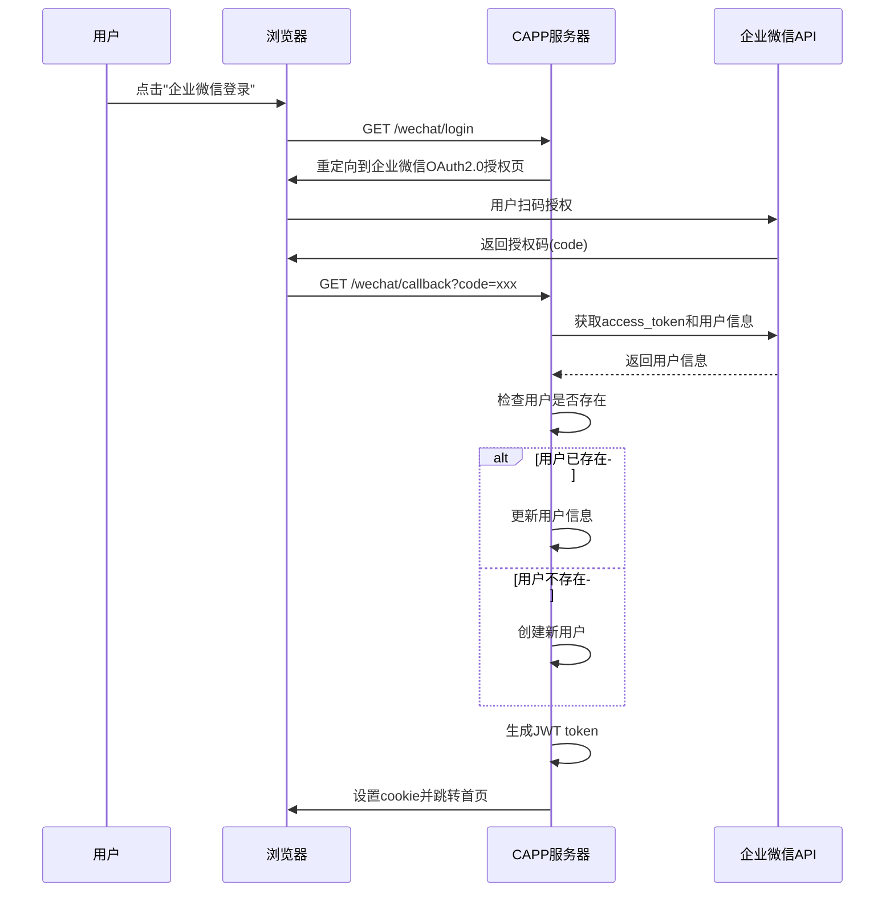
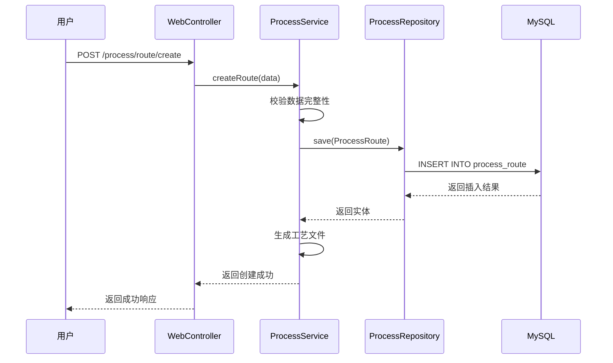
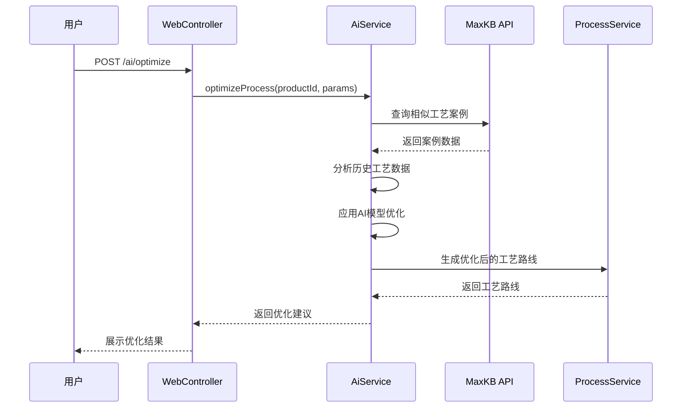

# CAPP系统架构设计文档

## 1. 架构概述

### 1.1 设计目标
本系统采用**分层架构**设计，遵循高内聚低耦合原则，确保系统的可扩展性、可维护性和可部署性。

### 1.2 架构风格
- **架构模式**：集成式单体应用（Integrated Monolith）
- **设计模式**：MVC模式、工厂模式、策略模式
- **通信方式**：RESTful API + 消息队列

### 1.3 技术选型
| 分类 | 技术 | 版本 | 说明 |
| :--- | :--- | :--- | :--- |
| 语言 | PHP | 8.0+ | 无框架原生开发 |
| 数据库 | MySQL | 8.0+ | 关系型数据库 |
| 缓存 | Redis | 6.0+ | 会话管理、数据缓存 |
| 消息队列 | RabbitMQ | 3.9+ | 异步消息处理 |
| 前端 | HTML5/JS/CSS3 | - | 原生前端开发 |
| 安全 | JWT | - | 身份认证 |

---

## 2. 系统架构图

```
┌─────────────────────────────────────────────────────────────────────────┐
│                         客户端层 (Client Layer)                          │
│  ┌─────────────┐ ┌─────────────┐ ┌─────────────┐ ┌─────────────────┐   │
│  │  Web浏览器   │ │ 企业微信    │ │ 移动端      │ │ 第三方系统      │   │
│  │  (Chrome)   │ │ 内置浏览器  │ │  H5页面     │ │ (CAXAPLM/U8/MES)│   │
│  └──────┬──────┘ └──────┬──────┘ └──────┬──────┘ └────────┬────────┘   │
└─────────┼────────────────┼────────────────┼────────────────┼─────────────┘
          │                │                │                │
          ▼                ▼                ▼                ▼
┌─────────────────────────────────────────────────────────────────────────┐
│                         接入层 (Access Layer)                            │
│  ┌─────────────────────────────────────────────────────────────────┐   │
│  │                    Nginx 反向代理                                │   │
│  │  - SSL/TLS 加密    - 负载均衡    - 请求路由    - 静态资源服务    │   │
│  └─────────────────────────────────────────────────────────────────┘   │
└─────────────────────────────────────────────────────────────────────────┘
          │
          ▼
┌─────────────────────────────────────────────────────────────────────────┐
│                         应用层 (Application Layer)                      │
│  ┌──────────────┐ ┌──────────────┐ ┌──────────────┐ ┌──────────────┐  │
│  │   Web控制器   │ │  API控制器   │ │  异步任务     │ │  消息服务     │  │
│  │  (Web层)     │ │  (API层)     │ │  (Task层)    │ │  (Message层) │  │
│  └──────┬───────┘ └──────┬───────┘ └──────┬───────┘ └──────┬───────┘  │
│         │                │                │                │          │
│         ▼                ▼                ▼                ▼          │
│  ┌─────────────────────────────────────────────────────────────────┐   │
│  │                      业务逻辑层 (Service Layer)                  │   │
│  │  ┌─────┐ ┌─────┐ ┌─────┐ ┌─────┐ ┌─────┐ ┌─────┐ ┌─────┐ ┌─────┐ │   │
│  │  │工艺 │ │物料 │ │用户 │ │AI   │ │集成 │ │审批 │ │消息 │ │系统 │ │   │
│  │  │服务 │ │服务 │ │服务 │ │服务 │ │服务 │ │服务 │ │服务 │ │服务 │ │   │
│  │  └─────┘ └─────┘ └─────┘ └─────┘ └─────┘ └─────┘ └─────┘ └─────┘ │   │
│  └─────────────────────────────────────────────────────────────────┘   │
└─────────────────────────────────────────────────────────────────────────┘
          │                │                │
          ▼                ▼                ▼
┌─────────────────────────────────────────────────────────────────────────┐
│                         数据访问层 (Data Access Layer)                   │
│  ┌─────────────────┐ ┌─────────────────┐ ┌─────────────────┐          │
│  │    MySQL ORM    │ │     Redis缓存   │ │   RabbitMQ队列  │          │
│  │  (数据持久化)   │ │  (会话/缓存)   │ │  (异步消息)     │          │
│  └─────────────────┘ └─────────────────┘ └─────────────────┘          │
└─────────────────────────────────────────────────────────────────────────┘
          │
          ▼
┌─────────────────────────────────────────────────────────────────────────┐
│                         数据存储层 (Data Storage Layer)                  │
│  ┌─────────────────┐ ┌─────────────────┐ ┌─────────────────┐          │
│  │   MySQL主库     │ │   MySQL从库     │ │    文件存储     │          │
│  │  (读写)         │ │  (只读查询)     │ │  (工艺文档)     │          │
│  └─────────────────┘ └─────────────────┘ └─────────────────┘          │
└─────────────────────────────────────────────────────────────────────────┘
```

---

## 3. 模块划分

### 3.1 模块列表

| 模块名称 | 职责描述 | 状态 |
| :--- | :--- | :--- |
| Web模块 | 前端页面渲染、用户交互 | 核心 |
| API模块 | RESTful接口、第三方系统对接 | 核心 |
| 工艺管理模块 | 工艺路线、工序、工艺文件管理 | 核心 |
| 物料管理模块 | BOM管理、物料信息维护 | 核心 |
| 用户管理模块 | 用户、角色、权限管理 | 核心 |
| 企业微信模块 | 扫码登录、用户同步、消息推送 | 核心 |
| AI模块 | AI决策、AI助手、知识库对接 | 核心 |
| 集成模块 | CAXAPLM、U8、MES对接 | 核心 |
| 消息模块 | 消息队列、异步通知 | 核心 |
| 系统模块 | 系统配置、日志管理 | 辅助 |

### 3.2 模块交互关系

```
Web模块 ──────► 工艺管理模块 ──────► 数据访问层
    │                   │
    ├─────► 用户管理模块 ├─────► Redis缓存
    │                   │
    ├─────► 企业微信模块 ├─────► 企业微信API
    │                   │
    └─────► AI模块 ──────► MaxKB API

API模块 ──────► 集成模块 ──────► CAXAPLM/U8/MES API
    │
    └─────► 消息模块 ──────► RabbitMQ
```

---

## 4. 核心组件设计

### 4.1 目录结构

```
capp/
├── src/                              # 源代码目录
│   ├── controller/                   # 控制器层
│   │   ├── WebController.php         # Web页面控制器
│   │   ├── ApiController.php         # API接口控制器
│   │   └── WechatController.php      # 企业微信控制器
│   ├── service/                      # 业务逻辑层
│   │   ├── ProcessService.php        # 工艺服务
│   │   ├── MaterialService.php       # 物料服务
│   │   ├── UserService.php           # 用户服务
│   │   ├── WechatService.php         # 企业微信服务
│   │   ├── AiService.php             # AI服务
│   │   ├── IntegrationService.php    # 集成服务
│   │   └── MessageService.php        # 消息服务
│   ├── model/                        # 数据模型层
│   │   ├── Product.php               # 产品模型
│   │   ├── Bom.php                   # BOM模型
│   │   ├── Operation.php             # 工序模型
│   │   ├── ProcessRoute.php          # 工艺路线模型
│   │   └── User.php                  # 用户模型
│   ├── repository/                   # 数据访问层
│   │   ├── BaseRepository.php        # 基础仓储
│   │   └── ProcessRepository.php     # 工艺仓储
│   ├── config/                       # 配置文件
│   │   ├── database.php              # 数据库配置
│   │   ├── wechat.php                # 企业微信配置
│   │   ├── integration.php           # 集成配置
│   │   └── ai.php                    # AI配置
│   ├── util/                         # 工具类
│   │   ├── JwtUtil.php               # JWT工具
│   │   ├── HttpClient.php            # HTTP客户端
│   │   └── Logger.php                # 日志工具
│   └── middleware/                   # 中间件
│       ├── AuthMiddleware.php        # 认证中间件
│       └── PermissionMiddleware.php  # 权限中间件
├── public/                           # 静态资源
│   ├── css/                          # 样式文件
│   ├── js/                           # JavaScript文件
│   └── index.php                     # 入口文件
├── docs/                             # 文档目录
└── vendor/                           # 第三方依赖
```

### 4.2 关键组件说明

#### 4.2.1 控制器层
| 组件 | 职责 | 关键方法 |
| :--- | :--- | :--- |
| WebController | 处理Web页面请求 | index(), list(), detail(), create(), edit() |
| ApiController | 处理API请求 | get(), post(), put(), delete() |
| WechatController | 处理企业微信请求 | login(), callback(), sync(), sendMessage() |

#### 4.2.2 服务层
| 组件 | 职责 | 关键方法 |
| :--- | :--- | :--- |
| ProcessService | 工艺业务处理 | createRoute(), updateRoute(), getRoute(), deleteRoute() |
| MaterialService | 物料业务处理 | createBom(), getBom(), compareBom(), exportBom() |
| UserService | 用户业务处理 | login(), getUser(), updateUser(), syncFromWechat() |
| WechatService | 企业微信API封装 | getAccessToken(), getUserInfo(), syncDepartment(), sendMessage() |
| AiService | AI功能封装 | optimizeProcess(), predictTime(), askQuestion(), searchKnowledge() |
| IntegrationService | 第三方系统对接 | syncFromCAXA(), syncFromU8(), syncFromMES(), sendToMES() |
| MessageService | 消息队列处理 | publish(), consume(), sendNotification() |

#### 4.2.3 数据模型层
| 组件 | 对应表 | 关键字段 |
| :--- | :--- | :--- |
| Product | product | id, name, code, type, version |
| Bom | bom | id, product_id, parent_id, material_id, quantity |
| Operation | operation | id, name, code, work_center, standard_time |
| ProcessRoute | process_route | id, product_id, version, status |
| User | user | id, username, wechat_id, role_id, department_id |

---

## 5. 关键业务流程

### 5.1 企业微信扫码登录流程



### 5.2 工艺路线创建流程



### 5.3 AI工艺优化流程



---

## 6. 部署架构

### 6.1 服务器配置

| 服务器类型 | 配置 | 数量 | 用途 |
| :--- | :--- | :--- | :--- |
| 应用服务器 | 8核16G | 2 | 运行PHP应用 |
| 数据库服务器 | 16核32G | 2 | MySQL主从 |
| 缓存服务器 | 4核8G | 1 | Redis缓存 |
| 消息队列服务器 | 4核8G | 1 | RabbitMQ |

### 6.2 网络拓扑

```
                    ┌──────────────────────┐
                    │      防火墙          │
                    └──────────┬───────────┘
                               │
                    ┌──────────▼───────────┐
                    │     Nginx负载均衡     │
                    └──────────┬───────────┘
                               │
         ┌─────────────────────┼─────────────────────┐
         ▼                     ▼                     ▼
    ┌─────────┐           ┌─────────┐           ┌─────────┐
    │ 应用服务器1 │           │ 应用服务器2 │           │ 静态资源服务器 │
    └─────┬─────┘           └─────┬─────┘           └─────────┘
          │                       │
          └───────────┬───────────┘
                      ▼
         ┌─────────────────────────────┐
         │         MySQL主从           │
         │  ┌───────┐    ┌───────┐    │
         │  │ 主库  │───▶│ 从库  │    │
         │  └───────┘    └───────┘    │
         └─────────────────────────────┘
                      │
          ┌───────────┼───────────┐
          ▼           ▼           ▼
       ┌─────┐    ┌───────┐    ┌───────┐
       │Redis│    │RabbitMQ│    │ 文件存储 │
       └─────┘    └───────┘    └───────┘
```

---

## 7. 安全设计

### 7.1 认证机制
- **JWT令牌**：无状态认证，有效期2小时
- **刷新令牌**：存储在Redis，有效期7天
- **会话管理**：支持强制下线、单点登录

### 7.2 权限控制
- **RBAC模型**：基于角色的访问控制
- **细粒度权限**：支持到按钮级别的权限控制
- **权限继承**：角色继承上级权限

### 7.3 数据安全
- **传输加密**：HTTPS/TLS 1.2+
- **存储加密**：敏感字段AES-256加密
- **输入校验**：参数过滤、SQL注入防护

---

## 8. 扩展性设计

### 8.1 模块扩展
- **插件机制**：支持动态加载业务模块
- **接口标准化**：统一API接口规范

### 8.2 数据扩展
- **数据字典**：可配置的数据项
- **自定义字段**：支持扩展实体字段

### 8.3 系统扩展
- **水平扩展**：支持多节点部署
- **读写分离**：数据库主从架构
