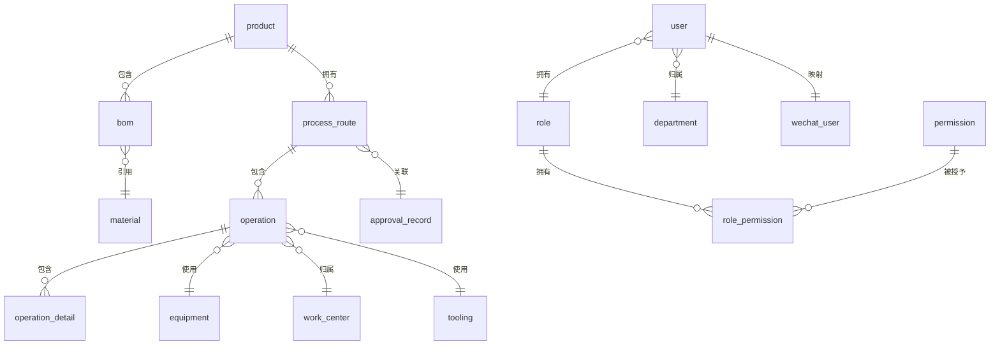

# CAPP系统数据库设计文档

## 1. 数据库概述

### 1.1 数据库选型
- **数据库类型**：MySQL 8.0+
- **存储引擎**：InnoDB（支持事务、外键约束）
- **字符集**：UTF-8mb4（支持emoji等特殊字符）

### 1.2 设计原则
- **第三范式**：确保数据规范化，减少冗余
- **主键设计**：使用自增主键
- **索引策略**：合理创建索引优化查询性能
- **事务支持**：关键业务操作使用事务

---

## 2. 数据库表设计

### 2.1 表清单

| 表名 | 中文名称 | 说明 |
| :--- | :--- | :--- |
| `product` | 产品表 | 产品基本信息 |
| `product_version` | 产品版本表 | 产品版本管理 |
| `bom` | 物料清单表 | BOM结构数据 |
| `material` | 物料表 | 物料基本信息 |
| `process_route` | 工艺路线表 | 工艺路线主表 |
| `operation` | 工序表 | 工序详细信息 |
| `operation_detail` | 工序明细表 | 工步信息 |
| `equipment` | 设备表 | 设备信息 |
| `work_center` | 工作中心表 | 车间/工位信息 |
| `tooling` | 工装夹具表 | 工装夹具信息 |
| `user` | 用户表 | 用户基本信息 |
| `role` | 角色表 | 角色定义 |
| `permission` | 权限表 | 权限定义 |
| `role_permission` | 角色权限关联表 | 角色权限映射 |
| `wechat_user` | 企业微信用户映射表 | 企业微信用户关联 |
| `department` | 部门表 | 部门信息 |
| `approval_flow` | 审批流程表 | 审批流程定义 |
| `approval_record` | 审批记录表 | 审批记录 |
| `message` | 消息表 | 消息记录 |
| `system_log` | 系统日志表 | 操作日志 |
| `sync_record` | 同步记录表 | 数据同步记录 |

---

### 2.2 核心表结构设计

#### 2.2.1 product（产品表）

| 字段名 | 类型 | 约束 | 说明 |
| :--- | :--- | :--- | :--- |
| `id` | INT | PRIMARY KEY AUTO_INCREMENT | 产品ID |
| `code` | VARCHAR(64) | NOT NULL UNIQUE | 产品编码 |
| `name` | VARCHAR(255) | NOT NULL | 产品名称 |
| `type` | VARCHAR(32) | NOT NULL | 产品类型（工业压缩机/压力容器） |
| `specification` | VARCHAR(512) | | 产品规格 |
| `status` | TINYINT | DEFAULT 1 | 状态（0-停用，1-启用） |
| `created_at` | DATETIME | DEFAULT CURRENT_TIMESTAMP | 创建时间 |
| `updated_at` | DATETIME | DEFAULT CURRENT_TIMESTAMP ON UPDATE CURRENT_TIMESTAMP | 更新时间 |

**索引**：`idx_code` (code), `idx_type` (type)

#### 2.2.2 bom（物料清单表）

| 字段名 | 类型 | 约束 | 说明 |
| :--- | :--- | :--- | :--- |
| `id` | INT | PRIMARY KEY AUTO_INCREMENT | BOM ID |
| `product_id` | INT | NOT NULL FOREIGN KEY | 产品ID |
| `product_version` | VARCHAR(32) | NOT NULL | 产品版本 |
| `parent_id` | INT | DEFAULT 0 | 父节点ID（0表示根节点） |
| `material_id` | INT | NOT NULL FOREIGN KEY | 物料ID |
| `quantity` | DECIMAL(18,4) | NOT NULL | 数量 |
| `unit` | VARCHAR(16) | | 单位 |
| `level` | TINYINT | NOT NULL | BOM层级 |
| `sequence` | INT | DEFAULT 0 | 排序序号 |
| `status` | TINYINT | DEFAULT 1 | 状态 |
| `created_at` | DATETIME | DEFAULT CURRENT_TIMESTAMP | 创建时间 |
| `updated_at` | DATETIME | DEFAULT CURRENT_TIMESTAMP ON UPDATE CURRENT_TIMESTAMP | 更新时间 |

**索引**：`idx_product` (product_id, product_version), `idx_parent` (parent_id)

#### 2.2.3 material（物料表）

| 字段名 | 类型 | 约束 | 说明 |
| :--- | :--- | :--- | :--- |
| `id` | INT | PRIMARY KEY AUTO_INCREMENT | 物料ID |
| `code` | VARCHAR(64) | NOT NULL UNIQUE | 物料编码 |
| `name` | VARCHAR(255) | NOT NULL | 物料名称 |
| `type` | VARCHAR(32) | | 物料类型 |
| `specification` | VARCHAR(512) | | 规格型号 |
| `unit` | VARCHAR(16) | | 单位 |
| `material_group` | VARCHAR(64) | | 物料组 |
| `status` | TINYINT | DEFAULT 1 | 状态 |
| `created_at` | DATETIME | DEFAULT CURRENT_TIMESTAMP | 创建时间 |
| `updated_at` | DATETIME | DEFAULT CURRENT_TIMESTAMP ON UPDATE CURRENT_TIMESTAMP | 更新时间 |

**索引**：`idx_code` (code), `idx_material_group` (material_group)

#### 2.2.4 process_route（工艺路线表）

| 字段名 | 类型 | 约束 | 说明 |
| :--- | :--- | :--- | :--- |
| `id` | INT | PRIMARY KEY AUTO_INCREMENT | 工艺路线ID |
| `product_id` | INT | NOT NULL FOREIGN KEY | 产品ID |
| `product_version` | VARCHAR(32) | NOT NULL | 产品版本 |
| `route_code` | VARCHAR(64) | NOT NULL UNIQUE | 工艺路线编码 |
| `name` | VARCHAR(255) | NOT NULL | 工艺路线名称 |
| `description` | TEXT | | 描述 |
| `status` | TINYINT | DEFAULT 0 | 状态（0-草稿，1-审核中，2-已通过，3-已驳回） |
| `approval_id` | INT | FOREIGN KEY | 审批记录ID |
| `created_by` | INT | NOT NULL FOREIGN KEY | 创建人ID |
| `created_at` | DATETIME | DEFAULT CURRENT_TIMESTAMP | 创建时间 |
| `updated_at` | DATETIME | DEFAULT CURRENT_TIMESTAMP ON UPDATE CURRENT_TIMESTAMP | 更新时间 |

**索引**：`idx_product` (product_id, product_version), `idx_status` (status)

#### 2.2.5 operation（工序表）

| 字段名 | 类型 | 约束 | 说明 |
| :--- | :--- | :--- | :--- |
| `id` | INT | PRIMARY KEY AUTO_INCREMENT | 工序ID |
| `route_id` | INT | NOT NULL FOREIGN KEY | 工艺路线ID |
| `code` | VARCHAR(64) | NOT NULL | 工序编码 |
| `name` | VARCHAR(255) | NOT NULL | 工序名称 |
| `work_center_id` | INT | FOREIGN KEY | 工作中心ID |
| `equipment_id` | INT | FOREIGN KEY | 设备ID |
| `sequence` | INT | NOT NULL | 工序顺序 |
| `standard_time` | DECIMAL(10,2) | | 标准工时(小时) |
| `setup_time` | DECIMAL(10,2) | | 准备工时(小时) |
| `machine_time` | DECIMAL(10,2) | | 加工工时(小时) |
| `description` | TEXT | | 工序描述 |
| `inspection_required` | TINYINT | DEFAULT 0 | 是否需要检验（0-否，1-是） |
| `created_at` | DATETIME | DEFAULT CURRENT_TIMESTAMP | 创建时间 |
| `updated_at` | DATETIME | DEFAULT CURRENT_TIMESTAMP ON UPDATE CURRENT_TIMESTAMP | 更新时间 |

**索引**：`idx_route` (route_id), `idx_sequence` (route_id, sequence)

#### 2.2.6 operation_detail（工序明细表）

| 字段名 | 类型 | 约束 | 说明 |
| :--- | :--- | :--- | :--- |
| `id` | INT | PRIMARY KEY AUTO_INCREMENT | 工步ID |
| `operation_id` | INT | NOT NULL FOREIGN KEY | 工序ID |
| `sequence` | INT | NOT NULL | 工步顺序 |
| `name` | VARCHAR(255) | NOT NULL | 工步名称 |
| `content` | TEXT | | 工步内容 |
| `tooling_id` | INT | FOREIGN KEY | 工装夹具ID |
| `feed_rate` | DECIMAL(10,2) | | 进给速度 |
| `spindle_speed` | DECIMAL(10,2) | | 主轴转速 |
| `cutting_depth` | DECIMAL(10,4) | | 切削深度 |
| `time_consuming` | DECIMAL(10,2) | | 耗时(分钟) |

**索引**：`idx_operation` (operation_id), `idx_sequence` (operation_id, sequence)

#### 2.2.7 user（用户表）

| 字段名 | 类型 | 约束 | 说明 |
| :--- | :--- | :--- | :--- |
| `id` | INT | PRIMARY KEY AUTO_INCREMENT | 用户ID |
| `username` | VARCHAR(64) | NOT NULL UNIQUE | 用户名 |
| `password` | VARCHAR(255) | | 密码（加密存储） |
| `real_name` | VARCHAR(64) | | 真实姓名 |
| `email` | VARCHAR(128) | | 邮箱 |
| `phone` | VARCHAR(32) | | 手机号 |
| `department_id` | INT | FOREIGN KEY | 部门ID |
| `role_id` | INT | FOREIGN KEY | 角色ID |
| `status` | TINYINT | DEFAULT 1 | 状态（0-禁用，1-启用） |
| `last_login_at` | DATETIME | | 最后登录时间 |
| `created_at` | DATETIME | DEFAULT CURRENT_TIMESTAMP | 创建时间 |
| `updated_at` | DATETIME | DEFAULT CURRENT_TIMESTAMP ON UPDATE CURRENT_TIMESTAMP | 更新时间 |

**索引**：`idx_username` (username), `idx_department` (department_id), `idx_role` (role_id)

#### 2.2.8 wechat_user（企业微信用户映射表）

| 字段名 | 类型 | 约束 | 说明 |
| :--- | :--- | :--- | :--- |
| `id` | INT | PRIMARY KEY AUTO_INCREMENT | ID |
| `user_id` | INT | NOT NULL UNIQUE FOREIGN KEY | 系统用户ID |
| `wechat_userid` | VARCHAR(128) | NOT NULL UNIQUE | 企业微信用户ID |
| `wechat_name` | VARCHAR(64) | | 企业微信名称 |
| `wechat_department` | TEXT | | 企业微信部门（JSON） |
| `wechat_position` | VARCHAR(64) | | 企业微信职位 |
| `avatar` | VARCHAR(512) | | 头像URL |
| `sync_time` | DATETIME | | 最后同步时间 |

**索引**：`idx_wechat_userid` (wechat_userid)

#### 2.2.9 role（角色表）

| 字段名 | 类型 | 约束 | 说明 |
| :--- | :--- | :--- | :--- |
| `id` | INT | PRIMARY KEY AUTO_INCREMENT | 角色ID |
| `name` | VARCHAR(64) | NOT NULL UNIQUE | 角色名称 |
| `code` | VARCHAR(64) | NOT NULL UNIQUE | 角色编码 |
| `description` | VARCHAR(255) | | 角色描述 |
| `status` | TINYINT | DEFAULT 1 | 状态 |
| `created_at` | DATETIME | DEFAULT CURRENT_TIMESTAMP | 创建时间 |

#### 2.2.10 permission（权限表）

| 字段名 | 类型 | 约束 | 说明 |
| :--- | :--- | :--- | :--- |
| `id` | INT | PRIMARY KEY AUTO_INCREMENT | 权限ID |
| `name` | VARCHAR(64) | NOT NULL | 权限名称 |
| `code` | VARCHAR(128) | NOT NULL UNIQUE | 权限编码 |
| `module` | VARCHAR(64) | | 所属模块 |
| `action` | VARCHAR(64) | | 操作类型 |
| `description` | VARCHAR(255) | | 权限描述 |

**索引**：`idx_code` (code), `idx_module` (module)

#### 2.2.11 role_permission（角色权限关联表）

| 字段名 | 类型 | 约束 | 说明 |
| :--- | :--- | :--- | :--- |
| `role_id` | INT | NOT NULL FOREIGN KEY | 角色ID |
| `permission_id` | INT | NOT NULL FOREIGN KEY | 权限ID |

**主键**：(role_id, permission_id)

#### 2.2.12 department（部门表）

| 字段名 | 类型 | 约束 | 说明 |
| :--- | :--- | :--- | :--- |
| `id` | INT | PRIMARY KEY AUTO_INCREMENT | 部门ID |
| `name` | VARCHAR(64) | NOT NULL | 部门名称 |
| `code` | VARCHAR(64) | NOT NULL UNIQUE | 部门编码 |
| `parent_id` | INT | DEFAULT 0 | 父部门ID |
| `wechat_department_id` | VARCHAR(64) | | 企业微信部门ID |
| `status` | TINYINT | DEFAULT 1 | 状态 |
| `created_at` | DATETIME | DEFAULT CURRENT_TIMESTAMP | 创建时间 |

**索引**：`idx_parent` (parent_id), `idx_wechat_id` (wechat_department_id)

#### 2.2.13 equipment（设备表）

| 字段名 | 类型 | 约束 | 说明 |
| :--- | :--- | :--- | :--- |
| `id` | INT | PRIMARY KEY AUTO_INCREMENT | 设备ID |
| `code` | VARCHAR(64) | NOT NULL UNIQUE | 设备编码 |
| `name` | VARCHAR(255) | NOT NULL | 设备名称 |
| `model` | VARCHAR(128) | | 设备型号 |
| `work_center_id` | INT | FOREIGN KEY | 工作中心ID |
| `status` | TINYINT | DEFAULT 1 | 状态（0-停用，1-正常，2-维护，3-故障） |
| `capacity` | VARCHAR(128) | | 设备能力 |
| `purchase_date` | DATE | | 采购日期 |
| `created_at` | DATETIME | DEFAULT CURRENT_TIMESTAMP | 创建时间 |
| `updated_at` | DATETIME | DEFAULT CURRENT_TIMESTAMP ON UPDATE CURRENT_TIMESTAMP | 更新时间 |

**索引**：`idx_work_center` (work_center_id), `idx_status` (status)

#### 2.2.14 approval_record（审批记录表）

| 字段名 | 类型 | 约束 | 说明 |
| :--- | :--- | :--- | :--- |
| `id` | INT | PRIMARY KEY AUTO_INCREMENT | 审批记录ID |
| `flow_id` | INT | FOREIGN KEY | 审批流程ID |
| `target_type` | VARCHAR(32) | NOT NULL | 审批对象类型 |
| `target_id` | INT | NOT NULL | 审批对象ID |
| `current_node` | INT | | 当前审批节点 |
| `status` | TINYINT | DEFAULT 0 | 状态（0-待审批，1-审批中，2-已通过，3-已驳回） |
| `created_by` | INT | NOT NULL FOREIGN KEY | 申请人ID |
| `created_at` | DATETIME | DEFAULT CURRENT_TIMESTAMP | 创建时间 |
| `updated_at` | DATETIME | DEFAULT CURRENT_TIMESTAMP ON UPDATE CURRENT_TIMESTAMP | 更新时间 |

**索引**：`idx_target` (target_type, target_id), `idx_status` (status)

#### 2.2.15 message（消息表）

| 字段名 | 类型 | 约束 | 说明 |
| :--- | :--- | :--- | :--- |
| `id` | INT | PRIMARY KEY AUTO_INCREMENT | 消息ID |
| `type` | VARCHAR(32) | NOT NULL | 消息类型 |
| `title` | VARCHAR(255) | | 消息标题 |
| `content` | TEXT | | 消息内容 |
| `receiver_id` | INT | NOT NULL FOREIGN KEY | 接收人ID |
| `sender_id` | INT | FOREIGN KEY | 发送人ID |
| `is_read` | TINYINT | DEFAULT 0 | 是否已读 |
| `send_time` | DATETIME | | 发送时间 |
| `created_at` | DATETIME | DEFAULT CURRENT_TIMESTAMP | 创建时间 |

**索引**：`idx_receiver` (receiver_id), `idx_is_read` (is_read)

#### 2.2.16 sync_record（同步记录表）

| 字段名 | 类型 | 约束 | 说明 |
| :--- | :--- | :--- | :--- |
| `id` | INT | PRIMARY KEY AUTO_INCREMENT | 记录ID |
| `sync_type` | VARCHAR(32) | NOT NULL | 同步类型（CAXA/U8/MES/Wechat） |
| `status` | TINYINT | NOT NULL | 状态（0-失败，1-成功） |
| `sync_count` | INT | DEFAULT 0 | 同步数量 |
| `error_message` | TEXT | | 错误信息 |
| `sync_time` | DATETIME | DEFAULT CURRENT_TIMESTAMP | 同步时间 |

**索引**：`idx_sync_type` (sync_type), `idx_sync_time` (sync_time)

---

## 3. 数据库关系图



---

## 4. 数据字典

### 4.1 产品类型（product.type）
| 值 | 说明 |
| :--- | :--- |
| diaphragm_compressor | 工业压缩机 |
| high_pressure_vessel | 高压容器 |
| medium_pressure_vessel | 中压容器 |
| low_pressure_vessel | 低压容器 |
| special_vessel | 特种容器 |

### 4.2 工序类型（operation.type）
| 值 | 说明 |
| :--- | :--- |
| machining | 机加工 |
| welding | 焊接 |
| assembly | 装配 |
| inspection | 检验 |
| heat_treatment | 热处理 |
| surface_treatment | 表面处理 |

### 4.3 审批状态（approval_record.status）
| 值 | 说明 |
| :--- | :--- |
| 0 | 待审批 |
| 1 | 审批中 |
| 2 | 已通过 |
| 3 | 已驳回 |

### 4.4 设备状态（equipment.status）
| 值 | 说明 |
| :--- | :--- |
| 0 | 停用 |
| 1 | 正常 |
| 2 | 维护 |
| 3 | 故障 |

---

## 5. 索引优化建议

### 5.1 复合索引
- `bom`: (product_id, product_version, parent_id)
- `operation`: (route_id, sequence)
- `user`: (department_id, role_id)
- `message`: (receiver_id, is_read, created_at)

### 5.2 单列索引
- `product`: code, type
- `material`: code, material_group
- `process_route`: status
- `wechat_user`: wechat_userid

---

## 6. 数据备份与恢复

### 6.1 备份策略
- **每日备份**：凌晨2:00执行全量备份
- **增量备份**：每小时执行增量备份
- **备份保留**：保留最近30天备份

### 6.2 备份命令示例
```sql
-- 全量备份
mysqldump -u root -p capp_db > /backup/capp_db_full_$(date +%Y%m%d).sql

-- 增量备份（需开启binlog）
mysqlbinlog --start-datetime="2024-01-01 00:00:00" --stop-datetime="2024-01-02 00:00:00" > /backup/capp_db_inc_$(date +%Y%m%d).sql
```

---

## 附录：ER图详细说明

```mermaid
erDiagram
    product {
        int id PK
        varchar code UK
        varchar name
        varchar type
        varchar specification
        tinyint status
        datetime created_at
        datetime updated_at
    }
    
    bom {
        int id PK
        int product_id FK
        varchar product_version
        int parent_id
        int material_id FK
        decimal quantity
        varchar unit
        tinyint level
        int sequence
        tinyint status
        datetime created_at
        datetime updated_at
    }
    
    material {
        int id PK
        varchar code UK
        varchar name
        varchar type
        varchar specification
        varchar unit
        varchar material_group
        tinyint status
        datetime created_at
        datetime updated_at
    }
    
    process_route {
        int id PK
        int product_id FK
        varchar product_version
        varchar route_code UK
        varchar name
        text description
        tinyint status
        int approval_id FK
        int created_by FK
        datetime created_at
        datetime updated_at
    }
    
    operation {
        int id PK
        int route_id FK
        varchar code
        varchar name
        int work_center_id FK
        int equipment_id FK
        int sequence
        decimal standard_time
        decimal setup_time
        decimal machine_time
        text description
        tinyint inspection_required
        datetime created_at
        datetime updated_at
    }
    
    user {
        int id PK
        varchar username UK
        varchar password
        varchar real_name
        varchar email
        varchar phone
        int department_id FK
        int role_id FK
        tinyint status
        datetime last_login_at
        datetime created_at
        datetime updated_at
    }
    
    role {
        int id PK
        varchar name UK
        varchar code UK
        varchar description
        tinyint status
        datetime created_at
    }
    
    permission {
        int id PK
        varchar name
        varchar code UK
        varchar module
        varchar action
        varchar description
    }
    
    role_permission {
        int role_id FK
        int permission_id FK
    }
    
    wechat_user {
        int id PK
        int user_id FK UK
        varchar wechat_userid UK
        varchar wechat_name
        text wechat_department
        varchar wechat_position
        varchar avatar
        datetime sync_time
    }
```
