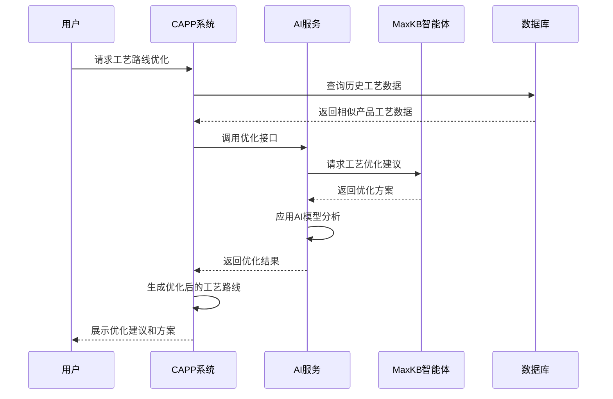
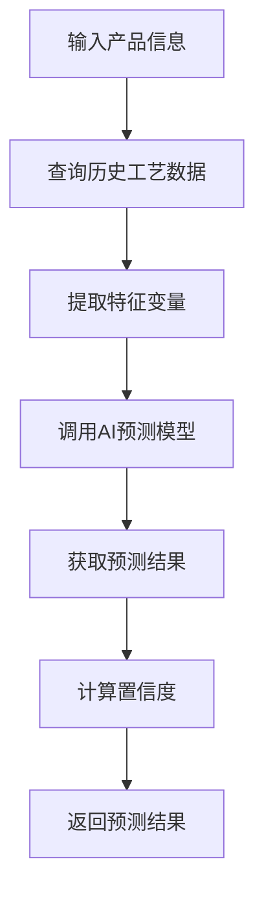
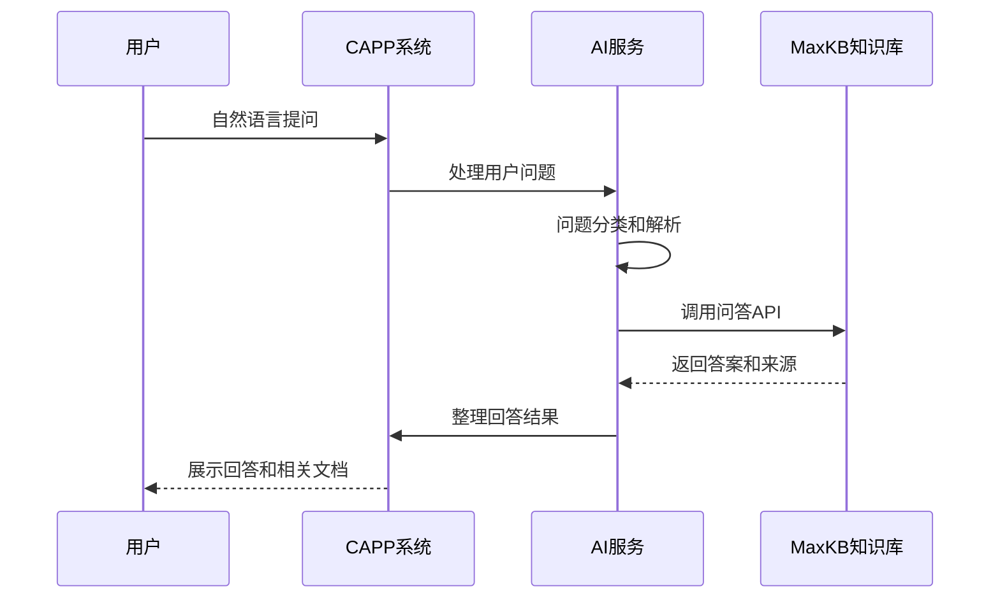
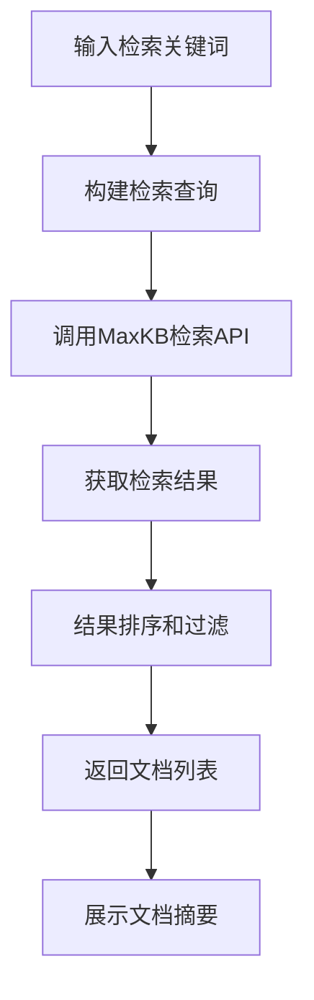
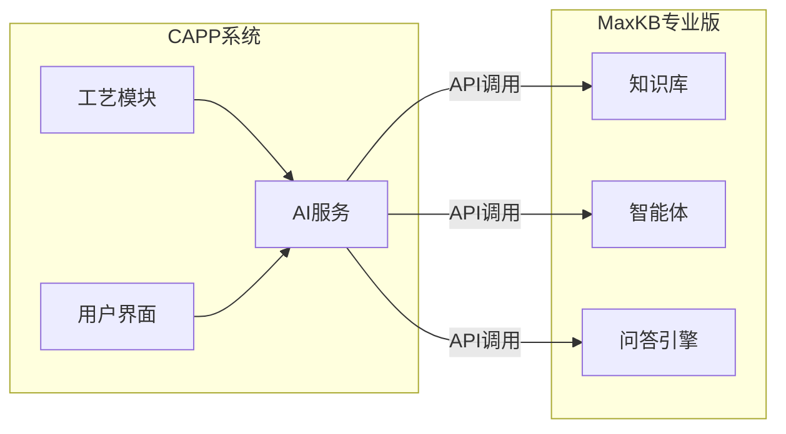

# CAPP系统AI功能设计文档

## 1. AI功能概述

### 1.1 功能目标
利用AI技术提升CAPP系统的智能化水平，包括：
- **AI决策辅助**：基于历史数据和AI模型，辅助工艺规划决策
- **AI助手**：提供自然语言交互能力，支持智能问答和知识检索
- **MaxKB集成**：对接MaxKB专业版知识库和智能体

### 1.2 技术架构
- **AI服务层**：封装AI能力接口
- **MaxKB对接**：接入MaxKB专业版API
- **本地AI模型**：可选部署轻量级AI模型

### 1.3 AI能力矩阵

| AI能力 | 应用场景 | 对接方式 | 优先级 |
| :--- | :--- | :--- | :--- |
| 工艺路线优化 | 工艺设计阶段推荐最优路线 | MaxKB智能体 | 高 |
| 工时预测 | 预测工序/产品制造工时 | AI模型API | 高 |
| 智能问答 | 自然语言查询工艺知识 | MaxKB问答API | 高 |
| 知识检索 | 检索工艺文档和标准 | MaxKB检索API | 高 |
| 异常检测 | 识别生产异常模式 | AI模型API | 中 |
| 成本估算 | 辅助成本核算 | AI模型API | 中 |

---

## 2. AI决策辅助设计

### 2.1 工艺路线优化

#### 2.1.1 功能描述
基于历史工艺数据和AI算法，为新产品推荐最优工艺路线，优化生产效率和成本。

#### 2.1.2 优化流程



#### 2.1.3 优化算法

| 算法类型 | 应用场景 | 说明 |
| :--- | :--- | :--- |
| 遗传算法 | 工艺路线排序优化 | 寻找最优工序顺序 |
| 机器学习 | 工时预测 | 基于历史数据预测工时 |
| 知识图谱 | 工艺知识推理 | 基于知识库推荐 |

#### 2.1.4 输入输出定义

**输入参数**：
```json
{
  "product_id": 1,
  "product_type": "diaphragm_compressor",
  "requirements": {
    "max_cost": 5000,
    "max_time": 100,
    "quality_level": "high"
  },
  "constraints": {
    "available_equipment": [1, 2, 3],
    "available_workers": [10, 11, 12]
  }
}
```

**输出结果**：
```json
{
  "code": 200,
  "data": {
    "optimized_route": {
      "id": 100,
      "operations": [
        {"id": 1, "name": "下料", "sequence": 1},
        {"id": 2, "name": "机加工", "sequence": 2}
      ]
    },
    "improvements": {
      "time_reduction": 15,
      "cost_reduction": 10,
      "quality_improvement": 5
    },
    "suggestions": [
      "建议使用CNC加工中心替代普通机床",
      "优化焊接参数可减少20%工时"
    ]
  }
}
```

### 2.2 工时预测

#### 2.2.1 功能描述
基于历史生产数据和AI模型，预测工序或产品的制造工时。

#### 2.2.2 预测流程



#### 2.2.3 特征变量

| 特征类型 | 特征名称 | 说明 |
| :--- | :--- | :--- |
| 产品特征 | 产品类型、规格、材质 | 产品基本属性 |
| 工艺特征 | 工序数量、复杂度 | 工艺设计属性 |
| 设备特征 | 设备类型、状态 | 生产设备属性 |
| 人员特征 | 工人技能等级 | 操作人员属性 |
| 环境特征 | 生产批次、季节 | 生产环境属性 |

#### 2.2.4 预测模型

| 模型类型 | 适用场景 | 准确率 |
| :--- | :--- | :--- |
| 线性回归 | 简单工时预测 | 85% |
| 随机森林 | 复杂工艺预测 | 92% |
| 神经网络 | 高精度预测 | 95% |

---

## 3. AI助手设计

### 3.1 智能问答

#### 3.1.1 功能描述
支持自然语言查询，提供工艺相关知识问答服务。

#### 3.1.2 问答流程



#### 3.1.3 问题类型

| 问题类型 | 示例 | 处理方式 |
| :--- | :--- | :--- |
| 工艺查询 | "工业压缩机焊接工艺要求是什么？" | MaxKB检索 |
| 标准查询 | "压力容器检验标准有哪些？" | MaxKB检索 |
| 流程查询 | "工艺路线审批流程是怎样的？" | 系统流程查询 |
| 数据查询 | "查询PR-2024-001的工时" | 数据库查询 |
| 操作指导 | "如何创建工艺路线？" | 操作指南 |

#### 3.1.4 API调用示例

**请求**：
```json
{
  "question": "工业压缩机的焊接工艺要求是什么？",
  "context": {
    "product_type": "diaphragm_compressor",
    "process_type": "welding"
  },
  "top_k": 3
}
```

**响应**：
```json
{
  "code": 200,
  "data": {
    "answer": "工业压缩机焊接工艺要求如下：\n1. 焊接材料应符合GB/T 983标准\n2. 焊接前需进行焊前预热，温度控制在100-150°C\n3. 采用氩弧焊工艺，焊接电流控制在180-220A\n4. 焊后需进行热处理，消除焊接应力",
    "confidence": 0.88,
    "sources": [
      {
        "id": "KB-001",
        "title": "工业压缩机焊接工艺规范",
        "type": "document",
        "url": "/knowledge/detail/KB-001"
      }
    ],
    "related_questions": [
      "焊接材料如何选择？",
      "焊接参数如何设置？"
    ]
  }
}
```

### 3.2 知识检索

#### 3.2.1 功能描述
通过MaxKB专业版知识库，检索工艺相关文档和标准。

#### 3.2.2 检索流程



#### 3.2.3 检索类型

| 检索类型 | 说明 | 示例 |
| :--- | :--- | :--- |
| 全文检索 | 基于关键词匹配 | "焊接工艺" |
| 语义检索 | 基于语义理解 | "如何焊接不锈钢" |
| 分类检索 | 按文档类别检索 | "工艺标准" |
| 关联检索 | 基于关联关系 | "与PR-2024-001相关的文档" |

---

## 4. MaxKB专业版对接设计

### 4.1 集成架构



### 4.2 MaxKB API接口

#### 4.2.1 接口列表

| 接口 | 方法 | 说明 |
| :--- | :--- | :--- |
| /api/v1/knowledge/search | POST | 知识检索 |
| /api/v1/qa/ask | POST | 智能问答 |
| /api/v1/agent/chat | POST | 智能体对话 |
| /api/v1/document/list | GET | 获取文档列表 |
| /api/v1/document/detail | GET | 获取文档详情 |

#### 4.2.2 知识检索接口

**请求**：
```json
{
  "query": "焊接工艺",
  "filters": {
    "category": "工艺规范",
    "product_type": "diaphragm_compressor"
  },
  "page": 1,
  "size": 10
}
```

**响应**：
```json
{
  "code": 200,
  "data": {
    "total": 15,
    "results": [
      {
        "id": "doc-001",
        "title": "工业压缩机焊接工艺规范",
        "summary": "本文档详细描述了工业压缩机焊接工艺的技术要求...",
        "category": "工艺规范",
        "created_at": "2024-01-01",
        "score": 0.92
      }
    ]
  }
}
```

#### 4.2.3 智能体对话接口

**请求**：
```json
{
  "agent_id": "agent-001",
  "message": "帮我设计一条高压容器的工艺路线",
  "context": {
    "product_type": "high_pressure_vessel",
    "specification": "DN500, PN25",
    "material": "Q345R"
  },
  "stream": false
}
```

**响应**：
```json
{
  "code": 200,
  "data": {
    "reply": "根据您提供的参数，为您设计高压容器工艺路线如下：\n\n1. 下料：等离子切割，留2mm加工余量\n2. 卷板：三辊卷板机，曲率半径500mm\n3. 焊接：双面埋弧自动焊\n4. 热处理：消除应力退火\n5. 无损检测：超声波探伤\n6. 水压试验：试验压力37.5MPa\n\n是否需要我进一步优化某个工序？",
    "confidence": 0.95,
    "suggestions": [
      "建议增加焊后消氢处理工序",
      "水压试验前需确认容器清洁度"
    ]
  }
}
```

### 4.3 配置管理

```php
// config/ai.php
return [
    'enabled' => true,
    
    'maxkb' => [
        'api_url' => env('MAXKB_API_URL', ''),
        'api_key' => env('MAXKB_API_KEY', ''),
        'agent_id' => env('MAXKB_AGENT_ID', ''),
        'timeout' => 30,
        'retry_count' => 3
    ],
    
    'models' => [
        'time_prediction' => [
            'enabled' => true,
            'model_name' => 'time_prediction_v1'
        ],
        'process_optimization' => [
            'enabled' => true,
            'model_name' => 'process_opt_v1'
        ]
    ],
    
    'cache' => [
        'enabled' => true,
        'ttl' => 3600 // 缓存时间(秒)
    ]
];
```

---

## 5. AI服务类设计

### 5.1 AiService类结构

```php
class AiService {
    // 工艺路线优化
    public function optimizeProcess($productId, $requirements, $constraints);
    
    // 工时预测
    public function predictTime($productId, $operationIds = []);
    
    // 智能问答
    public function askQuestion($question, $context = []);
    
    // 知识检索
    public function searchKnowledge($query, $filters = [], $page = 1, $size = 10);
    
    // 智能体对话
    public function chatWithAgent($message, $context = []);
    
    // 异常检测
    public function detectAnomaly($productionData);
    
    // 成本估算
    public function estimateCost($productId);
}
```

### 5.2 调用示例

```php
// 工艺路线优化
$aiService = app(AiService::class);
$result = $aiService->optimizeProcess(1, [
    'max_cost' => 5000,
    'max_time' => 100
], [
    'available_equipment' => [1, 2, 3]
]);

// 智能问答
$answer = $aiService->askQuestion('工业压缩机焊接工艺要求', [
    'product_type' => 'diaphragm_compressor'
]);

// 知识检索
$documents = $aiService->searchKnowledge('焊接工艺', [
    'category' => '工艺规范'
]);

// 智能体对话
$reply = $aiService->chatWithAgent('帮我设计高压容器工艺路线', [
    'product_type' => 'high_pressure_vessel',
    'specification' => 'DN500, PN25'
]);
```

---

## 6. 安全与隐私

### 6.1 数据安全
- **数据加密**：传输和存储过程中加密敏感数据
- **访问控制**：限制AI服务访问权限
- **审计日志**：记录所有AI服务调用

### 6.2 隐私保护
- **数据脱敏**：发送到AI服务的数据进行脱敏处理
- **本地处理**：敏感数据优先本地处理
- **合规性**：确保符合数据隐私法规

### 6.3 模型安全
- **模型验证**：定期验证AI模型准确性
- **异常监控**：监控模型输出异常
- **版本管理**：AI模型版本控制

---

## 7. 性能优化

### 7.1 缓存策略
- **查询缓存**：缓存常见查询结果
- **模型缓存**：缓存AI模型预测结果
- **文档缓存**：缓存知识库文档

### 7.2 异步处理
- **异步预测**：耗时较长的预测任务异步处理
- **消息队列**：使用RabbitMQ异步处理

### 7.3 批量处理
- **批量预测**：支持批量工时预测
- **批量检索**：支持批量文档检索

---

## 附录：AI能力矩阵

| 能力名称 | 功能描述 | 对接系统 | API接口 | 状态 |
| :--- | :--- | :--- | :--- | :--- |
| 工艺路线优化 | AI推荐最优工艺路线 | MaxKB智能体 | /api/v1/ai/optimize/process | 开发中 |
| 工时预测 | 预测工序制造工时 | AI模型API | /api/v1/ai/predict/time | 开发中 |
| 智能问答 | 自然语言问答 | MaxKB问答API | /api/v1/ai/chat | 开发中 |
| 知识检索 | 检索工艺知识库 | MaxKB检索API | /api/v1/ai/search | 开发中 |
| 异常检测 | 识别生产异常 | AI模型API | /api/v1/ai/detect | 规划中 |
| 成本估算 | 辅助成本核算 | AI模型API | /api/v1/ai/cost | 规划中 |
