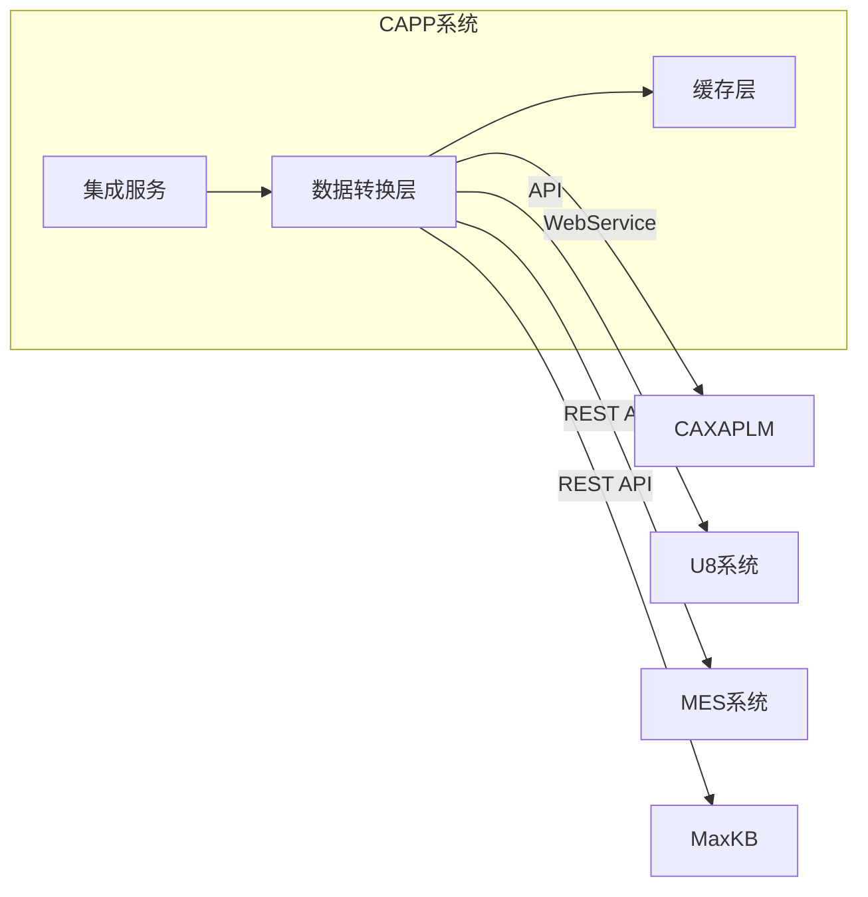
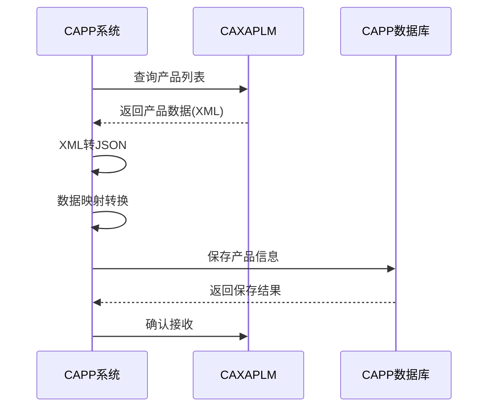
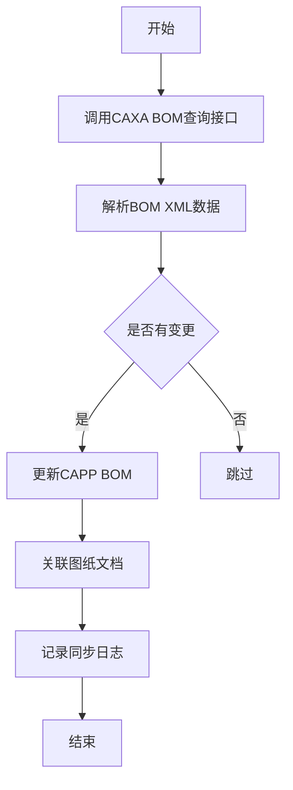
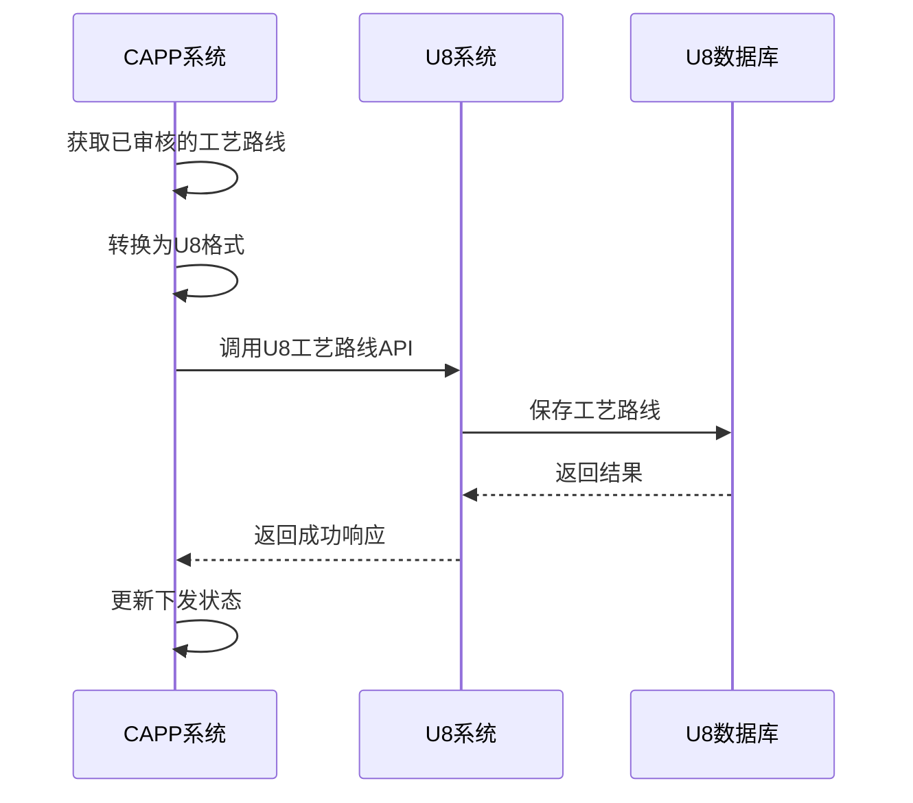
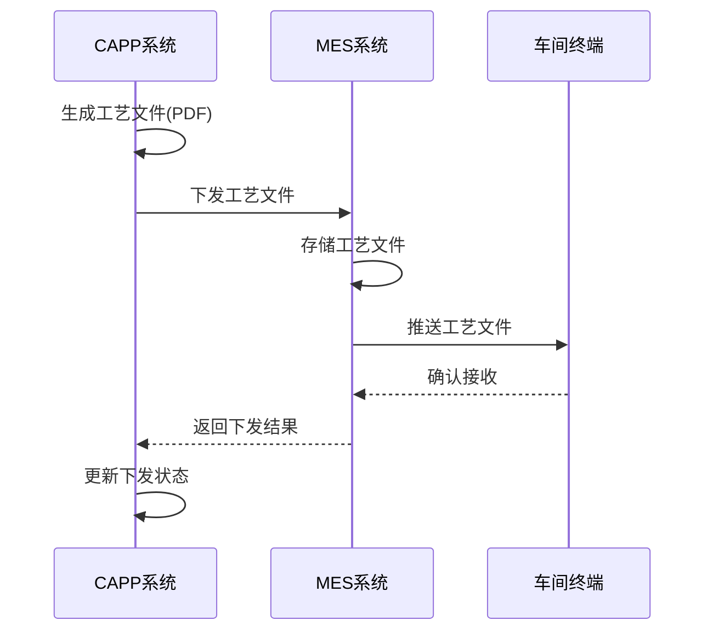
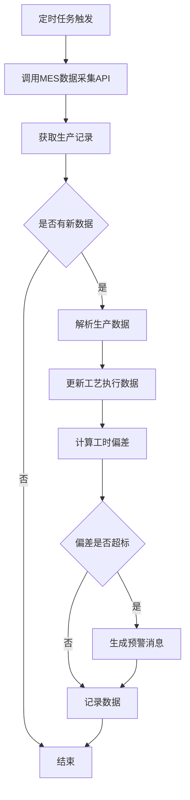

# CAPP系统第三方系统对接设计文档

## 1. 对接概述

### 1.1 对接目标
实现CAPP系统与企业现有信息化系统的无缝集成，打通数据通道，实现信息共享。

### 1.2 对接系统列表

| 系统名称 | 系统类型 | 对接方式 | 优先级 |
| :--- | :--- | :--- | :--- |
| CAXAPLM | PLM系统 | WebService/API | 高 |
| U8 | ERP系统 | API/中间表 | 高 |
| MES | 生产执行系统 | REST API | 高 |
| MaxKB | 知识库系统 | REST API | 高 |

### 1.3 对接架构



---

## 2. CAXAPLM对接设计

### 2.1 对接目标
实现与CAXAPLM系统的数据同步，包括产品设计数据、BOM结构、图纸文档等。

### 2.2 对接方式
- **接口类型**：WebService
- **协议**：SOAP
- **数据格式**：XML

### 2.3 数据同步内容

| 数据类型 | 同步方向 | 说明 |
| :--- | :--- | :--- |
| 产品信息 | CAXA → CAPP | 产品基本信息、版本 |
| BOM结构 | CAXA → CAPP | 物料清单结构 |
| 图纸文档 | CAXA → CAPP | CAD图纸、技术文档 |
| 设计变更 | CAXA → CAPP | 设计变更通知 |

### 2.4 同步流程

#### 2.4.1 产品数据导入



#### 2.4.2 BOM数据同步



### 2.5 CAXA接口定义

#### 2.5.1 查询产品信息

**接口地址**：`http://caxa-server/PLMService/ProductService.asmx`

**方法**：`GetProductList`

**请求参数**：
```xml
<soap:Envelope>
    <soap:Body>
        <GetProductList>
            <startDate>2024-01-01</startDate>
            <endDate>2024-12-31</endDate>
            <productType>diaphragm_compressor</productType>
        </GetProductList>
    </soap:Body>
</soap:Envelope>
```

**响应示例**：
```xml
<soap:Envelope>
    <soap:Body>
        <GetProductListResponse>
            <products>
                <product>
                    <productId>CAXA-PROD-001</productId>
                    <name>GM-100工业压缩机</name>
                    <specification>DN100, PN25</specification>
                    <version>V1.0</version>
                    <status>Released</status>
                </product>
            </products>
        </GetProductListResponse>
    </soap:Body>
</soap:Envelope>
```

#### 2.5.2 查询BOM结构

**方法**：`GetBOMStructure`

**请求参数**：
```xml
<GetBOMStructure>
    <productId>CAXA-PROD-001</productId>
    <version>V1.0</version>
    <level>3</level>
</GetBOMStructure>
```

**响应示例**：
```xml
<BOMStructure>
    <productId>CAXA-PROD-001</productId>
    <items>
        <item>
            <id>BOM-001</id>
            <parentId>0</parentId>
            <materialCode>MAT-001</materialCode>
            <materialName>不锈钢壳体</materialName>
            <quantity>1</quantity>
            <unit>件</unit>
            <level>1</level>
        </item>
    </items>
</BOMStructure>
```

### 2.6 数据映射规则

| CAXA字段 | CAPP字段 | 说明 |
| :--- | :--- | :--- |
| productId | code | 产品编码 |
| name | name | 产品名称 |
| specification | specification | 产品规格 |
| version | version | 版本号 |
| status | status | 状态映射 |

---

## 3. U8系统对接设计

### 3.1 对接目标
实现与用友U8系统的数据对接，包括物料主数据、工艺路线、生产订单等。

### 3.2 对接方式
- **接口类型**：U8 API / 中间表
- **协议**：REST / ODBC
- **数据格式**：JSON / XML

### 3.3 数据同步内容

| 数据类型 | 同步方向 | 说明 |
| :--- | :--- | :--- |
| 物料主数据 | U8 → CAPP | 物料编码、名称、规格 |
| 工艺路线 | CAPP → U8 | 工艺路线、工序信息 |
| 工时数据 | CAPP → U8 | 标准工时、定额 |
| 生产订单 | U8 → CAPP | 生产订单信息 |

### 3.4 同步流程

#### 3.4.1 工艺路线下发



### 3.5 U8接口定义

#### 3.5.1 创建工艺路线

**接口地址**：`http://u8-server/u8api/process/create`

**请求头**：
```
Authorization: Bearer <token>
Content-Type: application/json
```

**请求体**：
```json
{
  "routeCode": "PR-2024-001",
  "productCode": "GM-100",
  "productName": "工业压缩机",
  "version": "V1.0",
  "operations": [
    {
      "opCode": "OP-001",
      "opName": "下料",
      "workCenter": "机加工车间",
      "machineCode": "CNC-001",
      "standardTime": 2.5,
      "setupTime": 0.5,
      "sequence": 1
    }
  ]
}
```

**响应示例**：
```json
{
  "code": 0,
  "message": "成功",
  "data": {
    "u8RouteId": "U8-PR-001",
    "createdAt": "2024-01-15 10:30:00"
  }
}
```

#### 3.5.2 查询生产订单

**接口地址**：`http://u8-server/u8api/production/query`

**请求参数**：
```json
{
  "startDate": "2024-01-01",
  "endDate": "2024-01-31",
  "status": "Released"
}
```

**响应示例**：
```json
{
  "code": 0,
  "message": "成功",
  "data": {
    "orders": [
      {
        "orderId": "MO-2024-001",
        "productCode": "GM-100",
        "quantity": 10,
        "plannedStartDate": "2024-01-15",
        "plannedEndDate": "2024-01-25",
        "status": "Released"
      }
    ]
  }
}
```

---

## 4. MES系统对接设计

### 4.1 对接目标
实现与MES系统的实时数据交互，包括工艺文件下发、生产数据采集、进度反馈等。

### 4.2 对接方式
- **接口类型**：REST API
- **协议**：HTTP/HTTPS
- **数据格式**：JSON

### 4.3 数据同步内容

| 数据类型 | 同步方向 | 说明 |
| :--- | :--- | :--- |
| 工艺文件 | CAPP → MES | 工艺卡片、工序卡片 |
| 生产数据 | MES → CAPP | 实际生产数据、工时 |
| 进度反馈 | MES → CAPP | 生产进度、完成情况 |
| 质量数据 | MES → CAPP | 检验数据、合格率 |

### 4.4 同步流程

#### 4.4.1 工艺文件下发



#### 4.4.2 生产数据采集



### 4.5 MES接口定义

#### 4.5.1 下发工艺文件

**接口地址**：`POST http://mes-server/api/v1/process/send`

**请求体**：
```json
{
  "routeId": 1,
  "workCenterIds": [1, 2, 3],
  "documents": [
    {
      "type": "process_card",
      "fileName": "PR-2024-001.pdf",
      "content": "<base64-encoded-content>",
      "version": "V1.0"
    }
  ]
}
```

**响应示例**：
```json
{
  "code": 200,
  "message": "下发成功",
  "data": {
    "sentWorkCenters": [
      {"id": 1, "name": "机加工车间", "status": "success"},
      {"id": 2, "name": "焊接车间", "status": "success"}
    ]
  }
}
```

#### 4.5.2 查询生产进度

**接口地址**：`GET http://mes-server/api/v1/production/query`

**请求参数**：
```json
{
  "routeId": 1,
  "startTime": "2024-01-15 08:00:00",
  "endTime": "2024-01-15 18:00:00"
}
```

**响应示例**：
```json
{
  "code": 200,
  "message": "success",
  "data": {
    "records": [
      {
        "operationId": 1,
        "operationName": "下料",
        "workCenter": "机加工车间",
        "machineId": "CNC-001",
        "actualTime": 2.3,
        "standardTime": 2.5,
        "quantity": 10,
        "qualifiedQuantity": 9,
        "qualityRate": 0.9
      }
    ]
  }
}
```

---

## 5. MaxKB对接设计

### 5.1 对接目标
接入MaxKB专业版知识库和智能体，提供AI问答和知识检索能力。

### 5.2 对接方式
- **接口类型**：REST API
- **协议**：HTTP/HTTPS
- **数据格式**：JSON

### 5.3 对接能力

| 能力 | 接口 | 说明 |
| :--- | :--- | :--- |
| 知识检索 | /api/v1/knowledge/search | 检索知识库文档 |
| 智能问答 | /api/v1/qa/ask | 自然语言问答 |
| 智能体对话 | /api/v1/agent/chat | 与智能体交互 |
| 文档管理 | /api/v1/document | 文档上传/下载 |

### 5.4 MaxKB接口定义

#### 5.4.1 知识检索

**接口地址**：`POST http://maxkb-server/api/v1/knowledge/search`

**请求头**：
```
Authorization: Bearer <api-key>
```

**请求体**：
```json
{
  "query": "焊接工艺规范",
  "filters": {
    "category": "工艺标准",
    "productType": "diaphragm_compressor"
  },
  "page": 1,
  "size": 10
}
```

**响应示例**：
```json
{
  "code": 200,
  "data": {
    "total": 15,
    "results": [
      {
        "id": "kb-001",
        "title": "工业压缩机焊接工艺规范",
        "summary": "本文档描述了焊接工艺要求...",
        "category": "工艺标准",
        "score": 0.92
      }
    ]
  }
}
```

#### 5.4.2 智能问答

**接口地址**：`POST http://maxkb-server/api/v1/qa/ask`

**请求体**：
```json
{
  "question": "工业压缩机的焊接工艺要求是什么？",
  "context": {
    "productType": "diaphragm_compressor"
  },
  "topK": 3
}
```

**响应示例**：
```json
{
  "code": 200,
  "data": {
    "answer": "焊接工艺要求包括：1. 预热温度100-150°C...",
    "confidence": 0.88,
    "sources": [{"id": "kb-001", "title": "焊接工艺规范"}]
  }
}
```

---

## 6. 集成服务设计

### 6.1 IntegrationService类结构

```php
class IntegrationService {
    // CAXA对接
    public function syncFromCAXA($type, $params);
    public function importProductFromCAXA($caxaId);
    public function importBOMFromCAXA($productId);
    
    // U8对接
    public function syncToU8($type, $params);
    public function sendRouteToU8($routeId);
    public function syncProductionOrders();
    
    // MES对接
    public function sendToMES($routeId, $workCenterIds);
    public function collectFromMES($routeId, $timeRange);
    
    // MaxKB对接
    public function searchKnowledge($query, $filters);
    public function askQuestion($question, $context);
    public function chatWithAgent($message, $context);
    
    // 通用方法
    public function getSyncStatus($type);
    public function syncNow($type);
    public function getSyncLogs($type, $page, $size);
}
```

### 6.2 配置管理

```php
// config/integration.php
return [
    'caxa' => [
        'enabled' => true,
        'api_url' => env('CAXA_API_URL', ''),
        'username' => env('CAXA_USERNAME', ''),
        'password' => env('CAXA_PASSWORD', ''),
        'sync_cron' => '0 2 * * *' // 每天凌晨2点同步
    ],
    
    'u8' => [
        'enabled' => true,
        'api_url' => env('U8_API_URL', ''),
        'token' => env('U8_TOKEN', ''),
        'sync_cron' => '0 * * * *' // 每小时同步
    ],
    
    'mes' => [
        'enabled' => true,
        'api_url' => env('MES_API_URL', ''),
        'api_key' => env('MES_API_KEY', ''),
        'sync_cron' => '*/15 * * * *' // 每15分钟同步
    ],
    
    'maxkb' => [
        'enabled' => true,
        'api_url' => env('MAXKB_API_URL', ''),
        'api_key' => env('MAXKB_API_KEY', ''),
        'agent_id' => env('MAXKB_AGENT_ID', '')
    ],
    
    'retry' => [
        'count' => 3,
        'delay' => 60 // 重试间隔(秒)
    ]
];
```

---

## 7. 数据同步管理

### 7.1 同步状态

| 状态 | 说明 |
| :--- | :--- |
| pending | 待同步 |
| syncing | 同步中 |
| success | 同步成功 |
| failed | 同步失败 |
| partial | 部分成功 |

### 7.2 同步日志

| 字段 | 说明 |
| :--- | :--- |
| sync_type | 同步类型(CAXA/U8/MES/MaxKB) |
| status | 同步状态 |
| sync_count | 同步记录数 |
| success_count | 成功数 |
| failed_count | 失败数 |
| error_message | 错误信息 |
| sync_time | 同步时间 |

### 7.3 错误处理

| 错误类型 | 处理方式 |
| :--- | :--- |
| 网络超时 | 重试3次，间隔1分钟 |
| 接口限流 | 等待后重试 |
| 数据冲突 | 记录日志，人工处理 |
| 认证失败 | 通知管理员 |

---

## 8. 安全设计

### 8.1 认证方式
- **CAXA**：用户名/密码认证
- **U8**：Token认证
- **MES**：API Key认证
- **MaxKB**：API Key认证

### 8.2 数据加密
- **传输加密**：HTTPS/TLS 1.2+
- **敏感数据**：加密存储配置信息

### 8.3 访问控制
- **IP白名单**：限制接口访问IP
- **权限校验**：验证用户权限

---

## 附录：接口清单

| 系统 | 接口名称 | 方法 | 路径 |
| :--- | :--- | :--- | :--- |
| CAXA | GetProductList | POST | /ProductService.asmx |
| CAXA | GetBOMStructure | POST | /ProductService.asmx |
| U8 | 创建工艺路线 | POST | /u8api/process/create |
| U8 | 查询生产订单 | GET | /u8api/production/query |
| MES | 下发工艺文件 | POST | /api/v1/process/send |
| MES | 查询生产进度 | GET | /api/v1/production/query |
| MaxKB | 知识检索 | POST | /api/v1/knowledge/search |
| MaxKB | 智能问答 | POST | /api/v1/qa/ask |
| MaxKB | 智能体对话 | POST | /api/v1/agent/chat |
